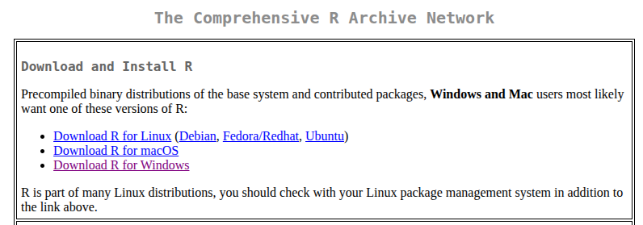
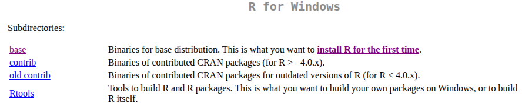
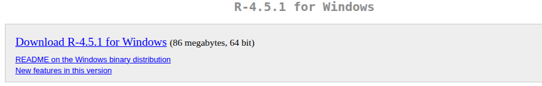
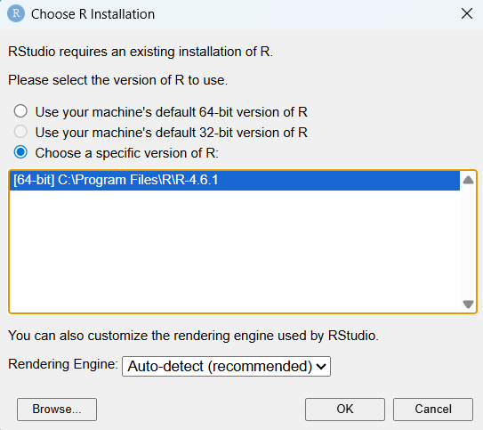
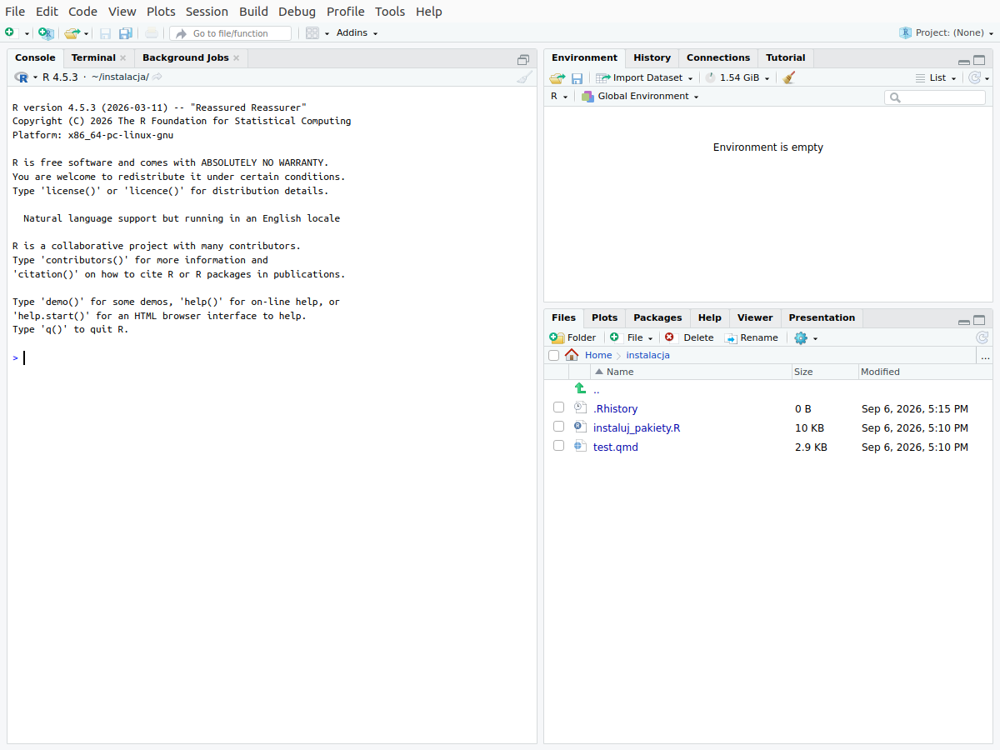

# Instalacja R i RStudio {#sec-instalacja}

Rozdział opisuje przygotowanie komputera z systemem Windows do ćwiczeń.
Instalację wykonuje się jeden raz, przed pierwszymi ćwiczeniami.

## Zanim zaczniesz {#sec-inst-wstep}

Do pracy potrzebne są cztery elementy:

| Kolejność | Element | Rola | Źródło |
|---|---|---|---|
| 1 | **R** | język programowania i środowisko, które wykonuje obliczenia | <https://cran.r-project.org> |
| 2 | **RStudio Desktop** | program, w którym otwiera się pliki z kodem, uruchamia kod i ogląda wyniki | <https://docs.posit.co/ide/user/#rstudio-ide-oss-downloads> |
| 3 | **Quarto** | program, który tworzy dokument (np. HTML) z pliku `.qmd` zawierającego tekst i kod R | wbudowany w RStudio |
| 4 | **pakiety R** | dodatkowe zestawy funkcji, np. do przetwarzania danych i tworzenia wykresów | instalowane w RStudio z serwera CRAN |

Wymagania:

- komputer z systemem Windows 10 lub nowszym;
- połączenie z internetem — pakiety pobierane są z serwera CRAN;
- prawo do instalowania programów. Na komputerze służbowym instalację R i RStudio
  może wykonać administrator; pakiety R instalują się bez uprawnień administratora.

R i RStudio instalują się w kilka minut, pobranie pakietów wraz z pakietami, od których
zależą, trwa kilkanaście minut.

**Kolejność instalacji ma znaczenie:** RStudio przy pierwszym uruchomieniu wyszukuje
R na dysku, dlatego R instaluje się jako pierwszy.

## Instalacja R {#sec-inst-r}

1. Otwórz stronę CRAN (*Comprehensive R Archive Network*): <https://cran.r-project.org>.
2. W sekcji **Download and Install R** wybierz **Download R for Windows**
   (@fig-inst-cran).
3. Wybierz **base** (@fig-inst-base).
4. Wybierz **Download R-x.x.x for Windows**, gdzie x.x.x to numer aktualnej wersji
   R (@fig-inst-r-win). Numer wersji zmienia się kilka razy w roku; na rycinie jest to
   wersja 4.5.1.
5. Uruchom pobrany plik `.exe`. Wybierz język instalacji, a w kolejnych oknach
   instalatora zatwierdź ustawienia domyślne przyciskiem **Dalej** (*Next*).

{#fig-inst-cran}

{#fig-inst-base}

{#fig-inst-r-win}

## Instalacja RStudio {#sec-inst-rstudio}

1. Otwórz stronę z plikami instalacyjnymi RStudio:
   <https://docs.posit.co/ide/user/#rstudio-ide-oss-downloads>.
2. Pobierz **RStudio Desktop** w wersji **Open Source** (bezpłatnej) — plik
   z rozszerzeniem `.exe` dla systemu Windows.
3. Uruchom pobrany plik i w kolejnych oknach instalatora zatwierdź ustawienia
   domyślne.
4. Uruchom RStudio. Przy pierwszym uruchomieniu może pojawić się okno
   **Choose R Installation** z pytaniem, której wersji R ma używać RStudio
   (@fig-inst-choose-r). Zaznacz trzecią opcję, **Choose a specific version of R**,
   wybierz z listy wersję zainstalowaną w poprzednim kroku i kliknij **OK**.

::: {.callout-important}
## RStudio Desktop, nie RStudio Server
Na stronie z plikami do pobrania znajdują się dwa programy o podobnej nazwie.
**RStudio Desktop** instaluje się na własnym komputerze — ta wersja jest potrzebna
do ćwiczeń. **RStudio Server** jest przeznaczone do instalacji na serwerze i obsługi
przez przeglądarkę. Wersję Open Source należy wybrać zamiast wersji Pro.
:::

{#fig-inst-choose-r width=60%}

Po poprawnej instalacji RStudio uruchamia się z oknem przedstawionym na
@fig-inst-rstudio. Części okna i zasady pracy w programie opisuje @sec-rstudio.

{#fig-inst-rstudio}

::: {.callout-tip}
Od tej pory uruchamia się wyłącznie RStudio. Programu R nie uruchamia się
bezpośrednio — RStudio korzysta z niego w tle.
:::

## Quarto {#sec-inst-quarto}

Quarto tworzy gotowy dokument z pliku `.qmd`, który zawiera tekst i bloki kodu R.
Aktualne wersje RStudio zawierają Quarto, dlatego zwykle nie instaluje się go
osobno. Jeżeli przy tworzeniu dokumentu z pliku `.qmd` (przycisk **Render**)
pojawi się komunikat o braku programu Quarto, należy pobrać i zainstalować Quarto
ze strony <https://quarto.org>, a następnie ponownie uruchomić RStudio.

## Instalacja pakietów {#sec-inst-pakiety}

Pakiet to zestaw funkcji rozszerzających podstawowe możliwości R, np. do przetwarzania
danych, tworzenia wykresów albo pracy z danymi przestrzennymi. Pakiet instaluje się
raz; zostaje na dysku i jest dostępny we wszystkich kolejnych sesjach pracy.
W skrypcie wykorzystywanych jest 15 pakietów, w tym jeden opcjonalny (`waffle`):

| Pakiet | Zastosowanie w skrypcie |
|---|---|
| `tidyverse` | przetwarzanie danych i wykresy; pakiet zbiorczy, zawiera m.in. `dplyr`, `ggplot2`, `tidyr` |
| `knitr`, `rmarkdown` | wykonywanie kodu R w dokumentach `.qmd`; tabele |
| `sf` | dane przestrzenne i mapy |
| `rnaturalearth`, `rnaturalearthdata` | granice państw świata |
| `geodata` | pobieranie granic jednostek administracyjnych, np. powiatów |
| `climate` | pobieranie danych meteorologicznych IMGW-PIB |
| `ggrepel` | etykiety na wykresach, które na siebie nie nachodzą |
| `scatterpie` | kartodiagram strukturalny: wykresy kołowe na mapie |
| `GGally` | macierz wykresów rozrzutu |
| `corrplot`, `Hmisc` | korelogram; współczynniki korelacji z wartościami p |
| `car`, `PerformanceAnalytics`, `psych` | macierz wykresów rozrzutu |
| `patchwork` | łączenie kilku wykresów w jedną rycinę |
| `ggridges` | wykres grzbietowy |
| `treemapify` | wykres treemap |
| `waffle` | opcjonalny: wykres typu waffle w załączniku (@sec-a2-wartosc); instalowany z serwisu GitHub |

Każdy pakiet korzysta z innych pakietów — są to jego **zależności** (*dependencies*).
R pobiera je automatycznie, dlatego podczas instalacji w konsoli pojawiają się nazwy
pakietów spoza powyższej tabeli; łącznie instalowanych jest ponad sto pakietów.
Opis pakietów zawiera @sec-pakiety.

Pakiet instaluje się w RStudio na jeden z dwóch sposobów: w zakładce **Packages**
albo poleceniem `install.packages()` wpisanym w konsoli. Oba sposoby pobierają
pakiet z serwera CRAN i dają ten sam wynik.

### Instalacja w zakładce Packages

1. W prawej dolnej części okna RStudio wybierz zakładkę **Packages** i kliknij
   **Install** (@fig-inst-packages).
2. W oknie **Install Packages** pozostaw w polu **Install from** wartość
   **Repository (CRAN)**.
3. W polu **Packages** wpisz nazwę pakietu, np. `tidyverse`. Podczas wpisywania
   RStudio podpowiada nazwy pakietów dostępnych w CRAN.
4. Pozostaw zaznaczoną opcję **Install dependencies** — RStudio zainstaluje także
   pakiety, od których zależy instalowany pakiet.
5. Kliknij **Install**. Przebieg instalacji wyświetla się w konsoli.
6. Powtórz kroki 1–5 dla kolejnych pakietów z tabeli.

{#fig-inst-packages width=70%}

### Instalacja poleceniem `install.packages()`

Polecenie wpisuje się w konsoli i zatwierdza klawiszem Enter. Poleceniem
`install.packages()` można zainstalować jeden pakiet albo kilka pakietów naraz.

**Jeden pakiet.** Nazwę pakietu podaje się w cudzysłowie:

```{r}
#| eval: false
# Instalacja jednego pakietu
install.packages("tidyverse")
```

**Wszystkie pakiety naraz.** Nazwy pakietów, każdą w cudzysłowie i oddzieloną
przecinkiem, łączy się funkcją `c()` (od ang. *combine*) w jeden **wektor** — uporządkowany
ciąg wartości tego samego typu, tu: nazw pakietów:

```{r}
#| eval: false
# Instalacja wszystkich pakietów z repozytorium CRAN jednym poleceniem
install.packages(c("tidyverse", "knitr", "rmarkdown", "sf", "rnaturalearth",
                   "rnaturalearthdata", "geodata", "ggrepel", "scatterpie",
                   "GGally", "patchwork", "ggridges", "treemapify", "climate",
                   "corrplot", "Hmisc", "car", "PerformanceAnalytics", "psych"))
```

Polecenie można skopiować do konsoli w całości. R pobiera i instaluje wszystkie
wymienione pakiety wraz z ich zależnościami.

Pakiet `waffle` jest opcjonalny: korzysta z niego tylko jeden wykres w załączniku
(@sec-a2-wartosc). Pakietu nie ma w repozytorium CRAN, dlatego polecenie
`install.packages("waffle")` zwraca komunikat o jego braku. Pakiet instaluje się z serwisu
GitHub za pomocą pakietu `remotes`:

```{r}
#| eval: false
# Instalacja pakietu waffle z serwisu GitHub
install.packages("remotes")
remotes::install_github("hrbrmstr/waffle")
```

### Przebieg instalacji

- W konsoli wyświetlane są kolejne komunikaty: nazwy pobieranych pakietów, w tym
  zależności, i informacje o rozpakowaniu plików. Część komunikatów ma kolor czerwony,
  co nie oznacza błędu.
- Dopóki w prawym górnym rogu konsoli widoczny jest czerwony znak stop, instalacja
  trwa. Pakiet `tidyverse` wraz z zależnościami instaluje się kilka minut.
- Instalacja jest zakończona, gdy w konsoli pojawi się znak zachęty `>`.
- Gdy użytkownik nie ma prawa zapisu w katalogu instalacji R (np. na komputerze
  służbowym), R wyświetla pytanie *Would you like to use a personal library instead?*,
  a następnie pytanie o utworzenie tego katalogu. Na oba pytania należy odpowiedzieć
  **Yes**. Pakiety zostaną zainstalowane w katalogu prywatnym użytkownika.

### Sprawdzenie instalacji pakietu

Zainstalowany pakiet wczytuje się poleceniem `library()` z nazwą pakietu, bez
cudzysłowu:

```{r}
#| eval: false
library(tidyverse)
```

Jeżeli pakiet jest zainstalowany, polecenie nie zwraca błędu. Po wczytaniu pakietu
`tidyverse` konsola wyświetla listę wczytanych pakietów i informację o konfliktach
nazw funkcji (*Conflicts*) — są to komunikaty informacyjne, nie błędy. Jeżeli pakietu
brakuje, R zwraca błąd `there is no package called ...`.

Instalację można sprawdzić także bez wpisywania polecenia: pakiet zainstalowany
znajduje się na liście w zakładce **Packages** (@sec-rs-packages).

Pakiet instaluje się jeden raz. Polecenie `library()` wykonuje się w każdej sesji
pracy — w skrypcie znajduje się ono w każdym pliku `.qmd`, przed pierwszym użyciem pakietu.

## Rozwiązywanie problemów {#sec-inst-problemy}

| Komunikat lub objaw | Przyczyna i postępowanie |
|---|---|
| `there is no package called "..."` | pakiet nie jest zainstalowany — zainstaluj go (@sec-inst-pakiety) |
| `package "..." is not available for this version of R` | zainstalowana wersja R jest nieaktualna albo nazwa pakietu zawiera błąd — sprawdź pisownię nazwy (wielkość liter ma znaczenie, np. `GGally`); jeśli jest poprawna, zainstaluj aktualną wersję R (@sec-inst-r) |
| `cannot open URL` / `unable to access index for repository` | brak połączenia z internetem albo blokada sieciowa; na komputerze służbowym administrator może odblokować dostęp do serwera CRAN |
| `'lib = "C:/Program Files/R/..."' is not writable` i pytanie *Would you like to use a personal library instead?* | brak prawa zapisu w katalogu instalacji R — odpowiedz **Yes** na to pytanie i na pytanie o utworzenie katalogu |
| komunikat o braku programu Quarto | zainstaluj Quarto ze strony <https://quarto.org> i ponownie uruchom RStudio |
| RStudio nie reaguje podczas instalacji | jeśli w rogu konsoli widoczny jest czerwony znak stop, instalacja trwa |

Jeżeli problem się powtarza, do zgłoszenia prowadzącej należy dołączyć treść
komunikatu z konsoli oraz wynik polecenia `sessionInfo()` wpisanego w konsoli —
zawiera on wersję R, wersję systemu i listę wczytanych pakietów.
