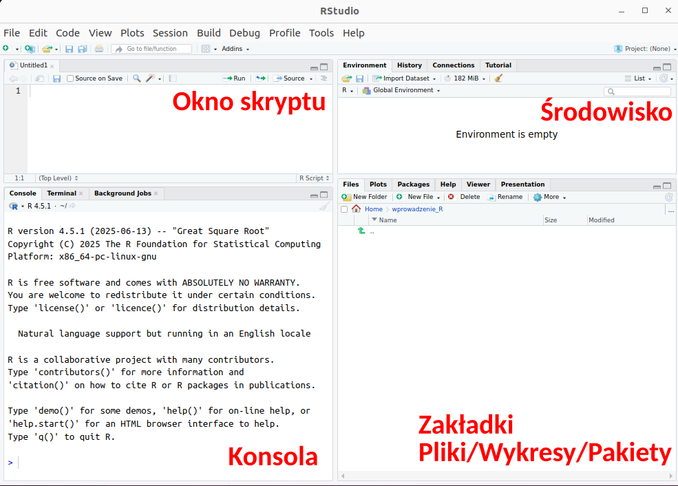
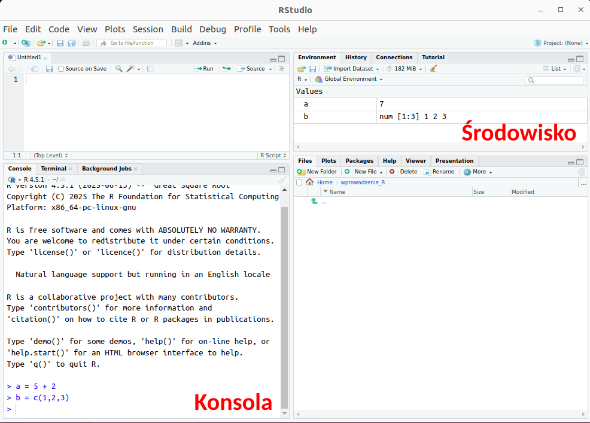
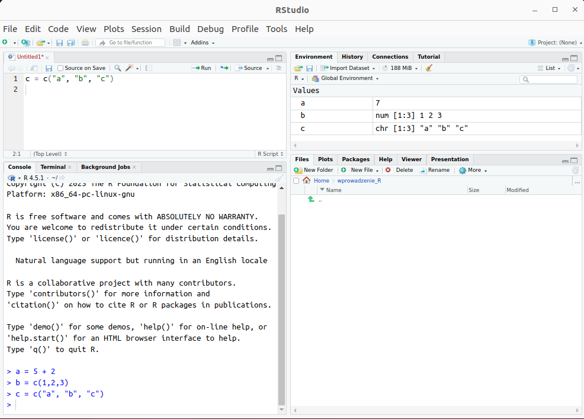
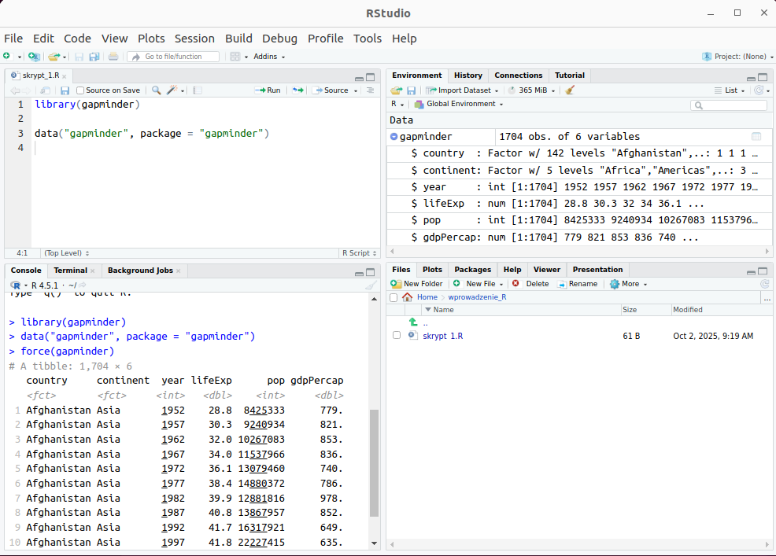
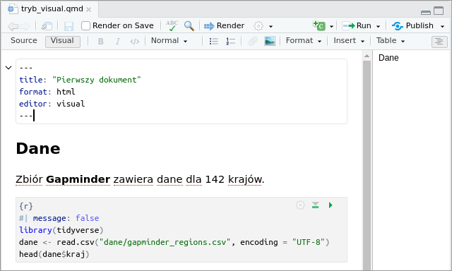
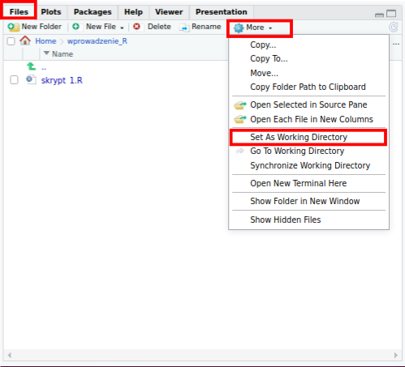

# Praca w RStudio {#sec-rstudio}

Rozdział opisuje okno programu RStudio oraz zasady pracy z plikami z kodem: wykonywanie
poleceń w konsoli, uruchamianie bloków kodu w dokumencie Quarto (`.qmd`), tworzenie
dokumentu przyciskiem **Render** i zapisywanie pracy.

## Okno RStudio {#sec-rs-okno}

Okno RStudio jest podzielone na cztery części (@fig-rs-okno):

- **okno skryptu** (lewa górna część) — edytor, w którym otwiera się, zmienia i zapisuje
  pliki z kodem. Pojawia się po otwarciu albo utworzeniu pliku; każdy otwarty plik ma
  osobną kartę;
- **konsola** (*Console*, lewa dolna część) — R wykonuje w niej polecenia i wyświetla
  wyniki, komunikaty oraz błędy;
- **środowisko** (*Environment*, prawa górna część) — lista obiektów utworzonych w bieżącej
  sesji pracy, np. wczytanych tabel z danymi. Karta *History* zawiera historię
  wykonanych poleceń;
- **zakładki pomocnicze** (prawa dolna część): *Files* — pliki w bieżącym folderze,
  *Plots* — wykresy utworzone poza dokumentem `.qmd`, *Packages* — zainstalowane pakiety,
  *Help* — dokumentacja funkcji, *Viewer* — podgląd dokumentów HTML.

{#fig-rs-okno}

Układ i rozmiar części okna można zmieniać, przeciągając ich granice; przyciski
w prawym górnym rogu każdej części minimalizują ją albo maksymalizują.

### Zakładka Packages {#sec-rs-packages}

Zakładka **Packages** zawiera listę pakietów zainstalowanych na komputerze: nazwę, opis
i numer wersji każdego pakietu (@fig-inst-packages). Aby sprawdzić, czy pakiet jest
zainstalowany, należy wpisać jego nazwę w polu wyszukiwania nad listą: pakiet zainstalowany
pojawia się na liście. Zaznaczone pole obok nazwy oznacza pakiet wczytany w bieżącej sesji
pracy. Przycisk **Install** instaluje nowy pakiet (@sec-inst-pakiety), a przycisk **Update**
aktualizuje pakiety zainstalowane.

## Konsola {#sec-rs-konsola}

Po uruchomieniu RStudio w konsoli pojawia się informacja o zainstalowanej wersji R.
Polecenie wpisuje się po znaku zachęty `>` i zatwierdza klawiszem **Enter**.
Wynik pojawia się bezpośrednio pod poleceniem:

```{r}
# dodawanie: polecenie wpisane w konsoli i jego wynik
5 + 2
```

Znak `[1]` przed wynikiem oznacza numer pierwszego elementu w wierszu wyniku.
Strzałka w górę (**↑**) przywołuje poprzednie polecenia, które można zmienić i wykonać
ponownie. Dopóki R wykonuje polecenie, w prawym górnym rogu konsoli widoczny jest
czerwony znak stop; kliknięcie go przerywa wykonywanie polecenia. Znak `+` na początku
wiersza zamiast `>` oznacza, że polecenie jest niekompletne, np. brakuje nawiasu
zamykającego; klawisz **Esc** przerywa wpisywanie takiego polecenia.

Na rycinie [-@fig-rs-konsola] w konsoli wpisano dwa polecenia:

- `a = 5 + 2` — przypisanie wyniku dodawania 5 + 2 do obiektu `a`. Po wykonaniu polecenia
  obiekt `a` o wartości 7 pojawia się w zakładce **Environment**;
- `b = c(1,2,3)` — utworzenie obiektu `b` zawierającego wartości 1, 2 i 3. Także ten
  obiekt pojawia się w zakładce **Environment**.

Przypisanie można zapisać znakiem `=` albo `<-`; zależność między tymi zapisami wyjaśnia
@sec-pd-obiekty.

{#fig-rs-konsola}

Konsola służy do pojedynczych poleceń, np. instalacji pakietu (@sec-inst-pakiety) albo
sprawdzenia wartości. Polecenia wpisane w konsoli nie są zapisywane w pliku, dlatego kod
analizy umieszcza się w pliku z kodem.

## Pliki z kodem: skrypt `.R` i dokument `.qmd` {#sec-rs-pliki}

RStudio obsługuje dwa rodzaje plików z kodem R:

| | Skrypt `.R` | Dokument Quarto `.qmd` |
|---|---|---|
| zawartość | wyłącznie kod R i komentarze | tekst oraz bloki kodu R |
| uruchamianie | przycisk **Run** (bieżący wiersz) albo **Source** (cały plik) | uruchamianie bloków albo przycisk **Render** (cały dokument) |
| wynik | obiekty, wykresy i komunikaty w RStudio | dokument (np. HTML) zawierający tekst, kod i wyniki |
| utworzenie | **File → New File → R Script** | **File → New File → Quarto Document…** |

W skrypcie cały kod znajduje się w dokumentach `.qmd`: łączą one opis analizy, kod
i wyniki w jednym pliku, z którego powstaje raport. Główne zasady pracy z tym dokumentem
przedstawia @sec-rs-qmd, a jego budowę opisuje @sec-quarto.

## Okno skryptu {#sec-rs-skrypt}

Kod analizy zapisuje się w pliku, w oknie skryptu, ponieważ plik można zapisać i wykorzystać
ponownie. Podstawowe zasady pracy w oknie skryptu:

1. Polecenie wpisuje się w oknie skryptu.
2. Polecenie wykonuje się przyciskiem **Run** albo skrótem **Ctrl+Enter**.
3. Wykonane polecenie pojawia się w konsoli, a utworzony obiekt — w zakładce **Environment**.

Na rycinie [-@fig-rs-skrypt-zmiany] w oknie skryptu wpisano i wykonano polecenie `c = c("a", "b", "c")`.
Obiekt `c` pojawił się w zakładce **Environment**, a polecenie — w konsoli. Plik nie został
jeszcze zapisany: nazwa jego karty (`Untitled1*`) jest wyświetlana na czerwono i zakończona
gwiazdką (`*`). W ten sposób RStudio oznacza każdy plik zawierający niezapisane zmiany.

{#fig-rs-skrypt-zmiany}

Zmiany zapisuje się poleceniem **File → Save** albo skrótem **Ctrl+S**. Istniejący plik
otwiera się poleceniem **File → Open File…** albo kliknięciem nazwy pliku w zakładce **Files**.

Na rycinie [-@fig-rs-skrypt-dane] przedstawiono zapisany skrypt `skrypt_1.R`, utworzony poleceniem
**File → New File → R Script**. Skrypt zawiera dwa polecenia:

- `library(gapminder)` — wczytanie pakietu `gapminder`;
- `data("gapminder", package = "gapminder")` — wczytanie danych z tego pakietu.

Wczytana tabela znajduje się w zakładce **Environment**, a kliknięcie strzałki obok jej nazwy
wyświetla listę kolumn. Pakiet `gapminder` występuje wyłącznie w tym przykładzie; pozostałe
rozdziały wczytują dane z pliku CSV (@sec-pd-wczytanie).

{#fig-rs-skrypt-dane}

## Praca z dokumentem `.qmd` {#sec-rs-qmd}

Dokument Quarto łączy w jednym pliku kod, tekst i wyniki. Główne zasady pracy z dokumentem:

- nowy dokument tworzy się poleceniem **File → New File → Quarto Document…** (@fig-q-nowy);
- na początku pliku, między wierszami `---`, znajduje się **nagłówek YAML** z ustawieniami
  dokumentu, np. tytułem i formatem;
- kod R umieszcza się w **blokach kodu**, a poza blokami zapisuje się tekst, który stanowi
  opis wyników;
- bloki kodu uruchamia się po kolei w RStudio, a gotowy dokument, np. w formacie HTML, PDF
  albo MS Word, tworzy przycisk **Render**.

Najprostszy dokument zawiera nagłówek, tekst i jeden blok kodu:

````markdown
---
title: "Pierwszy dokument"
format: html
---

Poniższy blok kodu oblicza sumę dwóch liczb.

```{{r}}
5 + 2
```
````

Kolejne sekcje opisują te zasady w RStudio. Pełny opis dokumentu, w tym opcje nagłówka,
składnię tekstu, ryciny, tabele i odsyłacze, zawiera @sec-quarto.

### Tryb Source i tryb Visual

Nad dokumentem `.qmd` znajdują się przyciski **Source** i **Visual**. W trybie
**Source** plik jest wyświetlany jako tekst, w tym znaki formatowania i nagłówek YAML.
W trybie **Visual** tekst wyświetlany jest z formatowaniem, zbliżonym do wyglądu
gotowego dokumentu (@fig-rs-source, @fig-rs-visual). Oba tryby przedstawiają ten sam plik.
Kod w skrypcie jest przedstawiony w postaci, którą widać w trybie Source.

{#fig-rs-source}

{#fig-rs-visual}

### Bloki kodu

Kod R umieszcza się w **blokach kodu** (ang. *chunks*). Blok zaczyna się wierszem
```` ```{r} ````, a kończy wierszem ```` ``` ````. Wiersze rozpoczynające się od `#|`
na początku bloku są **opcjami bloku**, np. `#| message: false` ukrywa komunikaty
w gotowym dokumencie. Tekst poprzedzony znakiem `#` to **komentarz** — R pomija go przy
wykonywaniu kodu.

Nowy blok wstawia się skrótem **Ctrl+Alt+I** albo przyciskiem z zielonym symbolem `+C`
nad dokumentem.

### Uruchamianie kodu

| Co uruchomić | Sposób |
|---|---|
| bieżący wiersz albo zaznaczony fragment | **Ctrl+Enter** albo przycisk **Run** |
| cały blok | zielona strzałka (*Run Current Chunk*) w prawym górnym rogu bloku albo **Ctrl+Shift+Enter** |
| wszystkie bloki powyżej bieżącego | szara strzałka z zieloną linią (*Run All Chunks Above*) w prawym górnym rogu bloku |
| wszystkie bloki dokumentu | **Run → Run All** albo **Ctrl+Alt+R** |

Przyciski w prawym górnym rogu bloku przedstawia @fig-rs-blok-przyciski. Zielona strzałka
uruchamia bieżący blok, a szara strzałka z zieloną linią — wszystkie bloki powyżej bieżącego.
Przycisk z symbolem koła zębatego otwiera okno opcji bloku.

{#fig-rs-blok-przyciski}

Wynik bloku pojawia się bezpośrednio pod blokiem, a utworzone obiekty — w zakładce
**Environment**.

**Bloki uruchamia się po kolei, od początku pliku.** Kolejne bloki korzystają z obiektów
utworzonych we wcześniejszych blokach, np. z tabeli wczytanej na początku pliku. Jeżeli
blok zostanie uruchomiony przed blokiem, który tworzy potrzebny obiekt, R zwraca błąd
`object '...' not found`.

Polecenie **Session → Restart R** rozpoczyna nową sesję R: usuwa wszystkie obiekty
z pamięci. Po ponownym uruchomieniu bloków od początku pliku obiekty zostają odtworzone.

### Render

Przycisk **Render** (@fig-rs-render) albo skrót **Ctrl+Shift+K** wykonuje cały dokument
od początku, w nowej sesji R, i tworzy z niego dokument HTML. Plik HTML powstaje w tym
samym folderze co plik `.qmd`, a jego podgląd otwiera się w zakładce **Viewer** albo
w przeglądarce internetowej. Render kończy się błędem, jeżeli którykolwiek blok kodu
zwraca błąd — komunikat wskazuje blok i wiersz pliku.

{#fig-rs-render}

## Katalog roboczy {#sec-rs-katalog}

**Katalog roboczy** to folder, względem którego R odczytuje ścieżki względne, np.
`"dane/gapminder_regions.csv"`. W tym folderze znajdują się zwykle dane i plik z kodem.

**Dokument `.qmd`.** Katalogiem roboczym jest folder, w którym zapisano plik `.qmd` —
zarówno przy uruchamianiu bloków, jak i przy tworzeniu dokumentu przyciskiem **Render**.
Dlatego folder `dane/` powinien znajdować się obok pliku `.qmd`, a ustawianie katalogu
roboczego nie jest potrzebne.

**Konsola i skrypt `.R`.** Katalog roboczy konsoli wyświetla się w jej nagłówku, a podaje
go także polecenie `getwd()`. Przed rozpoczęciem pracy w konsoli albo ze skryptem `.R`
należy ustawić katalog roboczy (@fig-rs-katalog):

1. W zakładce **Files** należy przejść do folderu, który ma być katalogiem roboczym.
2. Następnie należy wybrać **More → Set As Working Directory**.

Katalog roboczy ustawia także polecenie `setwd("C:/kurs/moje_dane")` wpisane w konsoli;
w ścieżce stosuje się znak `/`. Polecenia `setwd()` nie umieszcza się w dokumencie `.qmd`,
ponieważ podana w nim ścieżka nie istnieje na innym komputerze.

{#fig-rs-katalog width=60%}

## Pomoc {#sec-rs-pomoc}

Dokumentację funkcji wyświetla się w zakładce **Help** poleceniem wpisanym w konsoli:
znak zapytania i nazwa funkcji, np. `?summary`. Dokumentacja zawiera sekcje:
*Description* (co robi funkcja), *Usage* (sposób wywołania), *Arguments* (opis
argumentów), *Value* (co zwraca funkcja) i *Examples* (przykłady).

## Zakończenie pracy {#sec-rs-koniec}

Przed zamknięciem RStudio należy zapisać zmienione pliki (**Ctrl+S**). Przy zamykaniu
programu RStudio może wyświetlić pytanie *Save workspace image to ~/.RData?* o zapisanie
obiektów z bieżącej sesji. Przy pracy z dokumentami `.qmd` zapis nie jest potrzebny:
obiekty odtwarza się, uruchamiając plik od początku. Należy wybrać **Don't Save**.
