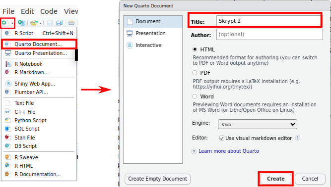

# Quarto {#sec-quarto}

Raport zaliczeniowy powstaje jako dokument Quarto: plik `.qmd` zawierający
tekst i kod R, z którego tworzy się dokument HTML. Rozdział opisuje, czym jest Quarto,
z jakich części składa się dokument `.qmd`, jak dodaje się do niego ryciny, tabele
i odsyłacze oraz jak tworzy się z niego gotowy dokument. Zasady opracowania treści
raportu przedstawia @sec-raport.

## Czym jest Quarto {#sec-q-czym}

Quarto (<https://quarto.org>) jest otwartym systemem publikacji naukowych i technicznych.
Z pliku `.qmd` tworzy dokumenty w formatach HTML, MS Word i PDF, a także prezentacje,
strony internetowe i książki — tym skryptem jest książka utworzona w Quarto. Quarto jest
następcą R Markdown, wcześniejszego systemu tego samego typu.

Tworzenie dokumentu z pliku `.qmd` nazywa się **renderowaniem** (ang. *render*) i składa
się z dwóch etapów:

1. pakiet `knitr` wykonuje kolejno wszystkie bloki kodu R i tworzy plik Markdown (`.md`),
   który zawiera tekst, kod i wyniki kodu;
2. program Pandoc zamienia plik Markdown na dokument w wybranym formacie, np. HTML.

Oba etapy wykonuje przycisk **Render** w RStudio (@sec-q-render).

## Odtwarzalność {#sec-q-odtwarzalnosc}

W dokumencie Quarto wyniki — liczby, tabele i ryciny — powstają podczas renderowania
z kodu zapisanego w tym samym pliku. Każdy wynik w raporcie ma więc w dokumencie kod,
który go utworzył. Dokument jest **odtwarzalny** (ang. *reproducible*): ponowne
renderowanie odtwarza wszystkie wyniki, a po zmianie danych — tworzy je od nowa
na podstawie nowych danych.

Renderowanie wykonuje cały dokument od początku, w nowej sesji R (@sec-rs-qmd). Jest to
sesja oddzielna od sesji, z której korzysta konsola RStudio. Dokument musi więc zawierać
wszystko, czego potrzebuje kod:

- wczytanie pakietów (`library()`) na początku pliku;
- wczytanie danych z pliku, ścieżką względną (np. `"dane/gapminder_regions.csv"`);
- wszystkie kroki przetwarzania danych, w kolejności wykonywania.

**Obiekty utworzone wyłącznie w konsoli nie są dostępne podczas renderowania.** Dotyczy to
także pakietów. Polecenie `library()` wykonane w konsoli wczytuje pakiet tylko w sesji
konsoli, a sesja renderowania rozpoczyna się bez tego pakietu. Dlatego wywołanie `library()`
musi znajdować się w dokumencie, przed pierwszym użyciem funkcji z pakietu. Jeżeli pakiet
wczytano wyłącznie w konsoli, blok kodu uruchomiony w RStudio działa, a renderowanie kończy
się błędem `could not find function "..."`.

Dokument spełniający te zasady renderuje się tak samo na każdym komputerze, na którym znajduje się
ten sam folder z danymi i zainstalowane są potrzebne pakiety.

## Nowy dokument {#sec-q-nowy}

Nowy dokument tworzy się poleceniem **File → New File → Quarto Document…**
(@fig-q-nowy). W oknie **New Quarto Document**:

- w polu **Title** wpisuje się tytuł dokumentu, w polu **Author** — autora;
- format **HTML** jest zaznaczony domyślnie;
- pole **Engine** pozostawia się z wartością **Knitr** — kod R wykonuje pakiet `knitr`;
- opcja **Use visual markdown editor** otwiera dokument w trybie Visual (@sec-rs-qmd);
- przycisk **Create** tworzy dokument z przykładową treścią, a **Create Empty Document**
  — dokument pusty.

Nowy dokument zapisuje się poleceniem **File → Save** (**Ctrl+S**), z rozszerzeniem
`.qmd`, w folderze, w którym znajduje się podfolder `dane/`.

{#fig-q-nowy}

## Budowa dokumentu {#sec-q-budowa}

Dokument `.qmd` składa się z trzech rodzajów elementów: nagłówka YAML, tekstu
w składni Markdown i bloków kodu. Poniższy dokument wczytuje dane, a następnie tworzy
tabelę i wykres:

````markdown
---
title: "Oczekiwana długość życia w 2007 roku"
author: "Imię Nazwisko"
lang: pl
crossref:
  fig-title: "Rycina"
  fig-prefix: "Rycina"
format:
  html:
    toc: true
    number-sections: true
    embed-resources: true
---

## Dane

Zbiór **Gapminder** zawiera dane dla 142 krajów. Dokument wykorzystuje obserwacje
z 2007 roku.

```{{r}}
#| message: false
library(tidyverse)
dane <- read.csv("dane/gapminder_regions.csv", encoding = "UTF-8")
dane2007 <- dane |>
  filter(year == 2007)
```

## Statystyki opisowe

Liczbę krajów i średnią oczekiwaną długość życia podaje @tbl-kontynenty.

```{{r}}
#| label: tbl-kontynenty
#| tbl-cap: "Liczba krajów i średnia oczekiwana długość życia według kontynentu, 2007"
dane2007 |>
  group_by(kontynent) |>
  summarise(n = n(), srednia = round(mean(lifeExp), 1)) |>
  knitr::kable(col.names = c("Kontynent", "Liczba krajów", "Średnia [lata]"))
```

## Wykres

Rozkład oczekiwanej długości życia przedstawia @fig-histogram.

```{{r}}
#| label: fig-histogram
#| fig-cap: "Rozkład oczekiwanej długości życia, 142 kraje, 2007"
ggplot(dane2007, aes(x = lifeExp)) +
  geom_histogram(binwidth = 5) +
  labs(x = "Oczekiwana długość życia [lata]", y = "Liczba krajów") +
  theme_bw(base_size = 13)
```
````

Wynik renderowania tego pliku przedstawia @fig-q-wynik. Kod każdego bloku jest widoczny
w dokumencie, a pod nim znajduje się wynik: tabela z numerem i podpisem oraz rycina
z numerem i podpisem. Numery sekcji, spis treści po prawej stronie i odsyłacze w tekście
tworzy Quarto. Plik z tym przykładem to `kod/07_quarto_przyklad.qmd`. Kolejne sekcje
opisują poszczególne elementy dokumentu, a tworzenie tabeli i ryciny wyjaśnia
@sec-q-odsylacze.

{#fig-q-wynik}

### Nagłówek YAML {#sec-q-yaml}

Nagłówek znajduje się na początku pliku, między dwoma wierszami `---`. Zawiera ustawienia
całego dokumentu zapisane w składni YAML: `nazwa: wartość`, z dwukropkiem i spacją.
Ustawienia podrzędne zapisuje się w kolejnych wierszach, z wcięciem o dwie spacje
— np. `toc: true` jest ustawieniem formatu `html`, który jest ustawieniem `format`.

| Ustawienie | Znaczenie |
|---|---|
| `title`, `author`, `date` | tytuł, autor i data dokumentu |
| `lang: pl` | język dokumentu: polskie nazwy elementów, np. „Tabela”, „Spis treści” |
| `crossref:` z `fig-title: "Rycina"` i `fig-prefix: "Rycina"` | nazwa „Rycina” w podpisach i odsyłaczach; przy `lang: pl` bez tego ustawienia Quarto stosuje nazwę „Rysunek” |
| `format: html` | format dokumentu; inne formaty: `docx` (MS Word), `pdf` |
| `toc: true` | spis treści na podstawie nagłówków |
| `number-sections: true` | numeracja nagłówków; wymagana przy odsyłaczach do sekcji (@sec-q-odsylacze) |
| `embed-resources: true` | dokument HTML w jednym pliku, z rycinami i stylami zapisanymi wewnątrz pliku (@sec-q-render) |
| `execute:` z `echo: false` | ukrycie kodu we wszystkich blokach dokumentu |

Błąd we wcięciu albo brak spacji po dwukropku powoduje błąd renderowania.

### Tekst w składni Markdown {#sec-q-markdown}

Tekst poza blokami kodu zapisuje się w składni **Markdown**: znaki formatowania
umieszczone w tekście określają wygląd dokumentu.

| Zapis | Wynik |
|---|---|
| `## Nagłówek`, `### Nagłówek` | nagłówek drugiego i trzeciego poziomu |
| `**tekst**` | **pogrubienie** |
| `*tekst*` | *kursywa* |
| `- element` | element listy punktowanej |
| `1. element` | element listy numerowanej |
| `[opis](https://quarto.org)` | odnośnik [opis](https://quarto.org) |
| `` `kod` `` | fragment kodu w tekście: `kod` |

Lista musi być poprzedzona pustym wierszem; bez niego elementy listy łączą się
z poprzedzającym tekstem w jeden akapit. Nowy akapit rozpoczyna się po pustym wierszu.

### Bloki kodu i opcje bloku {#sec-q-bloki}

Blok kodu zaczyna się wierszem ```` ```{r} ````, a kończy wierszem ```` ``` ````. Kod
w bloku jest wykonywany podczas renderowania, a jego wynik pojawia się w dokumencie
pod kodem.

Wiersze rozpoczynające się od `#|` na początku bloku to **opcje bloku**, zapisywane
w składni YAML (`nazwa: wartość`). Opcje używane w skrypcie:

| Opcja | Znaczenie |
|---|---|
| `label: fig-histogram` | etykieta bloku — unikalna w dokumencie; prefiks `fig-` albo `tbl-` umożliwia odsyłacz (@sec-q-odsylacze) |
| `echo: false` | kod nie jest pokazywany w dokumencie, wynik — tak (domyślnie: `true`) |
| `eval: false` | kod jest pokazywany, ale nie jest wykonywany (domyślnie: `true`) |
| `include: false` | kod jest wykonywany, ale ani kod, ani wynik nie pojawiają się w dokumencie |
| `message: false`, `warning: false` | komunikaty i ostrzeżenia nie pojawiają się w dokumencie |
| `fig-cap: "Podpis"` | podpis ryciny |
| `fig-width: 8`, `fig-height: 5` | szerokość i wysokość ryciny w calach |
| `tbl-cap: "Podpis"` | podpis tabeli |
| `R.options:` i w kolejnym wierszu, z wcięciem, `width: 120` | szerokość wydruku wyników kodu w znakach; szeroka tabela nie jest wtedy dzielona na kilka części |

Przykład bloku z opcjami:

````markdown
```{{r}}
#| label: fig-histogram
#| fig-cap: "Rozkład oczekiwanej długości życia, 2007"
#| echo: false
ggplot(dane2007, aes(x = lifeExp)) +
  geom_histogram(binwidth = 5)
```
````

Opcje dla wszystkich bloków dokumentu podaje się w nagłówku YAML, w ustawieniu
`execute`, np. `execute:` i w kolejnym wierszu, z wcięciem, `echo: false`. Opcja podana
w bloku zastępuje ustawienie z nagłówka.

## Ryciny, tabele i odsyłacze {#sec-q-odsylacze}

Rycina albo tabela utworzona w bloku kodu otrzymuje numer i podpis, jeżeli blok ma
odpowiednie opcje:

- rycina: etykieta z prefiksem `fig-` (numer i możliwość odsyłacza) i opcja `fig-cap`
  (podpis);
- tabela: etykieta z prefiksem `tbl-` i opcja `tbl-cap`; tabelę tworzy funkcja
  `kable()` z pakietu `knitr`.

W tekście do ryciny albo tabeli odwołuje się znakiem `@` i etykietą: zapis `@fig-histogram`
zostaje zastąpiony numerem ryciny, np. „Rycina 1”. Quarto numeruje ryciny i tabele
automatycznie, w kolejności występowania.

Przykład — dwa poniższe bloki tworzą tabelę i rycinę, do których odwołuje się tekst
pod nimi:

```{r}
#| message: false
# przygotowanie danych do przykładu
library(tidyverse)
dane <- read.csv("dane/gapminder_regions.csv", encoding = "UTF-8") |>
  mutate(across(where(is.character), as.factor))
dane2007 <- dane |>
  filter(year == 2007)
```

```{r}
#| label: tbl-q-kontynenty
#| tbl-cap: "Liczba krajów i średnia oczekiwana długość życia według kontynentu, 2007"
# tabela z podpisem: etykieta z prefiksem tbl- i opcja tbl-cap
dane2007 |>
  group_by(kontynent) |>
  summarise(n = n(), srednia = round(mean(lifeExp), 1)) |>
  knitr::kable(col.names = c("Kontynent", "Liczba krajów", "Średnia [lata]"))
```

- `knitr::kable()` zamienia tabelę z wynikami na tabelę w dokumencie. Bez tej funkcji
  wynik pojawia się w dokumencie w postaci wydruku z konsoli.
- Zapis `knitr::` wskazuje pakiet, z którego pochodzi funkcja, i nie wymaga wczytania
  pakietu poleceniem `library()` (@sec-pakiety).
- `col.names` podaje nazwy kolumn wyświetlane w tabeli. Argument `digits` określa
  maksymalną liczbę miejsc po przecinku w kolumnach liczbowych.

```{r}
#| label: fig-q-histogram
#| fig-cap: "Rozkład oczekiwanej długości życia, 142 kraje, 2007"
# rycina z podpisem: etykieta z prefiksem fig- i opcja fig-cap
ggplot(dane2007, aes(x = lifeExp)) +
  geom_histogram(binwidth = 5) +
  labs(x = "Oczekiwana długość życia [lata]", y = "Liczba krajów") +
  theme_bw(base_size = 13)
```

Tekst z odsyłaczami zapisany w pliku `.qmd`:

```markdown
Liczbę krajów na kontynentach podaje @tbl-q-kontynenty,
a rozkład oczekiwanej długości życia przedstawia @fig-q-histogram.
```

Wynik w dokumencie: Liczbę krajów na kontynentach podaje @tbl-q-kontynenty, a rozkład
oczekiwanej długości życia przedstawia @fig-q-histogram.

Do sekcji odwołuje się w ten sam sposób. Nagłówek sekcji otrzymuje etykietę
z prefiksem `sec-` w nawiasie klamrowym, np. `## Dane {#sec-dane}`, a w tekście —
zapis `@sec-dane`. Odsyłacze do sekcji wymagają numeracji nagłówków
(`number-sections: true` w nagłówku YAML).

Zasady zapisu etykiet:

- etykieta jest unikalna w dokumencie;
- etykieta ryciny, tabeli albo sekcji zaczyna się od prefiksu `fig-`, `tbl-` albo `sec-`;
- zawiera małe litery, cyfry i myślniki — bez polskich znaków, spacji i podkreśleń.

## Renderowanie {#sec-q-render}

Dokument renderuje się przyciskiem **Render** nad oknem dokumentu albo skrótem
**Ctrl+Shift+K** (@sec-rs-qmd). Render tworzy dokument w pierwszym formacie podanym
w nagłówku YAML; jeżeli nagłówek nie podaje formatu, powstaje dokument HTML. Opcja
**Render on Save** na pasku nad dokumentem powoduje renderowanie przy każdym zapisie
pliku.

Domyślnie render HTML tworzy obok pliku `raport.qmd` dwa elementy: plik `raport.html`
i folder `raport_files/` z rycinami i plikami stylów. Plik HTML wyświetla się poprawnie
tylko razem z tym folderem. Ustawienie `embed-resources: true` (@sec-q-yaml) zapisuje
wszystkie te elementy wewnątrz pliku HTML — powstaje jeden plik, który można przesłać
albo otworzyć na innym komputerze bez dodatkowych plików.

Inne formaty:

- `format: docx` — dokument MS Word;
- `format: pdf` — dokument PDF; wymaga instalacji systemu TeX. Zalecana dystrybucja
  TinyTeX instaluje się poleceniem `quarto install tinytex` wpisanym w zakładce
  **Terminal** w RStudio.

## Typowe błędy renderowania {#sec-q-bledy}

Błąd w bloku kodu przerywa renderowanie. Komunikat w zakładce **Background Jobs**
(albo **Render**) podaje treść błędu, nazwę pliku i numery wierszy bloku, np.
`Quitting from raport.qmd:13-15`.

| Komunikat albo objaw | Przyczyna i postępowanie |
|---|---|
| `object '...' not found` | obiekt utworzono w konsoli albo w bloku położonym niżej w pliku — kod tworzący obiekt umieszcza się w dokumencie przed miejscem użycia (@sec-q-odtwarzalnosc) |
| `could not find function "..."` | pakiet wczytano tylko w konsoli — `library()` umieszcza się na początku dokumentu |
| `cannot open file '...': No such file or directory` | ścieżka do pliku z danymi nie odpowiada położeniu pliku `.qmd` — folder `dane/` powinien znajdować się obok pliku `.qmd` |
| `Duplicate chunk label '...'` | dwa bloki mają tę samą etykietę — etykiety muszą być unikalne |
| w tekście `?@fig-...` i ostrzeżenie `Unable to resolve crossref` | odsyłacz do nieistniejącej etykiety: literówka w etykiecie albo brak prefiksu `fig-` / `tbl-` |
| błąd zapisu dokumentu Word | plik `.docx` z poprzedniego renderowania jest otwarty w programie Word — należy go zamknąć |
