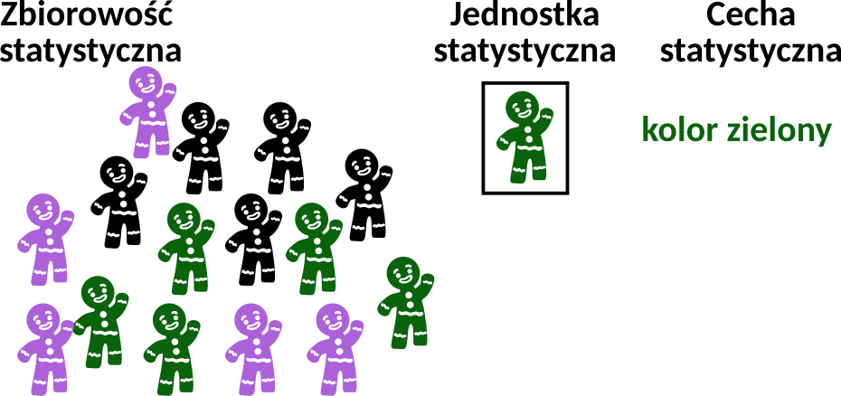
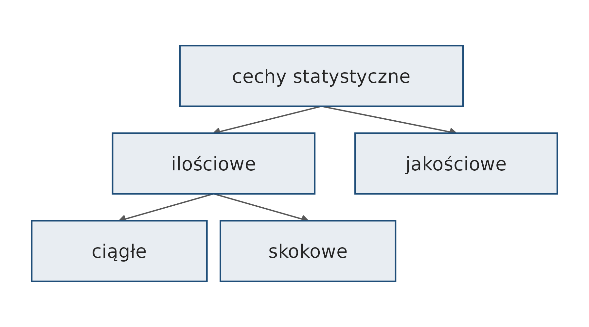
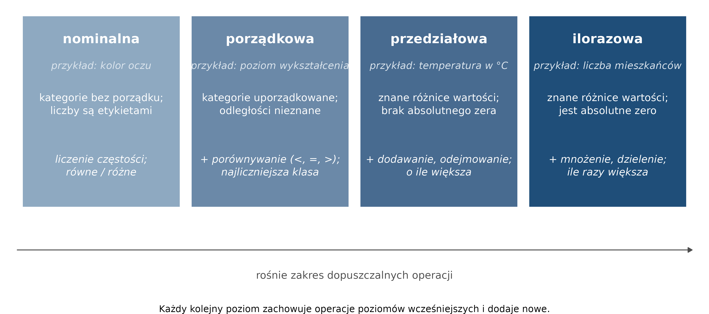

# Pojęcia podstawowe {#sec-pojecia}

Rozdział przedstawia podstawowe pojęcia z zakresu statystyki: zbiorowość, jednostkę i cechę
statystyczną, typy cech oraz skale pomiarowe. Pojęcia te są
podstawą doboru parametrów statystycznych (@sec-statystyki), współczynnika korelacji
(@sec-korelacja) i opisu danych w raporcie (@sec-raport).

## Zbiorowość, jednostka i cecha {#sec-st-pojecia}

**Statystyka** jest nauką, która zajmuje się metodami pozyskiwania, prezentacji i analizy
danych opisujących zjawiska.

{#fig-st-zbiorowosc width=60%}

- **Zbiorowość statystyczna** — ogół jednostek, które są przedmiotem badania
  statystycznego i mają wspólną cechę lub cechy istotne z punktu widzenia tego badania,
  np. wszyscy mieszkańcy Polski.
- **Jednostka statystyczna** — pojedynczy element zbiorowości statystycznej, np. jeden
  mieszkaniec Polski.
- **Cecha statystyczna** — właściwość, która charakteryzuje jednostkę statystyczną
  i odróżnia ją od innych jednostek tej samej zbiorowości, np. wiek albo kolor oczu
  mieszkańca.

| Zbiorowość | Jednostka | Cechy statystyczne |
|---|---|---|
| ludność kraju lub regionu | osoba | wiek, płeć, miejsce zamieszkania, wykształcenie, zarobki |
| miasta w państwie | miasto | liczba mieszkańców, powierzchnia, gęstość zaludnienia |
| rzeki na obszarze | rzeka | długość, powierzchnia dorzecza, przepływ |
| państwa świata | państwo | powierzchnia, liczba ludności, PKB, kontynent |
| stacje meteorologiczne | stacja | temperatura, opady, wilgotność |

W tabeli danych jednostka statystyczna odpowiada wierszowi, a cecha — kolumnie.

## Cechy statystyczne {#sec-st-cechy}

{#fig-st-cechy}

- **Cechy jakościowe** opisują właściwości niemierzalne liczbowo. Nie można ich wyrazić
  liczbą, ale można je sklasyfikować (kolor oczu) albo uporządkować (wykształcenie),
  np. płeć, miejsce zamieszkania (miasto, wieś), zawód.
- **Cechy ilościowe** opisują właściwości mierzalne, wyrażone liczbą; na ich wartościach
  można wykonywać działania arytmetyczne, np. obliczyć średnią.
  - **ciągłe** — mogą przyjmować dowolną wartość z pewnego przedziału, także ułamkową,
    np. wzrost (172,5 cm), temperatura (36,6°C);
  - **skokowe (dyskretne)** — przyjmują tylko określone, zwykle całkowite wartości,
    np. liczba dzieci w rodzinie, liczba uczniów w klasie.

## Skale pomiarowe {#sec-st-skale}

Skala pomiarowa określa, jak można interpretować i przetwarzać wartości cechy.
Wyróżnia się cztery skale; każda kolejna dopuszcza operacje skal wcześniejszych
i dodaje nowe (@fig-st-skale).

{#fig-st-skale}

| Skala | Przykłady |
|---|---|
| **nominalna** | płeć · typ gleby · rodzaj transportu · grupa krwi · kolor oczu |
| **porządkowa** | poziom wykształcenia: podstawowe < średnie < wyższe · miejsce w konkursie · klasa gleby · poziom stresu: niski, średni, wysoki |
| **przedziałowa** (interwałowa) | temperatura w °C lub °F · rok |
| **ilorazowa** | wzrost · masa · dochód · liczba mieszkańców · powierzchnia państw · wysokość nad poziomem morza |

W skali przedziałowej nie wykonuje się mnożenia ani dzielenia: 20°C nie jest dwa razy
cieplejsze niż 10°C. W skali ilorazowej istnieje zero bezwzględne, dlatego można
stwierdzić, że 100 kg to dwa razy więcej niż 50 kg.
