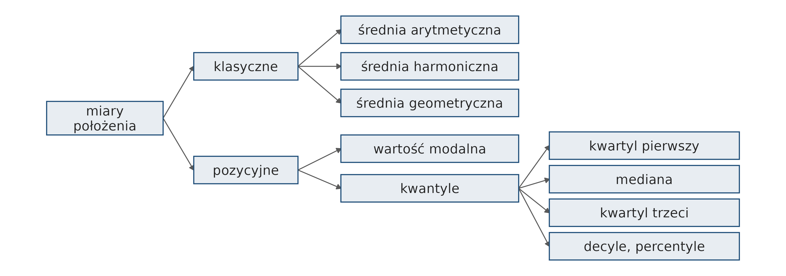
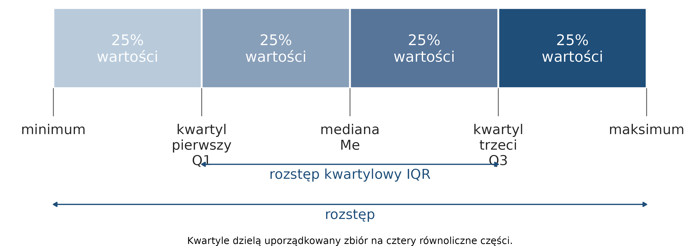
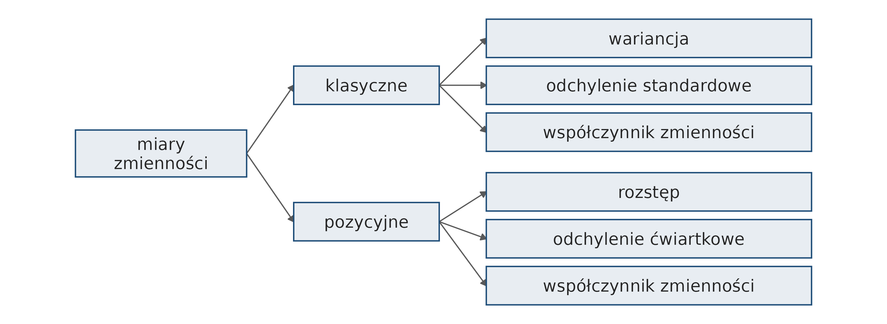
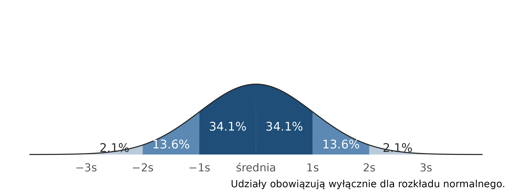
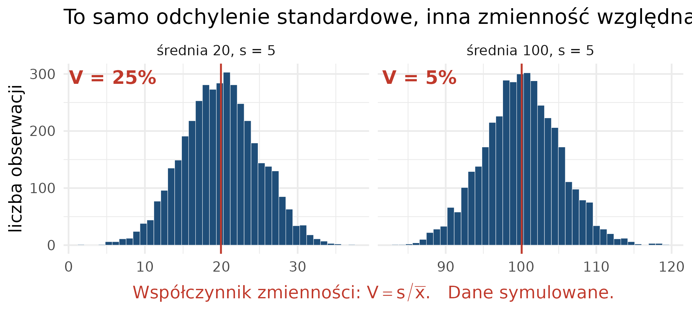
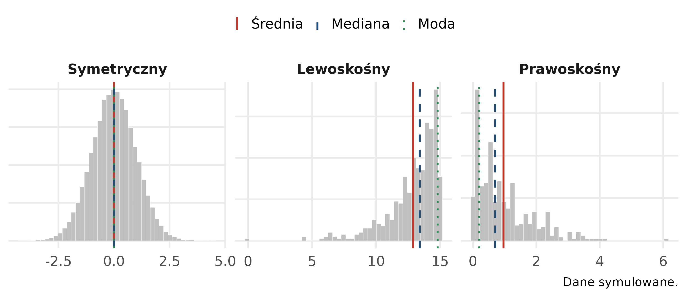
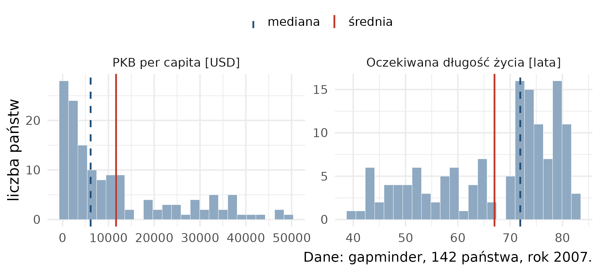
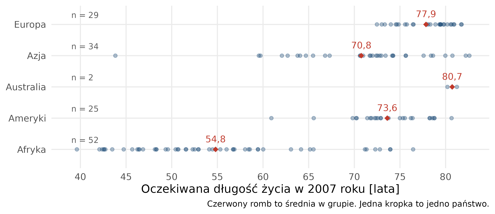
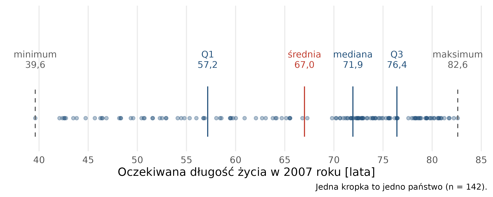
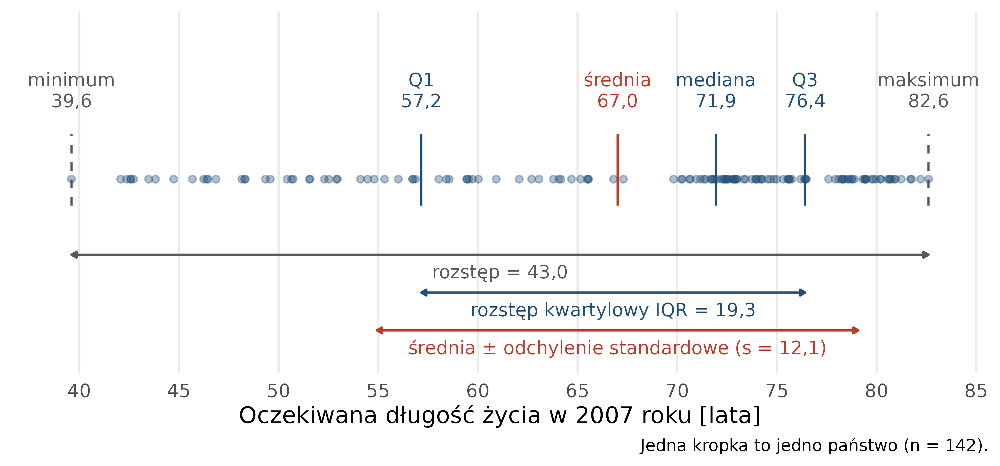

# Statystyki opisowe {#sec-statystyki}

Rozdział przedstawia statystykę opisową: miary położenia, zmienności
i asymetrii oraz statystyki dla cechy jakościowej. Dobór miary zależy od skali pomiarowej
zmiennej (@sec-st-skale). Na końcu rozdziału sekcja „Obliczenia w R” pokazuje, jak obliczyć
omówione miary na danych Gapminder. Wykresy przedstawiające statystyki opisowe omawia
@sec-wiz-statystyki.

Kod sekcji „Obliczenia w R” jest dostępny w pliku `kod/10_statystyki_opisowe.qmd`.

## Statystyka opisowa {#sec-st-opisowa}

**Statystyka opisowa** zajmuje się zbieraniem, organizacją, analizowaniem i prezentacją
danych statystycznych w celu opisania i podsumowania ich charakterystyk. Jej celem jest
przejrzyste podsumowanie zbioru danych i sformułowanie podstawowych wniosków na jego
temat. Statystykę opisową stosuje się zwykle jako pierwszy krok analizy danych.

**Parametry statystyczne** to liczby służące do syntetycznego opisu struktury
zbiorowości statystycznej. Dzielą się na miary położenia, miary zmienności oraz miary
asymetrii.

## Miary położenia {#sec-st-polozenie}

Miary położenia określają przeciętny poziom wartości cechy oraz umiejscowienie typowych
wartości cechy na osi liczbowej.

- **Miary klasyczne** — ich wartość wyznacza się na podstawie wszystkich obserwacji.
- **Miary pozycyjne** — ich wartość zależy tylko od wybranych obserwacji ze zbioru
  uporządkowanego.

Wśród miar położenia wyróżnia się **miary przeciętne** (miary tendencji centralnej):
średnie, wartość modalną i medianę. Charakteryzują one przeciętny poziom zmiennej.

{#fig-st-miary-polozenia}

### Średnia arytmetyczna

Średnia arytmetyczna jest najczęściej stosowaną miarą położenia. Oblicza się ją
na podstawie wszystkich obserwacji:

$$
\bar{x}=\frac{1}{n}\sum_{i=1}^n x_i=\frac{x_1+x_2+\ldots+x_n}{n}
$$

Średnia jest wrażliwa na **wartości odstające** (ang. *outliers*) — obserwacje, których
wartość wyraźnie odbiega od większości pozostałych.

### Wartość modalna

**Wartość modalna** (moda, dominanta, wartość najczęstsza) to wartość cechy, która
w zbiorze danych występuje najczęściej.

### Kwantyle i kwartyle

**Kwantyle** to wartości cechy, które dzielą uporządkowany zbiór danych na części
o określonej liczbie jednostek: **kwartyle** — na 4 części, **decyle** — na 10 części,
**percentyle** — na 100 części.

{#fig-st-kwartyle width=85%}

- **Kwartyl pierwszy (Q1)** — 25% jednostek ma wartości cechy niższe bądź równe Q1,
  a 75% — równe bądź wyższe.
- **Mediana (Me, kwartyl drugi)** — połowa jednostek ma wartości cechy mniejsze bądź
  równe medianie, a połowa — równe bądź większe.
- **Kwartyl trzeci (Q3)** — 75% jednostek ma wartości cechy niższe bądź równe Q3,
  a 25% — równe bądź wyższe.

### Mediana

Mediana jest wartością środkową uporządkowanego zbioru danych. Przy nieparzystej liczbie
obserwacji jest równa wartości środkowej:

- 12, 15, **16**, 18, 21 → mediana: 16

$$Me = x_{\frac{n+1}{2}}$$

Przy parzystej liczbie obserwacji mediana jest średnią z dwóch wartości środkowych:

- 12, 15, **15, 16**, 18, 21 → mediana: (15 + 16) / 2 = 15,5

$$Me = \frac{1}{2} \left(x_{\frac{n}{2}} + x_{\frac{n}{2}+1}\right)$$

Mediana nie zależy od wartości skrajnych i można ją stosować do zmiennych w skali
porządkowej. Medianę często podaje się razem ze średnią arytmetyczną; różnica między nimi
wskazuje na asymetrię rozkładu (@sec-st-asymetria).

### Przykład: średnia i mediana wynagrodzeń

W trzech firmach zatrudniających po 10 osób średnie wynagrodzenie wynosi 5000 zł
(przykład z bloga statystycznego <https://statystyczny.pl/srednio-na-jeza-czyli-srednia-arytmetyczna/>):

| Firma | Wynagrodzenia | Średnia | Mediana |
|---|---|---|---|
| 1 | 10 × 5000 zł | 5000 zł | 5000 zł |
| 2 | 1 × 500 zł, 8 × 1500 zł, 1 × 37 500 zł | 5000 zł | 1500 zł |
| 3 | 5 × 3000 zł, 5 × 7000 zł | 5000 zł | 5000 zł |

W firmie 2 jedno wysokie wynagrodzenie podnosi średnią, a mediana pokazuje wynagrodzenie
większości pracowników.

### Miary położenia a skale pomiarowe

| Skala | Moda | Mediana | Średnia |
|---|---|---|---|
| nominalna | X | | |
| porządkowa | X | X | |
| przedziałowa | X | X | X |
| ilorazowa | X | X | X |

Na przykład obliczanie średniej arytmetycznej z ocen (skala porządkowa) jest
statystycznie niepoprawne.

## Miary zmienności {#sec-st-zmiennosc}

**Miary zmienności** (rozproszenia, dyspersji) opisują rozrzut wartości cechy wokół
wartości przeciętnej. Charakteryzują stopień zróżnicowania jednostek zbiorowości pod
względem badanej cechy.

{#fig-st-miary-zmiennosci}

### Wariancja i odchylenie standardowe

**Wariancja** jest średnią arytmetyczną kwadratów odchyleń obserwacji od średniej.
Dla całej populacji liczącej $N$ jednostek, o średniej $\mu$:

$$\sigma^2 = \frac{1}{N} \sum_{i=1}^N (x_i - \mu)^2$$

Wariancja jest wyrażona w jednostkach cechy podniesionych do kwadratu, np. dla wzrostu
— w cm².

**Odchylenie standardowe** jest pierwiastkiem kwadratowym z wariancji i ma jednostkę
badanej cechy. Określa, o ile przeciętnie wartości cechy odchylają się od średniej.
Małe odchylenie standardowe oznacza, że wartości są blisko średniej, duże — że są od niej
odległe.

Wariancja i odchylenie standardowe są wyjątkiem wśród statystyk opisowych: oblicza się
je inaczej dla całej populacji i dla próby. Dla próby liczącej $n$ obserwacji w mianowniku
stosuje się $n - 1$ zamiast $n$:

$$s = \sqrt{\frac{1}{n-1} \sum_{i=1}^n (x_i - \bar{x})^2}$$

Pozostałe statystyki opisowe oblicza się tak samo dla populacji i dla próby.

W przykładzie wynagrodzeń (@sec-st-polozenie) odchylenie standardowe wynosi:
w firmie 1 — 0 zł, w firmie 2 — 11 423,66 zł, w firmie 3 — 2108,19 zł.

### Typowy obszar zmienności

Na podstawie średniej i odchylenia standardowego wyznacza się **typowy obszar
zmienności**:

$$\bar{x} - s < x_{typ} < \bar{x} + s$$

{#fig-st-normalny}

Relacja przedstawiona na rycinie [-@fig-st-normalny] dotyczy tylko zmiennych o rozkładzie
normalnym.

### Rozstęp i rozstęp kwartylowy

**Rozstęp** (zakres danych) jest różnicą między największą i najmniejszą wartością
cechy. Jest najprostszą miarą zmienności i jest wrażliwy na wartości odstające:

$$R = x_{max} - x_{min}$$

**Rozstęp kwartylowy** (IQR) jest różnicą między trzecim
i pierwszym kwartylem. Obejmuje środkowe 50% obserwacji:

$$IQR = Q_3 - Q_1$$

### Współczynnik zmienności

**Współczynnik zmienności** jest ilorazem bezwzględnej miary zmienności i średniej
wartości cechy. Klasyczny współczynnik zmienności:

$$V_s = \frac{s}{\bar{x}} \cdot 100\%, \quad \text{gdy } \bar{x} > 0$$

Współczynnik zmienności jest wielkością niemianowaną, podawaną zwykle w procentach.
Stosuje się go do porównania zróżnicowania kilku zbiorowości pod względem tej samej cechy
albo tej samej zbiorowości pod względem kilku cech. Duża wartość współczynnika oznacza
duże zróżnicowanie (niejednorodność) zbiorowości. Dwie zbiorowości o tym samym odchyleniu
standardowym mogą mieć różny współczynnik zmienności (@fig-st-wsp-zmiennosci).

{#fig-st-wsp-zmiennosci}

### Miary zmienności a skale pomiarowe

| Skala | Rozstęp | Percentyle | Odchylenie standardowe |
|---|---|---|---|
| nominalna | | | |
| porządkowa | X | X | |
| przedziałowa | X | X | X |
| ilorazowa | X | X | X |

## Miary asymetrii {#sec-st-asymetria}

W rozkładzie symetrycznym średnia, mediana i moda pokrywają się. Asymetria rozsuwa je,
a średnia przesuwa się najdalej w stronę dłuższego ogona rozkładu (@fig-st-asymetria).

{#fig-st-asymetria}

Asymetrię rozkładu określa **współczynnik skośności**: wartość 0 oznacza rozkład
symetryczny, wartość ujemna — rozkład asymetryczny lewostronnie (dłuższy lewy ogon),
wartość dodatnia — rozkład asymetryczny prawostronnie (dłuższy prawy ogon).

Kierunek asymetrii rozpoznaje się po wzajemnym położeniu średniej i mediany:
w rozkładzie asymetrycznym prawostronnie średnia jest większa od mediany,
w asymetrycznym lewostronnie — mniejsza (@fig-st-asymetria-gapminder).

{#fig-st-asymetria-gapminder}

## Inne miary {#sec-st-inne}

Tabela wymienia pozostałe miary i ich zastosowania:

| Miara | Kiedy się ją stosuje |
|---|---|
| średnia harmoniczna | gdy wartości cechy podawane są w przeliczeniu na stałą jednostkę innej zmiennej: prędkość w km/h, gęstość zaludnienia w os./km², spożycie w kg/osobę |
| średnia geometryczna | gdy zjawisko ujmowane jest dynamicznie, np. średnie tempo zmian; dla wartości procentowych i ułamkowych |
| średnia ważona | gdy poszczególnym obserwacjom przypisuje się różny udział w wyniku |
| odchylenie ćwiartkowe | miara zmienności stosowana w parze z medianą; połowa różnicy między Q3 a Q1 |
| pozycyjny współczynnik zmienności | współczynnik zmienności zbudowany z miar pozycyjnych zamiast klasycznych |
| kurtoza | miara koncentracji wartości cechy wokół średniej |

Dla danej cechy oblicza się jedną średnią — tę, która jest odpowiednia dla tej cechy.

## Statystyki dla cechy jakościowej {#sec-st-jakosciowa}

Dla cechy jakościowej wyznacza się **liczność** — liczbę jednostek w każdej kategorii
— oraz **częstość względną**, czyli udział kategorii w całej zbiorowości, podawany
zwykle w procentach. Suma liczności jest równa liczbie jednostek w zbiorowości, a suma
udziałów — 100%.

Miarą położenia jest **wartość modalna**: kategoria o największej liczności. Dla cechy
mierzonej w skali porządkowej wyznacza się dodatkowo medianę i kwartyle, ponieważ
kategorie można uporządkować.

Tabela liczności dla dwóch cech jakościowych to **tabela kontyngencji**. Pokazuje, jak
kategorie jednej cechy rozkładają się wewnątrz kategorii drugiej.

## Statystyki w grupach {#sec-st-grupy}

Statystyki opisowe rzadko oblicza się dla całego zbioru naraz. Zbiorowość dzieli się
na grupy wyznaczone przez cechę jakościową, a miary oblicza się osobno w każdej grupie.
Porównanie tych wartości jest podstawą wniosku o zróżnicowaniu zbiorowości
(@fig-st-os-grupy).

{#fig-st-os-grupy}

## Miary na osi liczbowej {#sec-st-os}

@fig-st-os-polozenie i @fig-st-os-zmiennosc przedstawiają omówione miary dla oczekiwanej
długości życia w 2007 roku: każda kropka to jedno państwo, a miary zaznaczono na tej
samej osi.

{#fig-st-os-polozenie}

{#fig-st-os-zmiennosc}

## Podsumowanie {#sec-st-podsumowanie}

| Miara | Co opisuje | Funkcja R |
|---|---|---|
| średnia arytmetyczna | przeciętny poziom cechy | `mean()` |
| mediana | wartość środkową | `median()` |
| kwartyle Q1, Q3 | granice środkowych 50% obserwacji | `quantile(x, 0.25)`, `quantile(x, 0.75)` |
| minimum, maksimum | wartości skrajne | `min()`, `max()` |
| rozstęp | zakres wartości | `max(x) - min(x)` |
| rozstęp kwartylowy | rozrzut środkowych 50% obserwacji | `IQR()` |
| odchylenie standardowe | przeciętne odchylenie od średniej | `sd()` |
| współczynnik zmienności | zróżnicowanie względem średniej [%] | `sd(x) / mean(x) * 100` |
| liczność i udział kategorii | strukturę cechy jakościowej | `n()`, `n / sum(n) * 100` |

Funkcja `sd()` stosuje w mianowniku $n - 1$, czyli wzór dla próby.

## Obliczenia w R {#sec-st-obliczenia}

Obliczenia wykorzystują dane Gapminder z 2007 roku: 142 kraje (@sec-pd-dane). Funkcje
i potoki zostały omówione w @sec-praca-z-danymi.

```{r}
#| message: false
# wczytanie pakietów i danych; obserwacje z 2007 roku
library(tidyverse)
dane <- read.csv("dane/gapminder_regions.csv", encoding = "UTF-8") |>
  mutate(across(where(is.character), as.factor))
dane2007 <- dane |>
  filter(year == 2007)
```

### Podsumowanie zmiennej: summary()

Funkcja `summary()` zastosowana do zmiennej liczbowej podaje sześć wartości: minimum
(`Min.`), pierwszy kwartyl (`1st Qu.`), medianę (`Median`), średnią (`Mean`), trzeci
kwartyl (`3rd Qu.`) i maksimum (`Max.`).

```{r}
# podsumowanie oczekiwanej długości życia w 2007 roku
summary(dane2007$lifeExp)
```

`dane2007$lifeExp` oznacza kolumnę `lifeExp` z tabeli `dane2007` (@sec-pd-wczytanie).

### Pojedyncze statystyki

Każdą miarę można obliczyć osobną funkcją. Argumentem funkcji jest zmienna, czyli
kolumna tabeli:

```{r}
# średnia arytmetyczna
mean(dane2007$lifeExp)

# mediana
median(dane2007$lifeExp)

# odchylenie standardowe
sd(dane2007$lifeExp)

# rozstęp kwartylowy (Q3 − Q1)
IQR(dane2007$lifeExp)

# wartość najmniejsza i największa
min(dane2007$lifeExp)
max(dane2007$lifeExp)
```

Funkcja `quantile()` oblicza kwantyl rzędu podanego w drugim argumencie: `0.25` — pierwszy
kwartyl, `0.75` — trzeci kwartyl, `0.1` — pierwszy decyl. Kilka rzędów podaje się
w wektorze `c()`:

```{r}
# pierwszy kwartyl
quantile(dane2007$lifeExp, 0.25)

# pierwszy kwartyl, mediana i trzeci kwartyl
quantile(dane2007$lifeExp, c(0.25, 0.5, 0.75))
```

Wynik `quantile()` ma nad wartością nazwę, np. `25%` — oznacza ona rząd kwantyla.

### Braki danych w obliczeniach

Jeżeli zmienna zawiera choć jeden brak danych (`NA`, @sec-pd-braki), funkcje `mean()`,
`median()`, `sd()`, `quantile()`, `min()` i `max()` zwracają `NA` albo błąd — wartości
nieznanej nie da się uwzględnić w obliczeniu. Argument `na.rm = TRUE` (ang. *NA remove*)
pomija braki danych i oblicza miarę z pozostałych wartości. Przykład na wektorze trzech
wartości, z których jedna jest brakiem danych:

```{r}
# przykładowy wektor: dwie wartości i jeden brak danych
x <- c(72.5, 81.8, NA)

# bez na.rm: wynik nieznany
mean(x)

# z na.rm = TRUE: średnia z dwóch znanych wartości
mean(x, na.rm = TRUE)
```

`summary()` pomija braki danych bez dodatkowego argumentu i podaje ich liczbę w pozycji
`NA's`:

```{r}
summary(x)
```

Liczbę braków danych w zmiennej zwraca `sum(is.na(x))`: `is.na()` sprawdza dla każdej
wartości, czy jest brakiem danych, a `sum()` zlicza wartości `TRUE`. Przed obliczeniem
statystyk warto sprawdzić, ile obserwacji pominięto — miara obliczona z części danych
opisuje tylko obserwacje kompletne. Zmienna `lifeExp` w danych Gapminder nie zawiera
braków danych; braki występują w danych meteorologicznych z 2020 roku (@sec-meteo-dane).

### Wiele statystyk w jednej tabeli: summarise()


```{r}
#| R.options:
#|   width: 120
# miary położenia i zmienności oczekiwanej długości życia w 2007 roku
dane2007 |>
  summarise(
    n = n(),                                          # liczba obserwacji
    srednia = round(mean(lifeExp), 1),                # średnia arytmetyczna
    mediana = round(median(lifeExp), 1),              # mediana
    q1 = round(quantile(lifeExp, 0.25), 1),           # pierwszy kwartyl
    q3 = round(quantile(lifeExp, 0.75), 1),           # trzeci kwartyl
    minimum = round(min(lifeExp), 1),                 # wartość najmniejsza
    maksimum = round(max(lifeExp), 1),                # wartość największa
    rozstep = round(max(lifeExp) - min(lifeExp), 1),  # rozstęp
    odch_std = round(sd(lifeExp), 1),                 # odchylenie standardowe
    iqr = round(IQR(lifeExp), 1),                     # rozstęp kwartylowy
    wsp_zm = round(sd(lifeExp) / mean(lifeExp) * 100, 1)  # współczynnik zmienności [%]
  )
```

Wartości są takie same jak na rycinach [-@fig-st-os-polozenie] i [-@fig-st-os-zmiennosc]. Średnia
(67,0 roku) jest mniejsza od mediany (71,9 roku), co wskazuje na asymetrię lewostronną
(@sec-st-asymetria). Pakiety podstawowe R i `tidyverse` nie zawierają funkcji obliczającej
współczynnik skośności; kierunek asymetrii odczytuje się z relacji średniej i mediany.

### Statystyki w grupach

```{r}
# statystyki oczekiwanej długości życia w 2007 roku w podziale na kontynenty
dane2007 |>
  group_by(kontynent) |>
  summarise(
    n = n(),
    srednia = round(mean(lifeExp), 1),
    mediana = round(median(lifeExp), 1),
    odch_std = round(sd(lifeExp), 1),
    wsp_zm = round(sd(lifeExp) / mean(lifeExp) * 100, 1)
  )
```

Współczynnik zmienności był najwyższy w Afryce (17,6%), a najniższy — wśród kontynentów
reprezentowanych przez więcej niż dwa kraje — w Europie (3,6%).

### Cecha jakościowa: liczność i udział

```{r}
# liczba krajów i udział [%] w grupach dochodowych w 2007 roku
dane2007 |>
  group_by(income_grp_pl) |>
  summarise(n = n()) |>
  mutate(udzial = round(n / sum(n) * 100, 1))
```

Wartością modalną jest grupa o średnim dochodzie (66 krajów, 46,5%). Pierwszy wiersz
to dwa kraje bez przypisania do grupy dochodowej (@sec-pd-braki).

### Tabela kontyngencji

```{r}
# liczba krajów według kontynentu i grupy dochodowej w 2007 roku
dane2007 |>
  filter(income_grp_pl != "") |>                       # pominięcie krajów bez grupy
  group_by(kontynent, income_grp_pl) |>
  summarise(n = n(), .groups = "drop") |>
  pivot_wider(names_from = income_grp_pl, values_from = n, values_fill = 0)
```

- `filter(income_grp_pl != "")` pomija kraje bez przypisania do grupy dochodowej;
  operator `!=` oznacza „różne od”.
- `group_by()` z dwiema zmiennymi tworzy grupy dla każdej pary kategorii; `.groups = "drop"`
  usuwa podział na grupy po obliczeniu podsumowania.
- `pivot_wider()` zamienia tabelę na postać szeroką: kategorie grupy dochodowej stają się
  kolumnami (@sec-pd-pivot). `values_fill = 0` wpisuje 0 w miejscach, gdzie dana para
  kategorii nie występuje.
