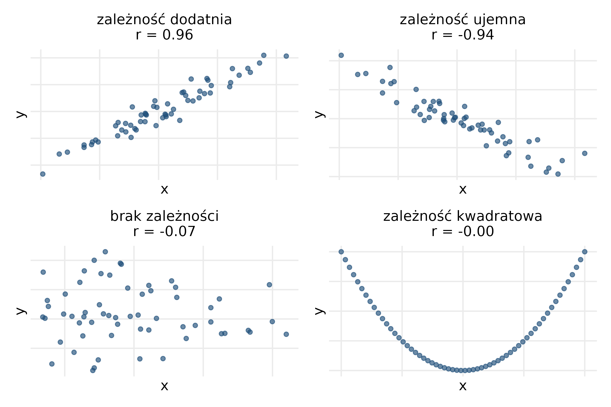
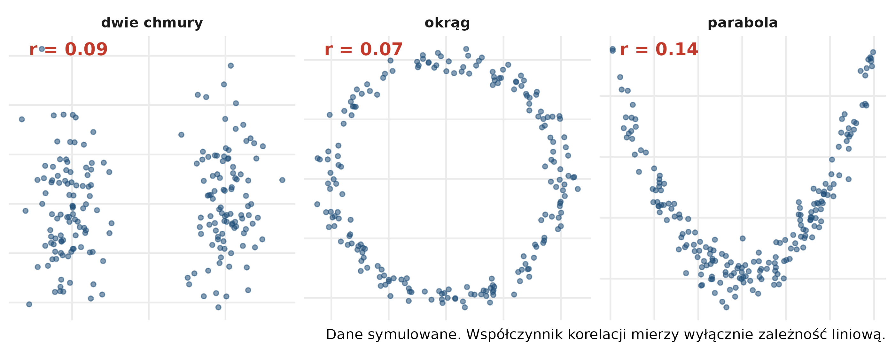
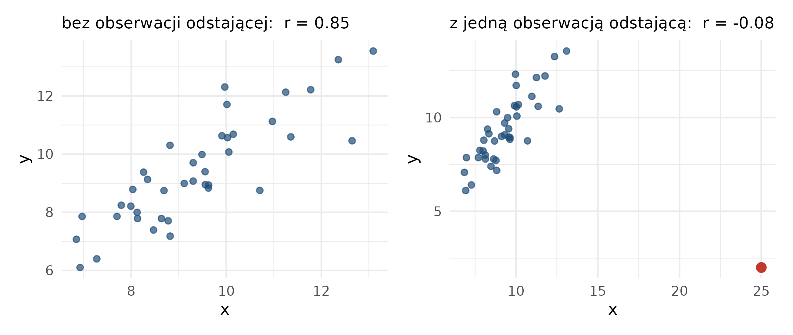
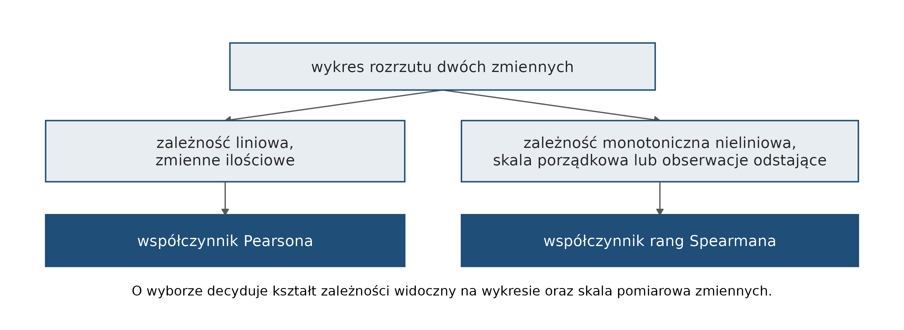

# Analiza korelacji {#sec-korelacja}

Rozdział przedstawia analizę korelacji: współczynniki korelacji Pearsona
i Spearmana, wybór współczynnika, test istotności i odczytanie jego wyniku. Na końcu
rozdziału sekcja „Obliczenia w R” pokazuje analizę korelacji na danych Gapminder.
Wykresy przedstawiające zależności omawia rozdział „Wizualizacja zależności”.

Kod sekcji „Obliczenia w R” jest dostępny w pliku `kod/11_korelacja.qmd`.

## Cel analizy korelacji {#sec-kor-cel}

Analiza korelacji służy do określenia:

- czy między badanymi zmiennymi występuje związek i czy jest on istotny statystycznie;
- jak **silny** jest związek;
- jaki jest **kierunek** związku.

Miarą korelacji jest **współczynnik korelacji**. Jego wartość bezwzględna określa siłę
związku, a znak — kierunek. Współczynnik przyjmuje wartości od −1 do 1. Najczęściej
stosowane współczynniki to współczynnik korelacji Pearsona i współczynnik korelacji rang
Spearmana. Wyniki analizy korelacji przedstawia się graficznie na **wykresie rozrzutu**.

{#fig-kor-kierunek}

## Korelacja a związek przyczynowy {#sec-kor-przyczynowosc}

Korelacja wskazuje współwystępowanie dwóch zmiennych, a nie związek przyczynowo-skutkowy.
Istnienie korelacji liczbowej nie potwierdza, że jedno zjawisko powoduje drugie
(ang. *correlation does not imply causation*). Korelacja między zmiennymi A i B może
wynikać z tego, że:

- A powoduje B;
- B powoduje A;
- A i B są wywołane przez trzecią zmienną C;
- zależność między A i B jest przypadkowa.

Przykłady korelacji pozornych zestawił Tyler Vigen:
<https://www.tylervigen.com/spurious-correlations>.

## Ograniczenia współczynnika korelacji {#sec-kor-ograniczenia}

- Wartość współczynnika bliska 0 nie zawsze oznacza brak zależności — może oznaczać
  jedynie brak zależności liniowej (@fig-kor-nieliniowa).
- Wartość współczynnika zależy od wartości skrajnych i odstających: jedna obserwacja
  może zmienić jego wartość i znak (@fig-kor-odstajace).

{#fig-kor-nieliniowa}

{#fig-kor-odstajace}

## Współczynniki korelacji {#sec-kor-wspolczynniki}

| Współczynnik korelacji Pearsona | Współczynnik korelacji rang Spearmana |
|---|---|
| zmienne ilościowe | zmienne o charakterze porządkowym |
| rozkład normalny lub zbliżony do normalnego | bardzo silnie skośne rozkłady |
| brak wartości odstających | obecność wielu obserwacji odstających |
| zależność liniowa | dowolny typ zależności |

### Współczynnik korelacji Pearsona

Współczynnik korelacji Pearsona jest miarą korelacji liniowej:

$$r = \frac{\sum(x - m_{x})(y - m_{y})}{\sqrt{\sum(x - m_{x})^2\sum(y - m_{y})^2}}$$

gdzie $x$, $y$ to wartości zmiennych, a $m_x$, $m_y$ — średnie wartości zmiennych
$x$ i $y$.

- Wartość **−1** oznacza doskonałą korelację **ujemną**: gdy wartości jednej zmiennej
  rosną, wartości drugiej maleją.
- Wartość **+1** oznacza doskonałą korelację **dodatnią**: gdy wartości jednej zmiennej
  rosną, wartości drugiej także rosną.
- Wartość **0** oznacza brak korelacji.

Współczynnik Pearsona nie ma sensownej interpretacji dla zmiennych w skali porządkowej,
ponieważ zależy od różnic między wartościami zmiennych, które dla cech porządkowych nie są
określone. Sposób obliczania współczynnika krok po kroku przedstawia
<https://statystyczny.pl/wspolczynnik-korelacji-pearsona-w-przykladach/>.

### Współczynnik korelacji rang Spearmana

Współczynnik Spearmana jest współczynnikiem korelacji nieparametrycznej, opartym
na **rangach**: każda obserwacja otrzymuje numer miejsca w uporządkowanym zbiorze,
a korelowane są rangi, a nie wartości zmiennych:

$$\rho = \frac{\sum(x' - m_{x'})(y' - m_{y'})}{\sqrt{\sum(x' - m_{x'})^2\sum(y' - m_{y'})^2}}$$

gdzie $x'$ to ranga $x$, a $y'$ — ranga $y$.

Współczynnik Spearmana zależy wyłącznie od uporządkowania wartości. Stosuje się go do
zmiennych, których wartości można uporządkować — mierzonych w skali porządkowej albo
o rozkładzie innym niż normalny. Jest w niewielkim stopniu wrażliwy na obserwacje
odstające.

### Wybór współczynnika

O wyborze współczynnika decyduje kształt zależności widoczny na wykresie rozrzutu oraz
skala pomiarowa zmiennych (@fig-kor-wybor).

{#fig-kor-wybor}

### Siła korelacji

Do opisu istotnej korelacji pomocna jest skala siły związku. Nie ma jednej przyjętej
skali; jedna z nich (dla wartości bezwzględnej współczynnika):

| Wartość | Siła korelacji |
|---|---|
| 0 | brak korelacji |
| 0,1–0,3 | słaba |
| 0,3–0,5 | przeciętna |
| 0,5–0,7 | wysoka |
| 0,7–0,9 | bardzo wysoka |
| 0,9–1 | prawie pełna |

## Test istotności korelacji {#sec-kor-test}

Dla każdego współczynnika korelacji należy sprawdzić jego **istotność statystyczną**
testem istotności przeznaczonym dla współczynników korelacji. Wysoki współczynnik, który
nie jest istotny statystycznie, nie stanowi podstawy wniosku o związku zmiennych.

- **Hipoteza zerowa:** $\rho_{x,y} = 0$ — w populacji nie ma korelacji.
- **Hipoteza alternatywna:** $\rho_{x,y} \neq 0$ (albo $\rho_{x,y} < 0$, albo
  $\rho_{x,y} > 0$).

Test korelacji liniowej Pearsona stosuje się, gdy zależność jest liniowa, a zmienne mają
rozkład zbliżony do normalnego. Test korelacji rang Spearmana stosuje się, gdy rozkład jest
silnie skośny albo występują wartości odstające.

Wynik testu w R (funkcja `cor.test()`) zawiera:

- **p-value** — jeżeli p-value < 0,05, współczynnik korelacji jest istotny statystycznie;
- **95 percent confidence interval** — 95% przedział ufności współczynnika korelacji:
  przedział wyznaczony z próby metodą, która w 95% powtórzeń badania daje przedział zawierający
  prawdziwą wartość współczynnika w populacji; podawany tylko dla współczynnika Pearsona;
- **sample estimates** — wartość współczynnika korelacji (`cor` dla Pearsona, `rho`
  dla Spearmana).

## Obliczenia w R {#sec-kor-obliczenia}

Obliczenia wykorzystują dane Gapminder z 2007 roku: 142 kraje (@sec-pd-dane).

```{r}
#| message: false
# wczytanie pakietów i danych; obserwacje z 2007 roku
library(tidyverse)
dane <- read.csv("dane/gapminder_regions.csv", encoding = "UTF-8") |>
  mutate(across(where(is.character), as.factor))
dane2007 <- dane |>
  filter(year == 2007)
```

### Wykres rozrzutu

```{r}
#| label: fig-kor-rozrzut
#| fig-cap: "Oczekiwana długość życia a PKB per capita, 142 kraje, 2007"
# wykres rozrzutu: PKB per capita na osi x, oczekiwana długość życia na osi y
ggplot(dane2007, aes(x = gdpPercap, y = lifeExp)) +
  geom_point() +
  labs(x = "PKB per capita [USD]", y = "Oczekiwana długość życia [lata]") +
  theme_bw(base_size = 13)
```

Zależność jest monotoniczna — wraz ze wzrostem PKB per capita rośnie oczekiwana długość
życia — ale nieliniowa: przy niskim PKB oczekiwana długość życia rośnie szybko,
a przy wysokim — powoli (@fig-kor-rozrzut).

### Współczynniki korelacji

```{r}
# współczynnik korelacji Pearsona i Spearmana, zaokrąglone do 2 miejsc
round(cor(dane2007$gdpPercap, dane2007$lifeExp, method = "pearson"), 2)
round(cor(dane2007$gdpPercap, dane2007$lifeExp, method = "spearman"), 2)
```

- `cor(x, y, method = )` oblicza współczynnik korelacji dwóch zmiennych; argument
  `method` wskazuje współczynnik: `"pearson"` albo `"spearman"`.

Współczynnik Pearsona (0,68), mierzący zależność liniową, jest dla tej nieliniowej
zależności niższy od współczynnika Spearmana (0,86). Kształt zależności na
@fig-kor-rozrzut wskazuje na wybór współczynnika Spearmana (@fig-kor-wybor).

### Test istotności

```{r}
# test istotności współczynnika korelacji rang Spearmana
cor.test(dane2007$gdpPercap, dane2007$lifeExp, method = "spearman")
```

Odczytanie wyniku:

- **p-value < 2,2 × 10⁻¹⁶** — znacznie poniżej progu 0,05, więc współczynnik jest istotny
  statystycznie;
- **rho = 0,857** — korelacja dodatnia, bardzo wysoka.

Wniosek: w 2007 roku korelacja oczekiwanej długości życia i PKB per capita była dodatnia,
bardzo wysoka i istotna statystycznie.

Dla porównania test korelacji Pearsona podaje także przedział ufności:

```{r}
# test istotności współczynnika korelacji Pearsona
cor.test(dane2007$gdpPercap, dane2007$lifeExp, method = "pearson")
```

95% przedział ufności współczynnika Pearsona wynosi od 0,579 do 0,759 i nie zawiera zera.

### Macierz współczynników korelacji

```{r}
# współczynniki korelacji Spearmana dla każdej pary trzech zmiennych
dane2007 |>
  select(lifeExp, gdpPercap, pop) |>
  cor(method = "spearman") |>
  round(3)
```

- `cor()` zastosowana do tabeli z kilkoma zmiennymi liczbowymi zwraca **macierz
  korelacji**: współczynnik dla każdej pary zmiennych. Na przekątnej znajduje się 1
  — korelacja zmiennej z samą sobą.

Współczynniki korelacji liczby ludności z oczekiwaną długością życia (0,003) i z PKB
per capita (−0,065) są bliskie 0. Test istotności dla tych par:

```{r}
# p-value testu Spearmana dla par z liczbą ludności
cor.test(dane2007$pop, dane2007$lifeExp, method = "spearman")$p.value
cor.test(dane2007$pop, dane2007$gdpPercap, method = "spearman")$p.value
```

Wartości p (0,97 i 0,44) są większe od 0,05: współczynniki korelacji liczby ludności
z oczekiwaną długością życia i z PKB per capita nie są istotne statystycznie. Zapis
`$p.value` pobiera z wyniku testu tylko wartość p.

Macierz wykresów rozrzutu ze współczynnikami korelacji i oznaczeniem istotności tworzy
funkcja `ggpairs()` z pakietu `GGally` (@sec-meteo-korelacja).
