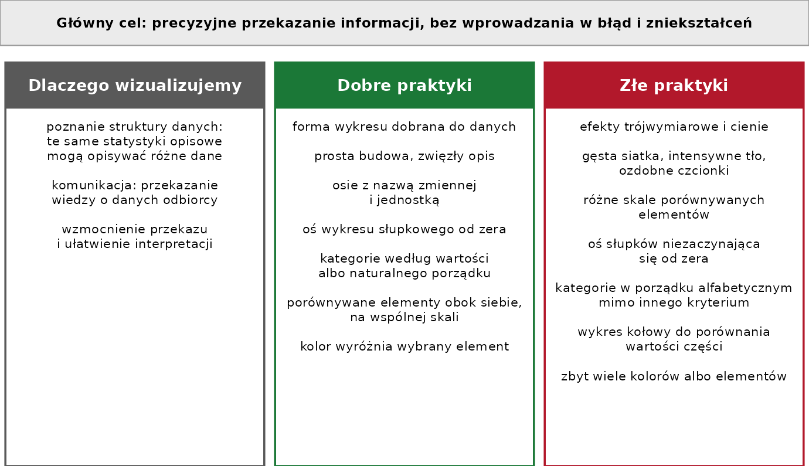

# Po co wizualizujemy dane {#sec-wizualizacja}

Rozdział przedstawia cele wizualizacji danych i zasady dobrej prezentacji. Przykłady wykorzystują dane Gapminder (@sec-pd-dane), z wyjątkiem kwartetu
Anscombe'a, dostępnego w R w pakiecie podstawowym `datasets`. Kod tworzący ryciny jest
zwinięty — rozwija się go przyciskiem **Kod** nad ryciną.

```{r}
#| code-summary: "Kod: wczytanie pakietów i danych"
#| message: false
library(tidyverse)
library(patchwork)
dane <- read.csv("dane/gapminder_regions.csv", encoding = "UTF-8") |>
  mutate(across(where(is.character), as.factor))
dane2007 <- dane |>
  filter(year == 2007)
```

## Kwartet Anscombe'a {#sec-wiz-anscombe}

Kwartet Anscombe'a (Anscombe, 1973) to cztery zbiory danych, każdy złożony z 11 par
wartości $x$ i $y$. Wszystkie cztery zbiory mają te same statystyki opisowe
(@tbl-wiz-anscombe).

```{r}
#| label: tbl-wiz-anscombe
#| tbl-cap: "Statystyki opisowe czterech zbiorów kwartetu Anscombe'a"
# zbiory kwartetu w postaci długiej: kolumny zbior, x, y
kwartet <- datasets::anscombe |>
  pivot_longer(everything(), cols_vary = "slowest",
               names_to = c(".value", "zbior"), names_pattern = "(.)(.)") |>
  mutate(zbior = paste("Zbiór", zbior))                # nazwy zbiorów: Zbiór 1 … Zbiór 4

kwartet |>
  group_by(zbior) |>
  summarise(srednia_x = mean(x), odch_std_x = sd(x),
            srednia_y = mean(y), odch_std_y = sd(y),
            korelacja = cor(x, y)) |>
  knitr::kable(digits = 2,
               col.names = c("Zbiór", "Średnia x", "Odch. std. x",
                             "Średnia y", "Odch. std. y", "Współczynnik korelacji"))
```

Wykresy rozrzutu pokazują, że zbiory różnią się od siebie (@fig-wiz-anscombe): tylko
w pierwszym zbiorze zależność ma postać liniową z rozproszeniem punktów; w drugim
zależność jest nieliniowa, a w trzecim i czwartym wartość współczynnika korelacji
wyznacza jedna obserwacja odstająca.

```{r}
#| label: fig-wiz-anscombe
#| fig-cap: "Kwartet Anscombe'a: cztery zbiory o tych samych statystykach opisowych"
ggplot(kwartet, aes(x = x, y = y)) +
  geom_point(size = 2) +
  facet_wrap(~ zbior) +
  theme_bw(base_size = 13)
```

::: {.callout-important}
## Statystyki opisowe nie zastępują wykresu
Te same wartości statystyk mogą opisywać dane o różnej strukturze. Dlatego analiza danych
obejmuje zarówno obliczenie statystyk, jak i wizualizację.
:::

## Cel wizualizacji danych {#sec-wiz-cel}

Większość wizualizacji danych służy komunikacji: autor zna zbiór danych i przekazuje
tę wiedzę odbiorcy. Głównym celem jest precyzyjne przekazanie informacji, bez
wprowadzania w błąd i zniekształceń. Dobra prezentacja wizualna wzmacnia przekaz,
a wykres powinien być estetyczny.

Według Tuftego (1983) dobra
prezentacja graficzna:

- jest dobrze zaprojektowaną prezentacją interesujących danych — łączy kwestie
  merytoryczne, statystyczne i projektowe;
- przekazuje złożone idee jasno, precyzyjnie i efektywnie;
- daje odbiorcy największą liczbę idei w najkrótszym czasie, przy użyciu najmniejszej
  ilości atramentu na najmniejszej przestrzeni;
- przekazuje prawdę o danych.

## Mniej znaczy więcej {#sec-wiz-mniej}

Udoskonalając wykres, należy zastanowić się, co można z niego usunąć, a nie co można
dodać: doskonałość osiąga się wtedy, gdy nie ma już nic do usunięcia (de Saint-Exupéry, 1939).
Elementy, które nie przedstawiają danych — efekty trójwymiarowe, cienie, intensywne
tło, gęsta siatka, ozdobne czcionki — utrudniają odczytanie wartości. Przykłady
usuwania zbędnych elementów z wykresu przedstawiają:

- Dark Horse Analytics (2013), *Data Looks Better Naked*:
  <https://www.darkhorseanalytics.com/blog/data-looks-better-naked>;
- Healy (2026, rozdz. 1), sekcja „What makes bad figures bad?”:
  <https://socviz.co/01-look-at-data.html#what-makes-bad-figures-bad>.

## Wykresy brzydkie, złe i błędne {#sec-wiz-wilke}

Wilke (2019, rozdz. 1) rozróżnia wykresy:

- **brzydkie** (*ugly*) — z wadami estetycznymi, np. jaskrawymi kolorami, wyraźną siatką
  tła, wieloma rodzajami czcionki;
- **złe** (*bad*) — utrudniające odczytanie albo wprowadzające w błąd, np. przez różne
  skale osi dla porównywanych elementów;
- **błędne** (*wrong*) — przedstawiające dane niepoprawnie, np. bez osi, z której można
  odczytać wartości.

@fig-wiz-wilke przedstawia te rodzaje na przykładzie trzech wartości: A = 3, B = 5 i C = 4.
Na wykresie A wartości odczytuje się poprawnie. Wykres B przedstawia te same wartości
z wadami estetycznymi. Na wykresie C każdy słupek ma własną skalę osi y, dlatego słupki mają
tę samą wysokość, choć wartości się różnią. Na wykresie D brakuje osi y, a oś nie zaczyna się
od zera: wartości nie można odczytać, a proporcje między słupkami są zniekształcone.

```{r}
#| label: fig-wiz-wilke
#| fig-cap: "Trzy wartości na wykresie poprawnym (A), brzydkim (B), złym (C) i błędnym (D); na podstawie: Wilke (2019); dane przykładowe"
#| fig-width: 9
#| fig-height: 6
przyklad <- tibble(kategoria = c("A", "B", "C"), wartosc = c(3, 5, 4))

p_poprawny <- ggplot(przyklad, aes(x = kategoria, y = wartosc)) +
  geom_col(fill = "steelblue", width = 0.7) +
  labs(x = NULL, y = "Wartość", title = "wykres poprawny") +
  theme_bw(base_size = 13)

p_brzydki <- ggplot(przyklad, aes(x = kategoria, y = wartosc, fill = kategoria)) +
  geom_col(width = 0.7) +
  scale_fill_manual(values = c("chartreuse", "cyan", "magenta"), guide = "none") +
  labs(x = NULL, y = "Wartość", title = "wykres brzydki (ugly)") +
  theme_bw(base_size = 13) +
  theme(panel.grid.major = element_line(colour = "black", linewidth = 0.8),  # wyraźna siatka
        axis.title.y = element_text(family = "mono", face = "bold", size = 18),
        axis.text.x = element_text(family = "serif", size = 11),
        axis.text.y = element_text(size = 17))

p_zly <- ggplot(przyklad, aes(x = "", y = wartosc)) +
  geom_col(fill = "steelblue", width = 0.7) +
  facet_wrap(~ kategoria, scales = "free_y") +          # każdy panel ma własną skalę osi y
  labs(x = NULL, y = "Wartość", title = "wykres zły (bad)") +
  theme_bw(base_size = 13)

p_bledny <- ggplot(przyklad, aes(x = kategoria, y = wartosc)) +
  geom_col(fill = "steelblue", width = 0.7) +
  coord_cartesian(ylim = c(2.4, 5.2)) +                 # oś y nie zaczyna się od zera
  labs(x = NULL, y = NULL, title = "wykres błędny (wrong)") +
  theme_bw(base_size = 13) +
  theme(axis.text.y = element_blank(), axis.ticks.y = element_blank(),  # brak opisu osi y
        panel.grid = element_blank())

(p_poprawny | p_brzydki) / (p_zly | p_bledny) + plot_annotation(tag_levels = "A")
```

Healy (2026, rozdz. 1) wskazuje trzy
źródła wad wykresu: zły gust (ang. *bad taste*), błędne dane (*bad data*) i problemy z percepcją
(*bad perception*). Przegląd typowych błędów zawiera także Li (2022). Oba źródła są dostępne
w internecie:

- Healy (2026, rozdz. 1): <https://socviz.co/01-look-at-data.html#what-makes-bad-figures-bad>;
- Li (2022), *Friends Don't Let Friends Make Bad Graphs*:
  <https://github.com/cxli233/FriendsDontLetFriends>.

## Oś wykresu słupkowego zaczyna się od zera {#sec-wiz-zero}

Na wykresie słupkowym wartość odczytuje się z długości słupka. Oś, która nie zaczyna się
od zera, skraca słupki o tę samą wielkość i zmienia proporcje między nimi
(@fig-wiz-zero).

```{r}
#| label: fig-wiz-zero
#| fig-cap: "PKB per capita Polski w latach 1992–2007: oś od 6000 USD (A) i oś od zera (B)"
#| fig-width: 10
#| fig-height: 4
polska <- dane |>
  filter(kraj == "Polska", year > 1990)

p_obcieta <- ggplot(polska, aes(x = factor(year), y = gdpPercap)) +
  geom_col() +
  coord_cartesian(ylim = c(6000, 16000), expand = FALSE) +   # oś y od 6000
  labs(x = "Rok", y = "PKB per capita [USD]") +
  theme_bw(base_size = 13)

p_zero <- ggplot(polska, aes(x = factor(year), y = gdpPercap)) +
  geom_col() +
  labs(x = "Rok", y = "PKB per capita [USD]") +
  theme_bw(base_size = 13)

p_obcieta + p_zero + plot_annotation(tag_levels = "A")
```

Na rycinie [-@fig-wiz-zero] A słupek z 2007 roku jest ponad pięciokrotnie dłuższy od słupka z 1992
roku, choć PKB per capita wzrósł niemal dwukrotnie (z 7739 do 15 390 USD) — co pokazuje
@fig-wiz-zero B.

::: {.callout-important}
## Słupki muszą zaczynać się od zera
Długość słupka przedstawia wartość, dlatego oś wykresu słupkowego musi zaczynać się od zera.
:::

## Kolejność kategorii {#sec-wiz-kolejnosc}

Kategorie nieuporządkowane porządkuje się na wykresie według wartości, a nie alfabetycznie.
Kategorie o naturalnym porządku, np. grupy dochodowe albo miesiące, zachowują ten porządek.
Uporządkowanie według wartości pozwala odczytać ranking i porównać sąsiednie kategorie (@fig-wiz-kolejnosc).

```{r}
#| label: fig-wiz-kolejnosc
#| fig-cap: "Oczekiwana długość życia w krajach Europy w 2007 roku: kraje uporządkowane według wartości (A) i alfabetycznie (B)"
#| fig-width: 10
#| fig-height: 7
europa2007 <- dane2007 |>
  filter(kontynent == "Europa")

p_wartosc <- ggplot(europa2007, aes(x = lifeExp, y = fct_reorder(kraj, lifeExp))) +
  geom_point(size = 2.5) +
  labs(x = "Oczekiwana długość życia [lata]", y = NULL) +
  theme_bw(base_size = 12)

p_alfabet <- ggplot(europa2007, aes(x = lifeExp, y = fct_rev(kraj))) +
  geom_point(size = 2.5) +
  labs(x = "Oczekiwana długość życia [lata]", y = NULL) +
  theme_bw(base_size = 12)

p_wartosc + p_alfabet + plot_annotation(tag_levels = "A")
```

## Wykres kołowy a wykres słupkowy {#sec-wiz-kolowy}

Na wykresie kołowym wartości odczytuje się z kątów i pól wycinków, na wykresie słupkowym
— z długości słupków na wspólnej osi. Różnice długości słupków odczytuje się łatwiej
niż różnice kątów (@fig-wiz-kolowy). Dyskusję wad i zalet wykresu kołowego przedstawiają
Kosara (2010) oraz Lima (2018).

```{r}
#| label: fig-wiz-kolowy
#| fig-cap: "Liczba krajów według kontynentu w 2007 roku: wykres kołowy (A) i słupkowy (B)"
#| fig-width: 10
#| fig-height: 4
kontynenty2007 <- dane2007 |>
  group_by(kontynent) |>
  summarise(liczba = n())

p_kolowy <- ggplot(kontynenty2007, aes(x = "", y = liczba, fill = kontynent)) +
  geom_col() +
  coord_polar(theta = "y") +                            # układ biegunowy: wykres kołowy
  labs(fill = "Kontynent") +
  theme_void(base_size = 13)

p_slupkowy <- ggplot(kontynenty2007, aes(x = liczba, y = fct_reorder(kontynent, liczba))) +
  geom_col() +
  labs(x = "Liczba krajów", y = NULL) +
  theme_bw(base_size = 13)

p_kolowy + p_slupkowy + plot_annotation(tag_levels = "A")
```

## Co porównuje wykres {#sec-wiz-porownania}

Układ wykresu określa, które wartości odbiorca porównuje najłatwiej: wartości położone
obok siebie, na wspólnej osi. Te same dane można ułożyć tak, aby porównywać lata
w obrębie kontynentu albo kontynenty w obrębie roku (@fig-wiz-porownania).

```{r}
#| label: fig-wiz-porownania
#| fig-cap: "Oczekiwana długość życia w Afryce, Amerykach i Europie w latach 1952, 1977 i 2007: porównanie lat w obrębie kontynentu (A) i kontynentów w obrębie roku (B)"
#| fig-width: 10
#| fig-height: 8
wybrane <- dane |>
  filter(kontynent %in% c("Afryka", "Ameryki", "Europa"),
         year %in% c(1952, 1977, 2007))

p_lata <- ggplot(wybrane, aes(x = kontynent, y = lifeExp, fill = factor(year))) +
  geom_boxplot() +
  labs(x = NULL, y = "Oczekiwana długość życia [lata]", fill = "Rok") +
  theme_bw(base_size = 13)

p_kontynenty <- ggplot(wybrane, aes(x = factor(year), y = lifeExp, fill = kontynent)) +
  geom_boxplot() +
  labs(x = NULL, y = "Oczekiwana długość życia [lata]", fill = "Kontynent") +
  theme_bw(base_size = 13)

p_lata / p_kontynenty + plot_annotation(tag_levels = "A")
```

## Wspólna skala przy porównaniu {#sec-wiz-skala}

Porównywane wykresy mają wspólną skalę osi. Wykresy o różnych skalach sprawiają, że
rozkłady o różnym położeniu wyglądają podobnie. Rozkłady jednej zmiennej porównuje się
najłatwiej, gdy wykresy znajdują się jeden pod drugim, ze wspólną osią x
(@fig-wiz-skala).

```{r}
#| label: fig-wiz-skala
#| fig-cap: "Rozkład oczekiwanej długości życia w Europie i Azji w 2007 roku: histogramy jeden pod drugim, ze wspólną skalą osi"
#| fig-height: 6
dane2007 |>
  filter(kontynent %in% c("Europa", "Azja")) |>
  ggplot(aes(x = lifeExp)) +
  geom_histogram(binwidth = 2) +
  facet_wrap(~ kontynent, nrow = 2) +                   # panele jeden pod drugim
  labs(x = "Oczekiwana długość życia [lata]", y = "Liczba krajów") +
  theme_bw(base_size = 13)
```

`facet_wrap()` tworzy panele ze wspólną skalą osi; argument `nrow = 2` układa panele
jeden pod drugim. Przykłady porównań i zasady układu wykresów przedstawia prezentacja Bromana (2018).

## Wykresy trójwymiarowe {#sec-wiz-3d}

Wilke (2019, rozdz. 26) zaleca unikanie wykresów, na których
trzeci wymiar nie przedstawia żadnych danych i służy wyłącznie ozdobie. Rzutowanie obiektów
trójwymiarowych na płaszczyznę zniekształca dane, a wzrok koryguje to zniekształcenie tylko
częściowo: na obróconym wykresie kołowym wycinek z przodu wydaje się większy niż w rzeczywistości,
a kolumny trójwymiarowego wykresu słupkowego wydają się niższe. Publikacja GUS także nie zaleca
stosowania wykresów trójwymiarowych (GUS, 2014).

## Podsumowanie {#sec-wiz-podsumowanie}

@fig-wiz-zasady podsumowuje rozdział: cel wizualizacji, dobre praktyki i praktyki, których
należy unikać. @tbl-wiz-praktyki przypisuje najważniejsze z nich do sekcji rozdziału.
Szczegółowe zasady opracowywania wykresów, wraz z warunkami, wyjątkami i źródłami, zawiera
@sec-zasady.

{#fig-wiz-zasady}

| Dobra praktyka | Praktyka, której należy unikać | Sekcja |
|:---|:---|:---|
| wykonanie wykresu obok obliczenia statystyk | ocena danych wyłącznie na podstawie statystyk | @sec-wiz-anscombe |
| usunięcie elementów, które nie przedstawiają danych | efekty ozdobne, gęsta siatka, intensywne tło | @sec-wiz-mniej |
| czytelne osie, które pozwalają odczytać wartość | brak osi, różne skale dla porównywanych elementów | @sec-wiz-wilke |
| oś wykresu słupkowego od zera | oś słupków rozpoczynająca się od innej wartości | @sec-wiz-zero |
| kategorie według wartości albo naturalnego porządku | porządek alfabetyczny bez uzasadnienia | @sec-wiz-kolejnosc |
| wykres słupkowy do porównania wartości | wykres kołowy do porównania wartości części | @sec-wiz-kolowy |
| porównywane wartości obok siebie | porównywane wartości w odległych częściach wykresu | @sec-wiz-porownania |
| wspólna skala przy porównaniu | różne skale porównywanych wykresów | @sec-wiz-skala |
| wykres dwuwymiarowy | wykres trójwymiarowy | @sec-wiz-3d |

: Dobre i złe praktyki oraz sekcje, które je omawiają {#tbl-wiz-praktyki tbl-colwidths="[42,42,16]"}

Jeżeli czytelność wykresu wymaga opisania wartości etykietami przy każdym elemencie, należy
rozważyć inną formę wykresu. Dobór wykresu do pytania badawczego opisuje @sec-dobor.

### Lista kontrolna wykresu {#sec-wiz-lista}

Lista zawiera podstawowe warunki poprawnej prezentacji danych. Wykres powinien spełniać każdy
z nich albo mieć uzasadnienie odstępstwa.

- [ ] forma wykresu odpowiada typom zmiennych i pytaniu badawczemu (@sec-dobor);
- [ ] wartości, zakres osi i skala przedstawiają dane bez zniekształcenia (@sec-wiz-wilke);
- [ ] osie są opisane nazwą zmiennej i jednostką;
- [ ] oś wykresu słupkowego zaczyna się od zera (@sec-wiz-zero);
- [ ] porównywane wykresy mają wspólny zakres i skalę osi (@sec-wiz-skala);
- [ ] wykres nie zawiera trzeciego wymiaru, który nie przedstawia danych (@sec-wiz-3d);
- [ ] porównywane wartości znajdują się obok siebie (@sec-wiz-porownania);
- [ ] kategorie są uporządkowane według wartości albo naturalnego porządku (@sec-wiz-kolejnosc);
- [ ] wykres pokazuje rozkład albo obserwacje, gdy miara przeciętna nie wystarcza do opisu danych (@sec-wiz-anscombe);
- [ ] kolor ma określony cel, a skala kolorystyczna odpowiada typowi zmiennej (@sec-fo-kolor);
- [ ] kolory są rozróżnialne także przy zaburzeniach rozpoznawania barw (@sec-fo-kolor);
- [ ] legenda ma tytuł albo dane opisano bezpośrednio na wykresie, a tekst jest czytelny w docelowym rozmiarze (@sec-fo-legenda, @sec-fo-tekst);
- [ ] wykres nie zawiera elementów ozdobnych, które nie przedstawiają danych (@sec-wiz-mniej);
- [ ] podpis ryciny określa, co przedstawia wykres, gdzie i kiedy (@sec-r-tekst).

## Źródła {#sec-wiz-zrodla}

- Anscombe F.J., 1973. Graphs in statistical analysis. *The American Statistician* 27, 17–21.
- Broman K., 2018. *Creating effective figures and tables*: <https://github.com/kbroman/Talk_Graphs>.
- de Saint-Exupéry A., 1939. *Terre des hommes*. Gallimard.
- Dark Horse Analytics, 2013. *Data Looks Better Naked*:
  <https://www.darkhorseanalytics.com/blog/data-looks-better-naked>.
- Główny Urząd Statystyczny (GUS), 2014. *Graficzna prezentacja danych statystycznych. Wykresy,
  mapy, GIS*. Warszawa (licencja CC BY 3.0 PL), rozdział 2.4.
- Healy K., 2026. *Data Visualization: A practical introduction*, wydanie 2 (wersja internetowa),
  rozdział 1 „Look at Data”: <https://socviz.co/01-look-at-data.html#what-makes-bad-figures-bad>.
- Kosara R., 2010. *Understanding pie charts*: <https://eagereyes.org/blog/2010/pie-charts>.
- Li C., 2022. *Friends Don't Let Friends Make Bad Graphs*:
  <https://github.com/cxli233/FriendsDontLetFriends>.
- Lima M., 2018. *Why humans love pie charts*:
  <https://medium.com/@mslima/why-humans-love-pie-charts-9cd346000bdc>.
- Tufte E.R., 1983. *The Visual Display of Quantitative Information*. Graphics Press.
- Wilke C.O., 2019. *Fundamentals of Data Visualization*, rozdziały 1 i 26:
  <https://clauswilke.com/dataviz/>.
