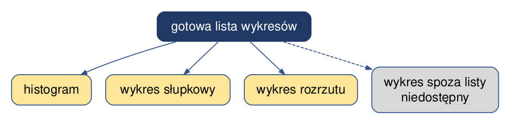
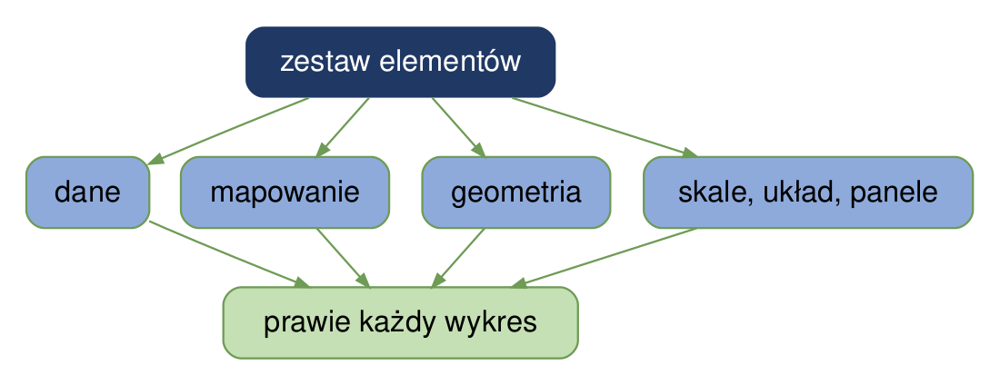
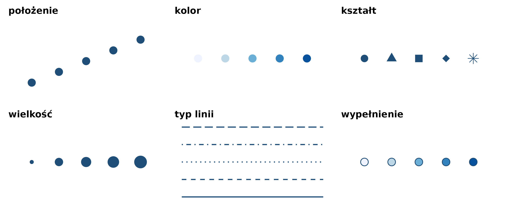
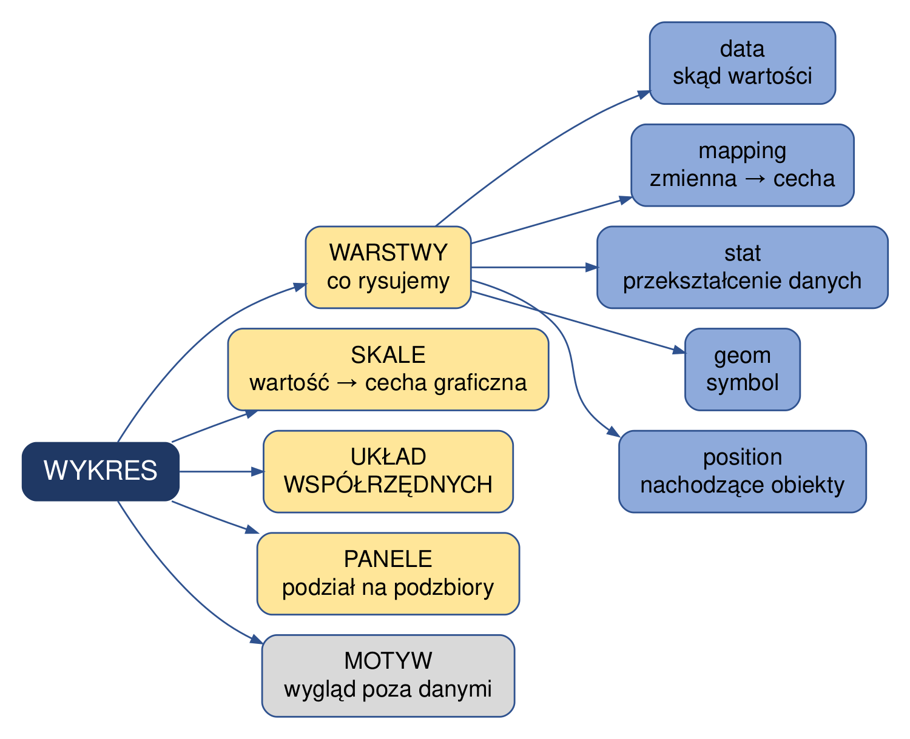
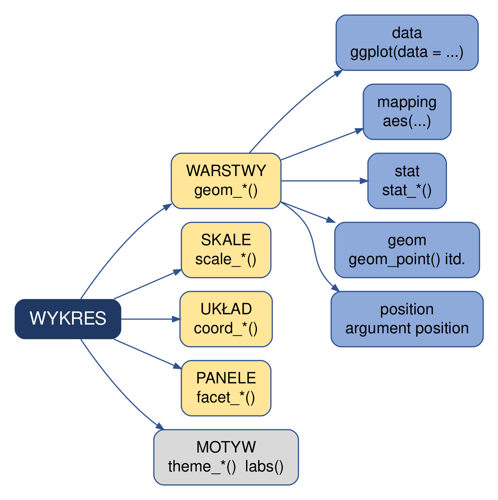
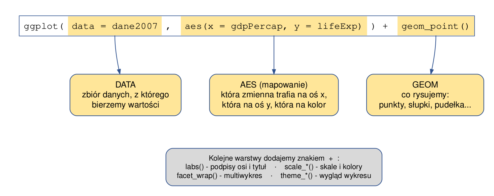

# Gramatyka grafiki {#sec-gramatyka}

**Gramatyka grafiki** (ang. *grammar of graphics*) to podejście do budowy wykresów, które
opisuje wykres jako złożenie niezależnych elementów: danych, odwzorowania danych na cechy
graficzne, warstw, skal, układu współrzędnych i paneli. Składa się ona z zestawu zasad
wykorzystywanych przy projektowaniu grafiki i pozwala konstruować wizualizacje w sposób
ustrukturyzowany i spójny. Podejście to przedstawił Wilkinson (1999) w książce *The Grammar of Graphics*.

Rozdział wyjaśnia gramatykę grafiki, a następnie pokazuje, jak realizuje ją pakiet `ggplot2`.
Budowę wykresu krok po kroku przedstawia @sec-ggplot2.

```{r}
#| code-summary: "Kod: wczytanie pakietów i danych"
#| message: false
library(tidyverse)
dane <- read.csv("dane/gapminder_regions.csv", encoding = "UTF-8") |>
  mutate(across(where(is.character), as.factor))
dane2007 <- dane |>
  filter(year == 2007)
```

## Katalog wykresów a gramatyka grafiki {#sec-gr-idea}

Wykres można wybierać z gotowej listy typów — liczba możliwych wykresów jest wtedy
ograniczona długością listy (@fig-gr-katalog).

{#fig-gr-katalog width=60%}

Gramatyka grafiki rozkłada wykres na niezależne elementy. Każdy element dobiera się
osobno, a wykres powstaje z ich złożenia — liczba możliwych wykresów jest ograniczona
tylko liczbą kombinacji elementów (@fig-gr-idea).

{#fig-gr-idea width=65%}

## Wizualizacja jako przekształcenie danych {#sec-gr-przeksztalcenie}

Wizualizacja danych polega na systematycznym przekształceniu wartości danych na elementy
graficzne. Elementy graficzne opisuje się mierzalnymi cechami, takimi jak położenie,
kształt, wielkość i kolor. Cechy te nazywa się **estetykami** (ang. *aesthetics*)
(@fig-gr-estetyki).

{#fig-gr-estetyki}

**Mapowanie** przypisuje zmienną do estetyki: wartość zmiennej decyduje o wyglądzie
elementu graficznego, np. o jego położeniu na osi albo kolorze. Każdy obiekt geometryczny
przyjmuje tylko wybrane estetyki — punkt ma kształt, a linia go nie ma.

**Skala** określa, które wartości danych odpowiadają konkretnym wartościom estetyki:
która wartość znajduje się w danym miejscu osi, która kategoria ma dany kolor albo
kształt. Typ skali zależy od typu zmiennej (@tbl-gr-typy-skale).

| Typ zmiennej | Przykład | Skala |
|---|---|---|
| ilościowa ciągła | temperatura powietrza (10,3°C, −2,2°C) | ciągła |
| ilościowa dyskretna | liczba dzieci w rodzinie (1, 2, 4) | dyskretna |
| jakościowa nieuporządkowana | typ gleby | dyskretna |
| jakościowa uporządkowana | wykształcenie, klasa gleby | dyskretna |
| data i czas | 1 października 2025, 10:00 | dyskretna albo ciągła |
| tekst | dowolny tekst | dyskretna albo brak skali |

: Typy zmiennych i odpowiadające im skale; na podstawie: Wilke (2019, rozdz. 2, tab. 2.1) {#tbl-gr-typy-skale}

Zmienne jakościowe nazywa się w R **czynnikami** (*factor*), a ich kategorie — **poziomami**
(*levels*). Poziomy mogą być uporządkowane albo nieuporządkowane.

@fig-gr-skala przedstawia skalę na przykładzie czterech wartości: 1, 2, 3 i 4. Każdej wartości
można przypisać położenie na osi, kształt albo kolor. Dobór tych cech zależy od typu zmiennej:
zmiennym ilościowym odpowiadają m.in. wielkość i jasność barwy, a zmiennym jakościowym
m.in. kształt i kolor (@tbl-gr-zmienne-graficzne).

```{r}
#| label: fig-gr-skala
#| fig-cap: "Skala: odwzorowanie czterech wartości na położenie, kształt i kolor; na podstawie: Wilke (2019, rozdz. 2)"
#| fig-height: 2.8
# ta sama wartość w trzech wierszach: położenie (punkt na osi), kształt i kolor
skala <- tibble(wartosc = 1:4)

ggplot(skala, aes(x = wartosc)) +
  geom_point(aes(y = "położenie"), colour = "steelblue", size = 4) +
  geom_point(aes(y = "kształt", shape = factor(wartosc)), size = 5, show.legend = FALSE) +
  geom_tile(aes(y = "kolor", fill = wartosc), width = 0.25, height = 0.6, show.legend = FALSE) +
  scale_shape_manual(values = c(16, 15, 18, 17)) +
  scale_fill_distiller(palette = "YlGnBu", direction = 1) +
  scale_y_discrete(limits = c("kolor", "kształt", "położenie")) +
  labs(x = "Wartość zmiennej", y = NULL) +
  theme_bw(base_size = 13)
```

| Typ danych | Zmienne graficzne |
|---|---|
| ilościowe | wielkość, jasność barwy, ziarnistość (wypełnienie) |
| jakościowe | kształt, orientacja, kolor |

: Zmienne graficzne stosowane do różnicowania cech obiektów; na podstawie: Medyńska-Gulij (2015), za: Bertin (1967) {#tbl-gr-zmienne-graficzne}

@fig-gr-zmienne przedstawia każdą ze zmiennych graficznych z @tbl-gr-zmienne-graficzne na przykładzie czterech znaków.

```{r}
#| label: fig-gr-zmienne
#| fig-cap: "Zmienne graficzne: górny wiersz — dane ilościowe, dolny wiersz — dane jakościowe"
#| fig-width: 9
#| fig-height: 3.6
# sześć paneli w ustalonej kolejności, po cztery znaki w każdym
panele <- c("ilościowe: wielkość", "ilościowe: jasność barwy", "ilościowe: ziarnistość",
            "jakościowe: kształt", "jakościowe: orientacja", "jakościowe: kolor")
znaki <- function(panel) tibble(x = 1:4, y = 0, panel = factor(panel, levels = panele))

# ziarnistość: ten sam udział koloru w kwadracie, coraz drobniejszy wzór punktów
ziarno <- map_dfr(1:4, function(k) {
  odstep <- 0.42 / k
  expand_grid(x = k + seq(-0.36, 0.36, by = odstep),
              y = seq(-0.36, 0.36, by = odstep)) |>
    mutate(wielkosc = 4.2 / k, panel = factor(panele[3], levels = panele))
})

# orientacja: odcinki tej samej długości pod różnymi kątami
katy <- c(0, 45, 90, 135) * pi / 180

ggplot() +
  geom_point(data = mutate(znaki(panele[1]), wielkosc = c(2, 4, 7, 10)),
             aes(x, y, size = wielkosc), colour = "#1f4e79") +
  geom_point(data = mutate(znaki(panele[2]), barwa = c("#deebf7", "#9ecae1", "#4292c6", "#084594")),
             aes(x, y, fill = barwa), shape = 21, size = 8, colour = "grey50") +
  geom_point(data = ziarno, aes(x, y, size = wielkosc), colour = "#1f4e79") +
  geom_point(data = mutate(znaki(panele[4]), znak = c(16, 15, 17, 18)),
             aes(x, y, shape = znak), size = 7, colour = "#1f4e79") +
  geom_segment(data = mutate(znaki(panele[5]),
                             x0 = x - 0.32 * cos(katy), y0 = -0.32 * sin(katy),
                             x1 = x + 0.32 * cos(katy), y1 = 0.32 * sin(katy)),
               aes(x = x0, y = y0, xend = x1, yend = y1), linewidth = 2.5, colour = "#1f4e79") +
  geom_point(data = mutate(znaki(panele[6]), barwa = c("#E69F00", "#56B4E9", "#009E73", "#CC79A7")),
             aes(x, y, fill = barwa), shape = 21, size = 8, colour = "grey50") +
  scale_size_identity() +
  scale_fill_identity() +
  scale_shape_identity() +
  coord_equal(xlim = c(0.4, 4.6), ylim = c(-0.5, 0.5)) +
  facet_wrap(~ panel, ncol = 3, drop = FALSE) +
  theme_void(base_size = 12) +
  theme(strip.text = element_text(margin = margin(b = 4)))
```

## Gramatyka grafiki w ggplot2 {#sec-gr-ggplot2}

Pakiet `ggplot2`, opracowany przez Hadleya Wickhama, jest implementacją gramatyki
grafiki w R. Podstawowym elementem każdego wykresu są **dane**. Dla każdego wykresu określa się
także sposób przekształcenia danych na elementy graficzne: warstwy, skale, układ współrzędnych
i panele. Wygląd elementów, które nie przedstawiają danych, określa motyw.

### Elementy gramatyki {#sec-gr-elementy}

{#fig-gr-elementy width=70%}

- **Warstwa** (ang. *layer*) jest podstawową jednostką wykresu. Wykres może mieć wiele
  warstw, a każda składa się z pięciu części:
  - **dane** (*data*) — tabela, z której pochodzą wartości;
  - **mapowanie** (*mapping*) — przypisanie zmiennych do estetyk;
  - **przekształcenie statystyczne** (*stat*) — obliczenie, które wykonuje się na danych
    przed narysowaniem, np. zliczenie obserwacji;
  - **obiekt geometryczny** (*geom*) — symbol, którym przedstawiane są dane: punkt, linia,
    słupek;
  - **położenie** (*position*) — sposób rozmieszczenia obiektów, które na siebie nachodzą,
    np. słupki obok siebie albo jeden na drugim.
- **Skale**, **układ współrzędnych** i **panele** działają na cały wykres jednocześnie,
  a nie na pojedynczą warstwę — dzięki temu wartości są odwzorowywane jednakowo we
  wszystkich warstwach:
  - **skale** odwzorowują wartości danych na estetyki: zakresy osi, kolory, wielkości;
    na ich podstawie powstają legendy i opisy osi;
  - **układ współrzędnych** rozmieszcza obiekty na płaszczyźnie wykresu; najczęściej jest
    to układ kartezjański; zamiana osi albo układ biegunowy to inny układ współrzędnych,
    a nie inny typ wykresu;
  - **panele** (*facets*) dzielą wykres na części przedstawiające podzbiory danych.
- **Motyw** (*theme*) jako jedyny element nie dotyczy danych — określa wygląd elementów,
  które ich nie przedstawiają: tła, siatki, czcionek, położenia legendy.

#### Przekształcenie statystyczne: przykład

Wykres słupkowy liczby krajów na kontynentach (@fig-gr-stat) powstaje z tabeli, w której
każdy wiersz to jeden kraj. Wysokości słupków nie ma w danych — wyznaczyło ją
przekształcenie statystyczne, które przed narysowaniem zliczyło obserwacje w każdej
kategorii.

```{r}
#| label: fig-gr-stat
#| fig-cap: "Liczba krajów na kontynentach w 2007 roku: wysokość słupka wyznacza przekształcenie statystyczne (zliczenie)"
#| fig-height: 4
# geom_bar() zlicza obserwacje w każdej kategorii zmiennej kontynent
ggplot(dane2007, aes(x = kontynent)) +
  geom_bar() +
  labs(x = NULL, y = "Liczba krajów") +
  theme_bw(base_size = 13)
```

`geom_bar()` zawiera przekształcenie zliczające obserwacje. `geom_col()` (@sec-pak-ggplot2)
rysuje słupki o wysokości podanej w danych, bez przekształcenia.

### Funkcje ggplot2 {#sec-gr-funkcje}

Każdemu elementowi gramatyki odpowiada w nim rodzina funkcji, rozpoznawalna
po przedrostku (@fig-gr-ggplot2). Elementy łączy się znakiem `+`. Dane i mapowanie podaje
się w funkcji `ggplot()` — są wtedy wspólne dla wszystkich warstw; każda warstwa może
jednak korzystać z własnych danych i własnego mapowania.

{#fig-gr-ggplot2 width=70%}

| Element gramatyki | Funkcja albo argument w ggplot2 | Przykład w skrypcie |
|---|---|---|
| dane | `ggplot(data = …)` albo `data =` w warstwie | @sec-gg-kroki |
| mapowanie | `aes(x = , y = , colour = , fill = , size = , shape = )` | @sec-gg-kroki |
| przekształcenie statystyczne | `stat_...()`, np. `stat_summary()`; przekształcenie wbudowane w `geom_bar()`, `geom_histogram()`, `geom_boxplot()` | @sec-zmiany |
| obiekt geometryczny | `geom_...()` | @sec-pak-ggplot2 |
| położenie | argument `position`, np. `geom_col(position = "dodge")` | @fig-za-dni-zgrupowany |
| skale | `scale_...()` | @sec-gg-kroki |
| układ współrzędnych | `coord_...()`, np. `coord_flip()`, `coord_polar()`, `coord_sf()` | @sec-wiz-kolowy |
| panele | `facet_wrap()`, `facet_grid()` | @sec-gg-modyfikacje |
| motyw | `theme_...()`, `theme()`; podpisy: `labs()` | @sec-gg-kroki |

Wywołanie `ggplot()` łączy dane, mapowanie i obiekt geometryczny; kolejne elementy
dodaje się znakiem `+` (@fig-gr-anatomia).

{#fig-gr-anatomia}

Poniższy kod łączy dane, mapowanie, obiekt geometryczny, skalę, podpisy i motyw w jeden wykres
(@fig-gr-przyklad).

```{r}
#| label: fig-gr-przyklad
#| fig-cap: "Przykładowy wykres ggplot2; poszczególne składowe są opisane krok po kroku w @sec-gg-kroki"
#| code-fold: false
#| fig-height: 4.5
ggplot(data = dane2007, aes(x = gdpPercap, y = lifeExp,   # dane i mapowanie
                            colour = kontynent)) +
  geom_point() +                                          # obiekt geometryczny
  scale_x_log10() +                                       # skala osi x
  labs(x = "PKB per capita [USD]",                        # podpisy osi i legendy
       y = "Oczekiwana długość życia [lata]",
       colour = "Kontynent") +
  theme_bw(base_size = 13)                                # motyw
```

## Źródła {#sec-gr-zrodla}

- Dokumentacja pakietu `ggplot2`: <https://ggplot2.tidyverse.org/>.
- Medyńska-Gulij B., 2015. *Kartografia. Zasady i zastosowania geowizualizacji*. Wydawnictwo
  Naukowe PWN, Warszawa.
- Wickham H., Navarro D., Pedersen T.L. *ggplot2: Elegant Graphics for Data Analysis*,
  wydanie 3 w przygotowaniu (wersja internetowa), rozdział „Mastering the grammar”:
  <https://ggplot2-book.org/mastery>.
- Wilke C.O., 2019. *Fundamentals of Data Visualization*, rozdział 2:
  <https://clauswilke.com/dataviz/aesthetic-mapping.html>.
- Wilkinson L., 1999. *The Grammar of Graphics*. Springer (wydanie drugie: 2005).
