# Typy wykresów {#sec-typy}

Gramatyka grafiki opisuje wykres jako złożenie niezależnych elementów (@sec-gramatyka).
Najczęściej stosowane złożenia mają własne nazwy: histogram, wykres pudełkowy, wykres
rozrzutu. Rozdział porządkuje te nazwy według klasyfikacji wykresów i dla każdej kategorii
wymienia należące do niej typy wykresów wraz z objaśnieniem. Kod wykresów stosowanych
w skrypcie zawiera @sec-katalog.

## Klasyfikacja wykresów {#sec-ty-klasyfikacja}

Wilke (2019) w rozdziale „Directory of visualizations” dzieli wykresy na sześć kategorii według tego, co wykres przedstawia. Jest to jedna
z możliwych klasyfikacji: Holtz i Healy (2018) w *From Data to Viz* porządkują wykresy według rodzaju danych
(@sec-ty-datatoviz), a @sec-db-mapowanie zestawia je według cechy graficznej, która
przedstawia wartość. Dalsza część rozdziału stosuje klasyfikację Wilkego (2019).

| Kategoria | Co przedstawia wykres | Przykład pytania | Przykłady wykresów |
|---|---|---|
| **ilości** (*amounts*) | wartości liczbowe przypisane do kategorii | Jaki PKB per capita miały wybrane kraje w 2007 roku? | słupkowy, kropkowy, heatmapa |
| **rozkłady** (*distributions*) | częstość występowania wartości zmiennej ilościowej | Jak rozkładała się oczekiwana długość życia krajów świata? | histogram, wykres gęstości, pudełkowy |
| **proporcje** (*proportions*) | podział całości na części | Jaki był udział grup dochodowych wśród krajów kontynentu? | kołowy, słupkowy skumulowany, treemap |
| **relacje** (*x–y relationships*) | związek jednej zmiennej ilościowej z drugą, w tym zmianę wartości w czasie | Czy oczekiwana długość życia zależy od PKB per capita? | rozrzutu, bąbelkowy, liniowy, korelogram |
| **dane przestrzenne** (*geospatial data*) | wartości zmiennej w ich położeniu geograficznym | Jak rozmieszczone są kraje o najniższej oczekiwanej długości życia? | mapa, kartogram |
| **niepewność** (*uncertainty*) | zakres prawdopodobnych wartości oszacowania albo pomiaru | W jakim zakresie mieści się wartość współczynnika korelacji w populacji? | słupki błędu |

Każda z kolejnych sekcji zawiera piktogramy typów wykresów i tabelę z objaśnieniami.
Piktogramy są schematyczne: przedstawiają dane symulowane, a mapy — wartości symulowane
dla województw. Tabela podaje w nawiasie przy polskiej nazwie wykresu nazwę
angielską z katalogu Wilkego (2019), według której można szukać przykładów w źródłach. Objaśnienie kończy się nazwą funkcji `ggplot2` potrzebnej do
wykonania wykresu; funkcja z innego pakietu jest zapisana z jego nazwą (`pakiet::funkcja()`).
Kolumna „Przykłady i kod” zawiera odnośnik do
*The R Graph Gallery* (@sec-zr-dobor) i odesłanie do sekcji załącznika z kodem; podany jest
ten z nich, który istnieje, a myślnik oznacza brak obu.

## Klasyfikacja From Data to Viz {#sec-ty-datatoviz}

*From Data to Viz* (Holtz i Healy, 2018) jest klasyfikacją typów wykresów według formatu danych
wejściowych. Ma postać drzewa decyzyjnego, które prowadzi od rodzaju danych do wykresów
odpowiednich dla tych danych (@fig-ty-datatoviz). Wersja interaktywna znajduje się na stronie
<https://www.data-to-viz.com/#explore>. Pierwszy poziom drzewa obejmuje sześć rodzajów danych:

| Rodzaj danych | Znaczenie |
|---|---|
| *Numeric* | zmienne liczbowe |
| *Categoric* | zmienne jakościowe |
| *Num & Cat* | zmienne liczbowe i jakościowe |
| *Maps* | dane przestrzenne |
| *Time series* | szeregi czasowe |
| *Network* | dane o powiązaniach między obiektami |

Dalsze rozgałęzienia zależą od struktury danych. Dla danych liczbowych są to m.in. liczba zmiennych,
uporządkowanie obserwacji i liczba punktów. Strona zestawia też wykresy według ich zastosowania:
rozkład (*Distribution*), korelacja (*Correlation*), ranking (*Ranking*), część całości
(*Part of a whole*), zmiana w czasie (*Evolution*), mapa (*Map*) i przepływ (*Flow*).

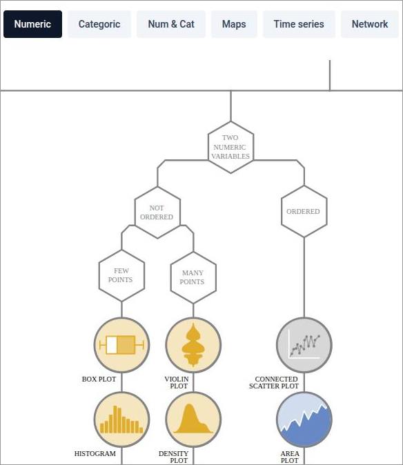{#fig-ty-datatoviz}

## Ilości {#sec-ty-ilosci}

Wykresy ilości przedstawiają wartości liczbowe przypisane do kategorii. Podstawowe wykresy
(@fig-ty-ilosci) wykorzystują jedną zmienną jakościową i jedną zmienną ilościową. Jeśli
kategorie określają dwie zmienne jakościowe, słupki grupuje się albo układa jeden na drugim,
a kategorie można też przypisać do osi x i y i przedstawić wartość barwą
(@fig-ty-ilosci-wiele).

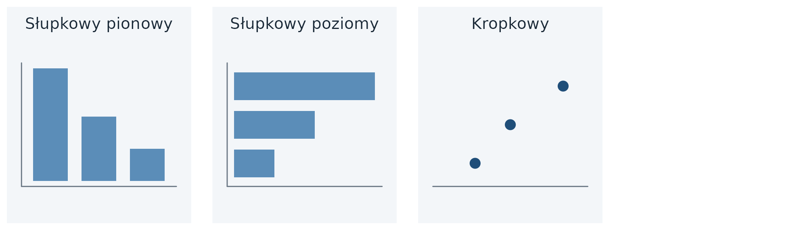{#fig-ty-ilosci}

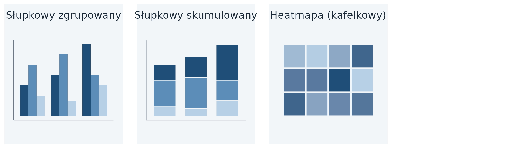{#fig-ty-ilosci-wiele}

| Wykres | Objaśnienie | Przykłady i kod |
|---|---|---|
| **słupkowy** (Bars) | wysokość albo długość słupka odpowiada wartości kategorii; słupki mogą być pionowe albo poziome; oś wartości zaczyna się od 0 (@sec-wiz-zero); słupki porządkuje się według wartości, chyba że kategorie mają ustalony porządek, np. lata. Funkcja: `geom_col()` | [galeria](https://r-graph-gallery.com/barplot.html){target="_blank"}; @sec-ap-slupkowy |
| **kropkowy** (Dots) | punkt znajduje się w miejscu, w którym kończyłby się słupek; oś wartości nie musi zaczynać się od 0; różnice między kategoriami są lepiej widoczne niż na wykresie słupkowym; kategorie porządkuje się według wartości. Funkcja: `geom_point()` | [galeria](https://r-graph-gallery.com/lollipop-plot.html){target="_blank"} (wykres lizakowy); @sec-ap-kropkowy |
| **słupkowy zgrupowany** (Grouped Bars) | na każdej pozycji osi znajduje się grupa słupków, a w grupie — słupki kategorii drugiej zmiennej; alternatywą jest wykres wielopanelowy. Funkcja: `geom_col(position = "dodge")` | [galeria](https://r-graph-gallery.com/stacked-barplot.html){target="_blank"}; @sec-ap-zgrupowany |
| **słupkowy skumulowany** (Stacked Bars) | słupki kategorii drugiej zmiennej są ustawione jeden na drugim; wysokość całego słupka jest sumą, stosuje się go, gdy suma ma znaczenie. Funkcja: `geom_col(position = "stack")` | [galeria](https://r-graph-gallery.com/stacked-barplot.html){target="_blank"}; @sec-ap-skumulowany |
| **heatmapa (kafelkowy)** (Heatmap) | kategorie znajdują się na osiach x i y, np. lata i państwa, a barwa kafelka przedstawia wartość; wykres nazywa się także mapą cieplną. Funkcja: `geom_tile()` | [galeria](https://r-graph-gallery.com/heatmap.html){target="_blank"}; @sec-ap-heatmapa |

: {tbl-colwidths="[24,54,22]"}

## Rozkłady {#sec-ty-rozklady}

Wykresy rozkładu przedstawiają, jak często występują wartości zmiennej ilościowej. Jeden
rozkład (@fig-ty-rozklady) przedstawia się zwykle histogramem albo wykresem gęstości. Oba
wymagają arbitralnego wyboru parametru: szerokości przedziału albo stopnia wygładzenia.
Dystrybuanta empiryczna i wykres kwantyl-kwantyl przedstawiają dane bez takiego wyboru, ale
trudniej je odczytać. Do porównania rozkładów w wielu grupach służą wykresy z @fig-ty-rozklady-wiele.

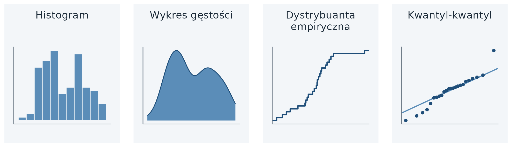{#fig-ty-rozklady}

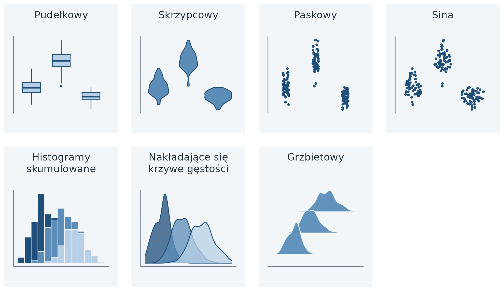{#fig-ty-rozklady-wiele}

| Wykres | Objaśnienie | Przykłady i kod |
|---|---|---|
| **histogram** (Histogram) | zakres zmiennej dzieli się na rozłączne przedziały o równej szerokości; wysokość słupka to liczba obserwacji w przedziale; obraz rozkładu zależy od szerokości przedziału (@sec-ws-histogram). Funkcja: `geom_histogram()` | [galeria](https://r-graph-gallery.com/histogram.html){target="_blank"}; @sec-ap-histogram |
| **wykres gęstości** (Density Plot) | rozkład w postaci ciągłej krzywej; może sugerować występowanie wartości tam, gdzie danych nie ma, szczególnie w ogonach rozkładu; przy kilku rozkładach jednocześnie jest lepszym wyborem niż histogram. Funkcja: `geom_density()` | [galeria](https://r-graph-gallery.com/density-plot.html){target="_blank"}; @sec-ap-gestosc |
| **dystrybuanta empiryczna** (Cumulative Density) | dla każdej wartości osi x podaje część obserwacji o wartości mniejszej bądź równej tej wartości; rośnie skokowo od 0 do 1. Funkcja: `stat_ecdf()` | @sec-ap-ecdf |
| **kwantyl-kwantyl** (Quantile-Quantile Plot) | porównuje dwa rozkłady przez wykreślenie ich kwantyli na osiach x i y; punkty rozkładów podobnych układają się wzdłuż linii y = x. Funkcja: `geom_qq()` | — |
| **pudełkowy** (Boxplots) | mediana, kwartyle, wąsy i wartości odstające (@sec-ws-pudelkowy). Funkcja: `geom_boxplot()` | [galeria](https://r-graph-gallery.com/boxplot.html){target="_blank"}; @sec-ap-pudelkowy |
| **skrzypcowy** (Violins) | wykres gęstości obrócony o 90° i odbity lustrzanie; szerokość odpowiada gęstości; pokazuje rozkłady z kilkoma skupieniami, niewidoczne na wykresie pudełkowym. Funkcja: `geom_violin()` | [galeria](https://r-graph-gallery.com/violin.html){target="_blank"}; @sec-ap-skrzypcowy |
| **paskowy** (Strip Charts) | każda obserwacja jest punktem na osi wartości; przy dużej liczbie punktów rozsuwa się je losowo w poprzek osi. Funkcja: `geom_jitter()` | [galeria](https://r-graph-gallery.com/89-box-and-scatter-plot-with-ggplot2.html){target="_blank"} (z wykresem pudełkowym) |
| **sina** (Sina Plots) | punkty rozsunięte w poprzek osi proporcjonalnie do ich gęstości; łączy cechy wykresu skrzypcowego i paskowego. Funkcja: `ggforce::geom_sina()` | — |
| **histogramy skumulowane** (Stacked Histograms) | histogramy grup ustawione jeden na drugim; bywają mylone z histogramami nakładającymi się, a wysokości słupków górnej grupy trudno porównać. Funkcja: `geom_histogram()` | [galeria](https://r-graph-gallery.com/histogram_several_group.html){target="_blank"} |
| **nakładające się krzywe gęstości** (Overlapping Densities) | krzywe gęstości kilku grup na wspólnych osiach; służą do szczegółowego porównania niewielkiej liczby rozkładów. Funkcja: `geom_density(alpha = 0.5)` | [galeria](https://r-graph-gallery.com/135-stacked-density-graph.html){target="_blank"}; @sec-ap-gestosc |
| **grzbietowy** (Ridgeline Plot) | krzywe gęstości ustawione jedna nad drugą, ze wspólną osią x; służy do przedstawienia wielu rozkładów albo zmian rozkładu w czasie. Funkcja: `ggridges::geom_density_ridges()` | [galeria](https://r-graph-gallery.com/ridgeline-plot.html){target="_blank"}; @sec-ap-grzbietowy |

: {tbl-colwidths="[24,54,22]"}

### Konstrukcja dystrybuanty empirycznej {#sec-ty-ecdf}

Dystrybuanta empiryczna (ang. *empirical cumulative distribution function*, ECDF) powstaje w trzech
krokach. Przykład wykorzystuje 10 przykładowych wartości oczekiwanej długości życia:
70,1; 60,5; 82,0; 72,8; 80,2; 74,3; 65,2; 76,0; 78,5; 85,1.

1. Wartości porządkuje się rosnąco: 60,5; 65,2; 70,1; 72,8; 74,3; 76,0; 78,5; 80,2; 82,0; 85,1.
2. Dla każdej wartości oblicza się:

$$
\text{ECDF}(x_i) = \frac{\text{liczba wartości} \leq x_i}{\text{liczba wszystkich wartości}}
$$

3. Na osi x nanosi się wartości, a na osi y — wyniki. Dla wartości 72,8 wynik wynosi 4/10 = 0,4:
   40% krajów ma oczekiwaną długość życia mniejszą bądź równą 72,8 roku. Wartości ECDF rosną
   skokowo od 0 do 1.

## Proporcje {#sec-ty-proporcje}

Wykresy proporcji przedstawiają podział całości na części, np. udział grup dochodowych wśród
krajów kontynentu, udział kobiet i mężczyzn w liczbie ludności, odsetek głosów oddanych na partie
polityczne albo udziały rynkowe firm. Wybór wykresu zależy od liczby podziałów: czy przedstawia się jeden podział
(@fig-ty-proporcje), kilka podziałów tej samej całości, np. na kolejnych kontynentach
(@fig-ty-proporcje-wiele), czy podział według kilku zmiennych jakościowych (@fig-ty-proporcje-zagn).

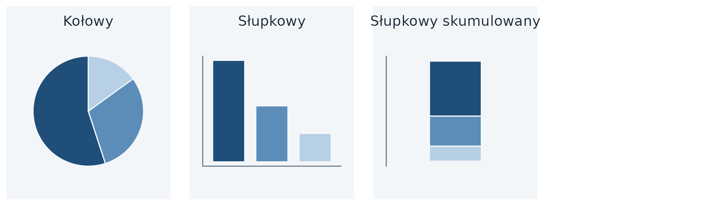{#fig-ty-proporcje}

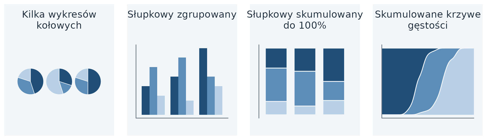{#fig-ty-proporcje-wiele}

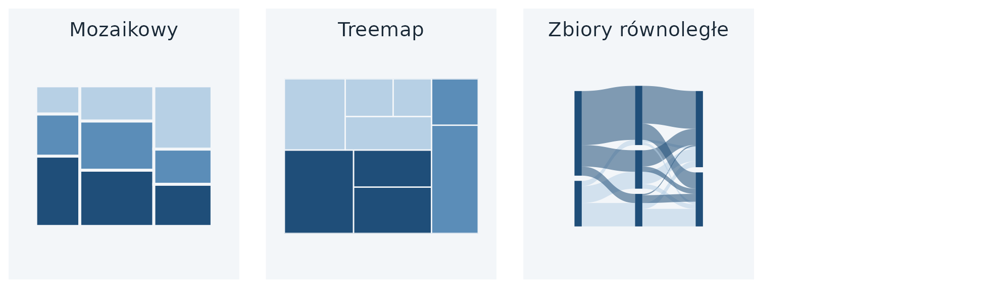{#fig-ty-proporcje-zagn}

| Wykres | Objaśnienie | Przykłady i kod |
|---|---|---|
| **kołowy** (Pie Chart) | kąt wycinka przedstawia udział kategorii; wykres podkreśla, że części składają się na całość (@sec-wiz-kolowy). Funkcja: `geom_col()` + `coord_polar(theta = "y")` | [galeria](https://r-graph-gallery.com/pie-plot.html){target="_blank"}; @sec-ap-kolowy |
| **słupkowy** (Bars) | wysokość słupka przedstawia liczność albo udział kategorii; poszczególne części porównuje się łatwiej niż na wykresie kołowym. Funkcja: `geom_bar()`, gdy słupki mają powstać przez zliczenie obserwacji w tabeli (każdy wiersz to jedna obserwacja); `geom_col()`, gdy tabela zawiera gotowe liczności albo udziały | [galeria](https://r-graph-gallery.com/barplot.html){target="_blank"}; @sec-ap-licznosci |
| **słupkowy skumulowany** (Stacked Bars) | części ustawione jedna na drugiej; przy jednym podziale jest mało czytelny, sprawdza się przy porównaniu wielu podziałów. Funkcja: `geom_col(position = "fill")` | [galeria](https://r-graph-gallery.com/48-grouped-barplot-with-ggplot2.html){target="_blank"}; @sec-ap-fill |
| **kilka wykresów kołowych** (Multiple Pie Charts) | jeden wykres kołowy dla każdego podziału; zajmuje dużo miejsca i utrudnia dostrzeżenie zależności między podziałami. Funkcja: `geom_col()` + `coord_polar(theta = "y")` + `facet_wrap()` | — |
| **słupkowy zgrupowany** (Grouped Bars) | słupki części ustawione obok siebie w każdym podziale; sprawdza się przy umiarkowanej liczbie porównywanych podziałów. Funkcja: `geom_col(position = "dodge")` | [galeria](https://r-graph-gallery.com/48-grouped-barplot-with-ggplot2.html){target="_blank"}; @sec-ap-zgrupowany |
| **skumulowane krzywe gęstości** (Stacked Densities) | udziały kategorii zmieniające się wzdłuż zmiennej ciągłej. Funkcja: `geom_density(position = "fill")` | [galeria](https://r-graph-gallery.com/135-stacked-density-graph.html){target="_blank"} |
| **mozaikowy** (Mosaic Plot) | prostokąty, których wysokość i szerokość przedstawiają udziały w dwóch zmiennych; zakłada, że każdą kategorię jednej zmiennej można połączyć z każdą kategorią drugiej. Funkcja: `ggmosaic::geom_mosaic()` | — |
| **treemap** (Treemap) | prostokąt dzieli się na mniejsze, zagnieżdżone prostokąty, których pole przedstawia udział; podział jednej grupy może być zupełnie inny niż podział drugiej; np. kontynenty dzielone na państwa, pole odpowiada liczbie ludności, a kolor — grupie zamożności. Funkcja: `treemapify::geom_treemap()` | [galeria](https://r-graph-gallery.com/treemap.html){target="_blank"}; @sec-ap-treemap |
| **zbiory równoległe** (Parallel Sets) | podział całego zbioru według każdej zmiennej, a pasma pokazują powiązania podgrup; sprawdza się przy więcej niż dwóch zmiennych. Funkcja: `ggforce::geom_parallel_sets()` | — |

: {tbl-colwidths="[24,54,22]"}

Trzy najczęściej stosowane wykresy proporcji różnią się możliwościami odczytu (@tbl-ty-proporcje).

```{=html}
<style>
.tab-proporcje { border-collapse: collapse; width: 100%; margin-bottom: .5rem; }
.tab-proporcje th, .tab-proporcje td { border: 1px solid #fff; padding: .35rem .6rem; }
.tab-proporcje th { border-bottom: 1px solid #666; font-weight: 600; text-align: center; }
.tab-proporcje th:first-child { text-align: left; }
.tab-proporcje td.tak, .tab-proporcje td.nie { text-align: center; width: 17%; }
.tab-proporcje td.tak { background: #bcd9ee; font-weight: 600; }
.tab-proporcje td.nie { background: #fbe0c8; }
</style>
```

::: {#tbl-ty-proporcje}

```{=html}
<table class="tab-proporcje" data-quarto-disable-processing="true">
<thead><tr><th></th><th>Kołowy</th><th>Słupkowy skumulowany</th><th>Słupkowy zgrupowany</th></tr></thead>
<tbody>
<tr><td>wyraźnie przedstawia dane jako części całości</td><td class="tak">tak</td><td class="tak">tak</td><td class="nie">nie</td></tr>
<tr><td>umożliwia łatwe porównanie względnych proporcji</td><td class="nie">nie</td><td class="nie">nie</td><td class="tak">tak</td></tr>
<tr><td>podkreśla ułamki 1/4, 1/3, 1/2</td><td class="tak">tak</td><td class="nie">nie</td><td class="nie">nie</td></tr>
<tr><td>sprawdza się, gdy całość dzieli się na wiele części</td><td class="nie">nie</td><td class="nie">nie</td><td class="tak">tak</td></tr>
</tbody>
</table>
```

Możliwości odczytu trzech wykresów proporcji

:::

## Relacje {#sec-ty-relacje}

Wykresy relacji przedstawiają związek jednej zmiennej ilościowej z drugą (@fig-ty-relacje)
i uzupełniają analizę korelacji (@sec-korelacja). Przy dużej liczbie obserwacji punkty
nakładają się na siebie — zastępuje się je wtedy obrazem gęstości punktów
(@fig-ty-relacje-gestosc), a przy więcej niż dwóch zmiennych można przedstawić współczynniki
korelacji zamiast samych danych. Jeśli oś x przedstawia czas, stosuje się wykresy liniowe
(@fig-ty-relacje-linie).

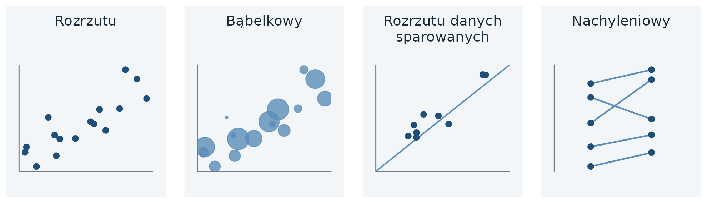{#fig-ty-relacje}

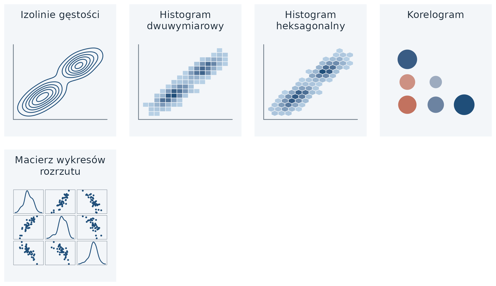{#fig-ty-relacje-gestosc}

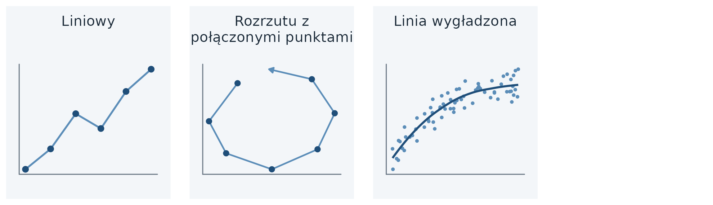{#fig-ty-relacje-linie}

| Wykres | Objaśnienie | Przykłady i kod |
|---|---|---|
| **rozrzutu** (Scatterplot) | jedna obserwacja to jeden punkt, a jego położenie określają wartości dwóch zmiennych ilościowych; trzecią zmienną jakościową przedstawia kolor albo kształt, a ilościową — kolor albo wielkość (@sec-wz-rozrzut). Funkcja: `geom_point()` | [galeria](https://r-graph-gallery.com/scatterplot.html){target="_blank"}; @sec-ap-rozrzut |
| **bąbelkowy** (Bubble Chart) | wykres rozrzutu, w którym wielkość punktu przedstawia trzecią zmienną ilościową. Funkcja: `geom_point(aes(size = ))` | [galeria](https://r-graph-gallery.com/bubble-chart.html){target="_blank"}; @sec-ap-rozrzut |
| **rozrzutu danych sparowanych** (Paired Scatterplot) | obie osie przedstawiają wielkości w tych samych jednostkach, a linia x = y ułatwia porównanie pomiarów tej samej obserwacji. Funkcja: `geom_point()` + `geom_abline()` | — |
| **nachyleniowy** (Slopegraph) | punkty ułożone w dwóch kolumnach; linie łączą pomiary tej samej obserwacji, a ich nachylenie pokazuje wielkość i kierunek zmiany. Funkcja: `geom_line()` + `geom_point()` | — |
| **izolinie gęstości** (Density Contours) | linie łączą miejsca o jednakowej gęstości punktów. Funkcja: `geom_density_2d()` | [galeria](https://r-graph-gallery.com/2d-density-chart.html){target="_blank"} |
| **histogram dwuwymiarowy** (2D Bins) | płaszczyzna podzielona na prostokąty; barwa przedstawia liczbę punktów w prostokącie. Funkcja: `geom_bin_2d()` | [galeria](https://r-graph-gallery.com/2d-density-chart.html){target="_blank"} |
| **histogram heksagonalny** (Hex Bins) | jak histogram dwuwymiarowy, z podziałem płaszczyzny na sześciokąty. Funkcja: `geom_hex()` (wymaga pakietu `hexbin`) | [galeria](https://r-graph-gallery.com/2d-density-chart.html){target="_blank"} |
| **korelogram** (Correlogram) | współczynniki korelacji wszystkich par zmiennych, przedstawione barwą albo wielkością znaku (@sec-wz-korelogram). Funkcja: `GGally::ggcorr()` | [galeria](https://r-graph-gallery.com/correlogram.html){target="_blank"}; @sec-ap-korelogram |
| **macierz wykresów rozrzutu** | wykres rozrzutu dla każdej pary zmiennych (@sec-wz-macierz). Funkcja: `GGally::ggpairs()` | [galeria](https://r-graph-gallery.com/199-correlation-matrix-with-ggally.html){target="_blank"}; @sec-ap-korelogram |
| **liniowy** (Line Graph) | linia łączy kolejne wartości; oś x przedstawia czas albo inną wielkość ściśle rosnącą. Funkcja: `geom_line()` | [galeria](https://r-graph-gallery.com/line-plot.html){target="_blank"}; @sec-ap-liniowy |
| **rozrzutu z połączonymi punktami** (Connected Scatterplot) | wykres rozrzutu dwóch zmiennych, w którym linia łączy punkty sąsiednich momentów czasu. Funkcja: `geom_path()` + `geom_point()` | [galeria](https://r-graph-gallery.com/connected_scatterplot_ggplot2.html){target="_blank"} |
| **linia wygładzona** (Smooth Line Graph) | gładka linia przedstawia trend w większym zbiorze danych. Funkcja: `geom_smooth()` | [galeria](https://r-graph-gallery.com/50-51-52-scatter-plot-with-ggplot2.html){target="_blank"} |

: {tbl-colwidths="[24,54,22]"}

## Dane przestrzenne {#sec-ty-przestrzenne}

Mapa przenosi współrzędne z powierzchni Ziemi na płaszczyznę, tak aby kształty i odległości
na mapie w przybliżeniu odpowiadały rzeczywistym (@fig-ty-przestrzenne). Na mapie można
przedstawić wartości przypisane obszarom albo położeniom. Przygotowanie danych i kod map
zawiera @sec-przestrzenne.

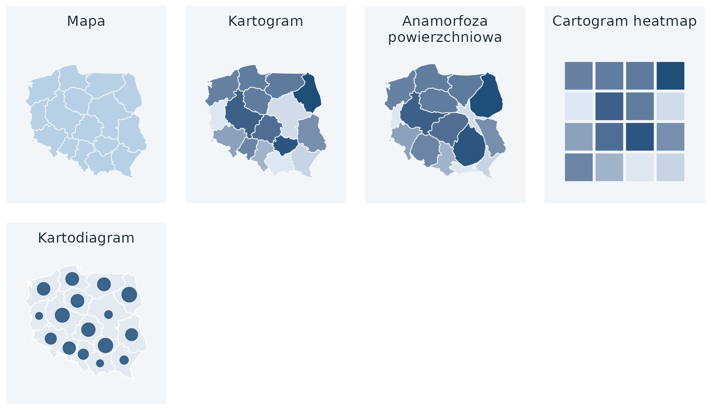{#fig-ty-przestrzenne}

| Wykres | Objaśnienie | Przykłady i kod |
|---|---|---|
| **mapa** (Map) | obszary w ich położeniu geograficznym; barwa obszaru może przedstawiać wartość zmiennej (@sec-2007-mapa). Funkcja: `geom_sf()` | [galeria](https://r-graph-gallery.com/map.html){target="_blank"}; @sec-ap-mapa |
| **kartogram** (Choropleth) | barwa obszaru przedstawia wartość względną odniesioną do pola odniesienia, np. odsetek osób w określonym wieku. Funkcja: `geom_sf(aes(fill = ))` | [galeria](https://r-graph-gallery.com/choropleth-map.html){target="_blank"}; @sec-sf-kartogram |
| **anamorfoza powierzchniowa** (Cartogram) | obszary zniekształcone proporcjonalnie do innej wielkości, np. liczby ludności; nie występuje w skrypcie. Funkcja: `cartogram::cartogram_cont()` + `geom_sf()` | [galeria](https://r-graph-gallery.com/cartogram.html){target="_blank"} |
| **cartogram heatmap** | każdy obszar zastąpiony kwadratem o jednakowej wielkości, a barwa kwadratu przedstawia wartość; nie występuje w skrypcie. Funkcja: `geom_tile()` | [galeria](https://r-graph-gallery.com/hexbin-map.html){target="_blank"} (sześciokąty) |
| **kartodiagram** | znak umieszczony w położeniu obiektu przedstawia wartość zmiennej (wielkość znaku, @sec-sf-kartodiagram) albo strukturę zjawiska (kartodiagram strukturalny, np. wykresy kołowe, @sec-sf-kolowe); typ stosowany w skrypcie, spoza katalogu Wilkego (2019). Funkcja: `geom_sf(aes(size = ))`; strukturalny: `scatterpie::geom_scatterpie()` | [galeria](https://r-graph-gallery.com/bubble-map.html){target="_blank"}; @sec-sf-kartodiagram |

: {tbl-colwidths="[24,54,22]"}

Nazwy angielskie i polskie różnią się znaczeniem: ang. *choropleth* odpowiada polskiemu
**kartogramowi**, a ang. *cartogram* oznacza **anamorfozę**. Jeśli barwa obszaru przedstawia
wartość, która nie jest odniesiona do pola odniesienia, np. oczekiwaną długość życia, w skrypcie
stosuje się nazwę **mapa** (@sec-2007-mapa).

## Niepewność {#sec-ty-niepewnosc}

Wykresy niepewności przedstawiają zakres prawdopodobnych wartości oszacowania albo pomiaru,
np. 95% przedział ufności współczynnika korelacji (@sec-korelacja). Punktem odniesienia jest
oszacowanie, a zakres przedstawiają słupki błędu (@fig-ty-niepewnosc). Skrypt nie wykorzystuje
wykresów niepewności, dlatego załącznik nie zawiera ich kodu.

Podobną formę graficzną mają w skrypcie wykresy opisujące zmienność obserwacji: średnia
± odchylenie standardowe (@fig-ws-sd) i rozstęp w kolejnych latach (@fig-ws-wstega). Zakres
na tych wykresach dotyczy wartości obserwacji w grupie, a na wykresach niepewności —
oszacowania.

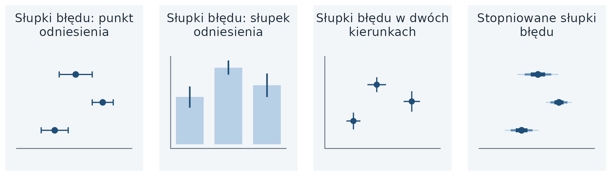{#fig-ty-niepewnosc}

| Wykres | Objaśnienie | Przykłady i kod |
|---|---|---|
| **słupki błędu** (Error Bars) | odcinki odchodzące od punktu odniesienia, którym może być punkt albo słupek; przy dwóch zmiennych biegną w dwóch kierunkach (2D Error Bars). Funkcja: `geom_errorbar()` | [galeria](https://r-graph-gallery.com/4-barplot-with-error-bar.html){target="_blank"} |

: {tbl-colwidths="[24,54,22]"}

## Źródła {#sec-ty-zrodla}

- Holtz Y. *The R Graph Gallery*: <https://r-graph-gallery.com/>.
- Holtz Y., Healy C., 2018. *From Data to Viz*: <https://www.data-to-viz.com/>.
- Wilke C.O., 2019. *Fundamentals of Data Visualization*, rozdział „Directory of visualizations”:
  <https://clauswilke.com/dataviz/directory-of-visualizations.html>.
- Piktogramy: opracowanie własne w `ggplot2`, dane symulowane; granice województw: Natural
  Earth (domena publiczna).
