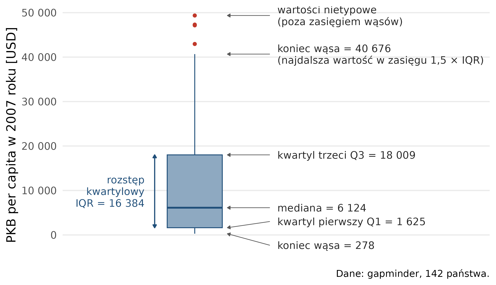



```{webr}
#| setup: true
#| exercise:
#|   - ws_1
#|   - ws_2
#|   - ws_3
#|   - ws_4
library(dplyr)
library(ggplot2)
dane <- read.csv("dane/gapminder_regions.csv", encoding = "UTF-8") |>
  mutate(across(where(is.character), as.factor))
dane2007 <- dane |>
  filter(year == 2007)
```

# Wizualizacja statystyk opisowych {#sec-wiz-statystyki}

Rozdział przedstawia wizualizację statystyk opisowych.
Każdy wykres przedstawia wybraną miarę albo rozkład zmiennej omówione w
@sec-statystyki. Przykłady wykorzystują dane Gapminder (@sec-pd-dane); kod jest zwinięty
nad każdą ryciną.

```{r}
#| code-summary: "Kod: wczytanie pakietów i danych"
#| message: false
library(tidyverse)
library(patchwork)
library(ggridges)
dane <- read.csv("dane/gapminder_regions.csv", encoding = "UTF-8") |>
  mutate(across(where(is.character), as.factor))
dane2007 <- dane |>
  filter(year == 2007)
```

## Rozkład jednej zmiennej: histogram {#sec-ws-histogram}

Histogram powstaje przez podział zakresu zmiennej na rozłączne przedziały o równej
szerokości i zliczenie obserwacji należących do każdego z nich. Wysokość słupka odpowiada
liczbie obserwacji w przedziale (@fig-ws-histogram).

```{r}
#| label: fig-ws-histogram
#| fig-cap: "Histogram oczekiwanej długości życia, 142 kraje, 2007; przedziały o szerokości 5 lat"
#| fig-height: 4
ggplot(dane2007, aes(x = lifeExp)) +
  geom_histogram(binwidth = 5, fill = "#1f4e79", colour = "white") +
  labs(x = "Oczekiwana długość życia [lata]", y = "Liczba krajów") +
  theme_bw(base_size = 13)
```

### Szerokość przedziału zmienia obraz rozkładu

Przy wąskich przedziałach widoczne są pojedyncze skupienia obserwacji, przy szerokich
— ogólny kształt rozkładu (@fig-ws-szerokosc). Szerokość przedziału jest decyzją osoby
wykonującej wykres.

```{r}
#| label: fig-ws-szerokosc
#| fig-cap: "Histogram oczekiwanej długości życia, 2007, przy czterech szerokościach przedziału; skala osi y dobrana osobno dla każdego wykresu"
#| fig-width: 10
#| fig-height: 6
# wspólna część czterech wykresów: dane, mapowanie, podpisy, motyw
baza <- ggplot(dane2007, aes(x = lifeExp)) +
  labs(x = "Oczekiwana długość życia [lata]", y = "Liczba krajów") +
  theme_bw(base_size = 12)

(baza + geom_histogram(binwidth = 1, fill = "#1f4e79", colour = "white") +
   labs(title = "szerokość = 1")) +
  (baza + geom_histogram(binwidth = 2.5, fill = "#1f4e79", colour = "white") +
     labs(title = "szerokość = 2,5")) +
  (baza + geom_histogram(binwidth = 5, fill = "#1f4e79", colour = "white") +
     labs(title = "szerokość = 5")) +
  (baza + geom_histogram(binwidth = 10, fill = "#1f4e79", colour = "white") +
     labs(title = "szerokość = 10"))
```

### Rozkład w podziale na grupy

Histogram powtórzony w panelach dla każdej grupy osobno. Wspólna skala osi pozwala
porównać położenie i rozrzut wartości (@fig-ws-panele).

```{r}
#| label: fig-ws-panele
#| fig-cap: "Histogramy oczekiwanej długości życia w 2007 roku według kontynentu"
#| fig-height: 5
ggplot(dane2007, aes(x = lifeExp)) +
  geom_histogram(binwidth = 5, fill = "#1f4e79", colour = "white") +
  facet_wrap(~ kontynent, nrow = 2) +
  labs(x = "Oczekiwana długość życia [lata]", y = "Liczba krajów") +
  theme_bw(base_size = 13)
```

## Krzywa gęstości i wykres grzbietowy {#sec-ws-gestosc}

**Krzywa gęstości** przedstawia rozkład jako funkcję ciągłą, bez podziału na przedziały
(@fig-ws-gestosc). Pole pod krzywą jest równe 1, dlatego oś y podaje gęstość, a nie
liczbę obserwacji.

```{r}
#| label: fig-ws-gestosc
#| fig-cap: "Histogram i krzywa gęstości oczekiwanej długości życia, 2007"
#| fig-height: 4
ggplot(dane2007, aes(x = lifeExp)) +
  geom_histogram(aes(y = after_stat(density)), binwidth = 5,   # histogram w skali gęstości
                 fill = "#c8d5e0", colour = "white") +
  geom_density(colour = "#c0392b", linewidth = 1.3) +           # krzywa gęstości
  labs(x = "Oczekiwana długość życia [lata]", y = "Gęstość") +
  theme_bw(base_size = 13)
```

`after_stat(density)` w mapowaniu histogramu zamienia liczbę obserwacji na gęstość, aby
histogram i krzywa miały tę samą skalę osi y.

**Wykres grzbietowy** przedstawia krzywe gęstości kilku grup ustawione jedna nad drugą,
ze wspólną osią x (@fig-ws-grzbietowy).

```{r}
#| label: fig-ws-grzbietowy
#| fig-cap: "Wykres grzbietowy oczekiwanej długości życia w 2007 roku według kontynentu"
#| fig-height: 4.5
#| message: false
ggplot(dane2007, aes(x = lifeExp, y = kontynent)) +
  geom_density_ridges(fill = "#8ea9c1", alpha = 0.75, colour = "white") +
  labs(x = "Oczekiwana długość życia [lata]", y = NULL) +
  theme_bw(base_size = 13)
```

## Wykres pudełkowy {#sec-ws-pudelkowy}

Wykres pudełkowy przedstawia medianę, kwartyle i rozstęp kwartylowy, a także wartości
odstające (@fig-ws-budowa).

{#fig-ws-budowa}

### Średnia i mediana na jednym wykresie

Linia w pudełku to mediana, a czerwony punkt — średnia dodana warstwą `stat_summary()`.
Im silniejsza asymetria rozkładu, tym dalej od siebie leżą (@fig-ws-srednia-mediana).

```{r}
#| label: fig-ws-srednia-mediana
#| fig-cap: "PKB per capita w 2007 roku według kontynentu: mediana (linia w pudełku) i średnia (czerwony punkt)"
#| fig-height: 4.5
ggplot(dane2007, aes(x = kontynent, y = gdpPercap)) +
  geom_boxplot(fill = "#8ea9c1") +
  stat_summary(fun = mean, geom = "point", shape = 20, size = 5,   # średnia w grupie
               colour = "#c0392b") +
  labs(x = NULL, y = "PKB per capita [USD]") +
  theme_bw(base_size = 13)
```

### Porównanie rozkładów w grupach

Punkty naniesione na wykres pudełkowy pokazują, ile obserwacji składa się na każde
pudełko (@fig-ws-punkty).

```{r}
#| label: fig-ws-punkty
#| fig-cap: "Oczekiwana długość życia w 2007 roku według kontynentu: wykres pudełkowy z punktami krajów"
#| fig-height: 4.5
ggplot(dane2007, aes(x = kontynent, y = lifeExp)) +
  geom_boxplot(fill = "#8ea9c1", outlier.shape = NA) +             # bez osobnych punktów odstających
  geom_jitter(width = 0.15, alpha = 0.5, colour = "#1f4e79") +      # punkty krajów rozsunięte w poziomie
  labs(x = NULL, y = "Oczekiwana długość życia [lata]") +
  theme_bw(base_size = 13)
```

`geom_jitter()` rozsuwa punkty losowo w poziomie, aby nie nakładały się na siebie.
`outlier.shape = NA` ukrywa punkty wartości odstających rysowane przez `geom_boxplot()` —
wszystkie obserwacje przedstawiają punkty `geom_jitter()`.

### Wykres skrzypcowy

Szerokość „skrzypiec” odpowiada gęstości obserwacji na danym poziomie zmiennej. Wykres
pudełkowy w środku podaje medianę i kwartyle (@fig-ws-skrzypcowy).

```{r}
#| label: fig-ws-skrzypcowy
#| fig-cap: "Wykres skrzypcowy z wykresem pudełkowym: oczekiwana długość życia w 2007 roku według kontynentu"
#| fig-height: 4.5
ggplot(dane2007, aes(x = kontynent, y = lifeExp)) +
  geom_violin(fill = "#8ea9c1", colour = "#1f4e79") +
  geom_boxplot(width = 0.14, fill = "white", outlier.size = 1.5) +
  labs(x = NULL, y = "Oczekiwana długość życia [lata]") +
  theme_bw(base_size = 13)
```

## Wartości obliczone w grupach: stat_summary() {#sec-ws-stat-summary}

Warstwa `stat_summary()` oblicza miarę w każdej grupie i rysuje ją wskazanym obiektem
geometrycznym (argument `geom`).

### Średnia i odchylenie standardowe

Punkt to średnia, a wąsy sięgają jednego odchylenia standardowego w każdą stronę —
graficzne przedstawienie typowego obszaru zmienności (@fig-ws-sd).

```{r}
#| label: fig-ws-sd
#| fig-cap: "Średnia ± odchylenie standardowe oczekiwanej długości życia w 2007 roku według kontynentu"
#| fig-height: 4.5
ggplot(dane2007, aes(x = kontynent, y = lifeExp)) +
  stat_summary(fun = mean, geom = "point", size = 3.5, colour = "#c0392b") +
  stat_summary(fun.min = function(x) mean(x) - sd(x),             # dolny koniec: średnia − s
               fun.max = function(x) mean(x) + sd(x),             # górny koniec: średnia + s
               geom = "errorbar", width = 0.18, colour = "#c0392b") +
  labs(x = NULL, y = "Oczekiwana długość życia [lata]") +
  theme_bw(base_size = 13)
```

`function(x) mean(x) - sd(x)` to funkcja zapisana bezpośrednio w wywołaniu: dla wartości
`x` w grupie oblicza średnią pomniejszoną o odchylenie standardowe.

### Średnia w czasie

```{r}
#| label: fig-ws-czas
#| fig-cap: "Średnia oczekiwana długość życia według kontynentu w latach 1952–2007"
#| fig-height: 4.5
ggplot(dane, aes(x = year, y = lifeExp, colour = kontynent)) +
  stat_summary(fun = mean, geom = "line", linewidth = 1.1) +
  labs(x = "Rok", y = "Średnia oczekiwana długość życia [lata]", colour = "Kontynent") +
  theme_bw(base_size = 13)
```

Linie przedstawiają średnią z wartości dla krajów każdego kontynentu w kolejnych latach
(@fig-ws-czas).

### Zakres wartości: minimum, maksimum, rozstęp

Wstęga obejmuje rozstęp — od kraju o najniższej do kraju o najwyższej wartości w danym
roku; linia to średnia (@fig-ws-wstega).

```{r}
#| label: fig-ws-wstega
#| fig-cap: "Oczekiwana długość życia w latach 1952–2007: rozstęp (wstęga) i średnia (linia), 142 kraje"
#| fig-height: 4.5
ggplot(dane, aes(x = year, y = lifeExp)) +
  stat_summary(fun.min = min, fun.max = max, geom = "ribbon",      # wstęga od minimum do maksimum
               fill = "#8ea9c1", alpha = 0.5) +
  stat_summary(fun = mean, geom = "line", linewidth = 1.2, colour = "#c0392b") +
  labs(x = "Rok", y = "Oczekiwana długość życia [lata]") +
  theme_bw(base_size = 13)
```

## Cecha jakościowa: liczność i udziały {#sec-ws-jakosciowa}

`geom_bar()` zlicza obserwacje w każdej kategorii — wysokość słupka to liczba wierszy
w danych. `geom_col()` rysuje wartość podaną w danych, np. średnią obliczoną wcześniej
funkcją `summarise()` (@fig-ws-slupki). O wyborze warstwy decyduje to, czy wysokość słupka
ma oznaczać liczbę obserwacji, czy obliczoną wartość.

```{r}
#| label: fig-ws-slupki
#| fig-cap: "Liczba krajów (A, geom_bar) i średnia oczekiwana długość życia (B, geom_col) według kontynentu, 2007"
#| fig-width: 10
#| fig-height: 4
p_bar <- ggplot(dane2007, aes(x = kontynent)) +
  geom_bar(fill = "#1f4e79") +
  labs(x = NULL, y = "Liczba krajów") +
  theme_bw(base_size = 12)

p_col <- dane2007 |>
  group_by(kontynent) |>
  summarise(srednia = mean(lifeExp)) |>
  ggplot(aes(x = kontynent, y = srednia)) +
  geom_col(fill = "#1f4e79") +
  labs(x = NULL, y = "Średnia oczekiwana długość życia [lata]") +
  theme_bw(base_size = 12)

p_bar + p_col + plot_annotation(tag_levels = "A")
```

Udziały kategorii jednej cechy wewnątrz kategorii drugiej przedstawia wykres słupkowy
skumulowany do 100%: wszystkie słupki mają tę samą wysokość, a podział słupka pokazuje
udziały (@fig-ws-udzialy).

```{r}
#| label: fig-ws-udzialy
#| fig-cap: "Udział grup dochodowych wśród krajów każdego kontynentu, 2007"
#| fig-height: 4
dane2007 |>
  filter(income_grp_pl != "") |>                                  # bez krajów bez grupy dochodowej
  ggplot(aes(x = kontynent, fill = income_grp_pl)) +
  geom_bar(position = "fill") +                                   # słupki skumulowane do 100%
  scale_y_continuous(labels = scales::label_percent()) +
  scale_fill_brewer(palette = "Blues") +
  labs(x = NULL, y = "Udział krajów", fill = "Grupa dochodowa") +
  theme_bw(base_size = 13)
```

## Podsumowanie: miara i jej obraz {#sec-ws-podsumowanie}

| Miara opisowa | Wykres | Warstwa w ggplot2 |
|---|---|---|
| rozkład wartości | histogram | `geom_histogram()` |
| rozkład jako funkcja ciągła | krzywa gęstości | `geom_density()` |
| rozkłady wielu grup na wspólnej osi | wykres grzbietowy | `ggridges::geom_density_ridges()` |
| rozkład w każdej grupie osobno | histogram w panelach | `geom_histogram()` + `facet_wrap()` |
| mediana, kwartyle, IQR | wykres pudełkowy | `geom_boxplot()` |
| średnia naniesiona na rozkład | pudełkowy z punktem | `geom_boxplot()` + `stat_summary()` |
| porównanie rozkładów w grupach | pudełkowy z punktami obserwacji | `geom_boxplot()` + `geom_jitter()` |
| rozkłady wielu grup obok siebie | wykres skrzypcowy | `geom_violin()` |
| średnia i odchylenie standardowe | punkt z wąsami | `stat_summary()` |
| średnia w kolejnych okresach | wykres liniowy | `stat_summary()` |
| minimum, maksimum, rozstęp | wykres wstęgowy | `stat_summary()` |
| liczność kategorii | wykres słupkowy | `geom_bar()` |
| udziały kategorii w grupach | słupkowy skumulowany do 100% | `geom_bar(position = "fill")` |
| wartości policzone wcześniej | wykres słupkowy | `geom_col()` |

## Zadania do samodzielnego wykonania {#sec-ws-zadania}

Zadania polegają na modyfikacji kodu z rozdziału i wykonuje się je w przeglądarce, bez
instalowania R. Kod w polu można zmienić i uruchomić przyciskiem **Run Code**. Pierwsze
uruchomienie pobiera środowisko R i pakiety, dlatego trwa dłużej i wymaga połączenia z internetem;
jeżeli po kliknięciu wynik się nie pojawia, należy odczekać i kliknąć przycisk ponownie.
Rozwiązanie wyświetla przycisk **Show Solution**.

**Zadanie 1. Histogram innej zmiennej.** Wykonaj histogram PKB per capita (`gdpPercap`) zamiast oczekiwanej długości życia. Ustaw szerokość przedziału na 5000 USD i popraw opis osi x.

```{webr}
#| exercise: ws_1
ggplot(dane2007, aes(x = lifeExp)) +
  geom_histogram(binwidth = 5, fill = "#1f4e79", colour = "white") +
  labs(x = "Oczekiwana długość życia [lata]", y = "Liczba krajów") +
  theme_bw(base_size = 13)
```

:::: {.solution exercise="ws_1"}
::: {.callout-tip title="Rozwiązanie" collapse="false"}
```r
ggplot(dane2007, aes(x = gdpPercap)) +
  geom_histogram(binwidth = 5000, fill = "#1f4e79", colour = "white") +
  labs(x = "PKB per capita [USD]", y = "Liczba krajów") +
  theme_bw(base_size = 13)
```
:::
::::

**Zadanie 2. Inne grupowanie.** Porównaj rozkłady oczekiwanej długości życia w grupach dochodowych (`income_grp_pl`) zamiast na kontynentach. Kraje bez przypisanej grupy pomiń, zastępując `dane2007` zapisem `filter(dane2007, income_grp_pl != "")`.

```{webr}
#| exercise: ws_2
ggplot(dane2007, aes(x = kontynent, y = lifeExp)) +
  geom_violin(fill = "#8ea9c1", colour = "#1f4e79") +
  geom_boxplot(width = 0.14, fill = "white", outlier.size = 1.5) +
  labs(x = NULL, y = "Oczekiwana długość życia [lata]") +
  theme_bw(base_size = 13)
```

:::: {.solution exercise="ws_2"}
::: {.callout-tip title="Rozwiązanie" collapse="false"}
```r
ggplot(filter(dane2007, income_grp_pl != ""), aes(x = income_grp_pl, y = lifeExp)) +
  geom_violin(fill = "#8ea9c1", colour = "#1f4e79") +
  geom_boxplot(width = 0.14, fill = "white", outlier.size = 1.5) +
  labs(x = NULL, y = "Oczekiwana długość życia [lata]") +
  theme_bw(base_size = 13)
```
:::
::::

**Zadanie 3. Inna statystyka w czasie.** Przedstaw **medianę** zamiast średniej: zmień funkcję w argumencie `fun` i opis osi y. Porównaj przebieg linii dla Afryki z wykresem średniej.

```{webr}
#| exercise: ws_3
ggplot(dane, aes(x = year, y = lifeExp, colour = kontynent)) +
  stat_summary(fun = mean, geom = "line", linewidth = 1.1) +
  labs(x = "Rok", y = "Średnia oczekiwana długość życia [lata]", colour = "Kontynent") +
  theme_bw(base_size = 13)
```

:::: {.solution exercise="ws_3"}
::: {.callout-tip title="Rozwiązanie" collapse="false"}
```r
ggplot(dane, aes(x = year, y = lifeExp, colour = kontynent)) +
  stat_summary(fun = median, geom = "line", linewidth = 1.1) +
  labs(x = "Rok", y = "Mediana oczekiwanej długości życia [lata]", colour = "Kontynent") +
  theme_bw(base_size = 13)
```
:::
::::

**Zadanie 4. Liczność zamiast udziału.** Zastąp słupki skumulowane do 100% słupkami zgrupowanymi: ustaw `position = "dodge"`, usuń warstwę `scale_y_continuous()` i popraw opis osi y.

```{webr}
#| exercise: ws_4
dane2007 |>
  filter(income_grp_pl != "") |>
  ggplot(aes(x = kontynent, fill = income_grp_pl)) +
  geom_bar(position = "fill") +
  scale_y_continuous(labels = scales::label_percent()) +
  scale_fill_brewer(palette = "Blues") +
  labs(x = NULL, y = "Udział krajów", fill = "Grupa dochodowa") +
  theme_bw(base_size = 13)
```

:::: {.solution exercise="ws_4"}
::: {.callout-tip title="Rozwiązanie" collapse="false"}
```r
dane2007 |>
  filter(income_grp_pl != "") |>
  ggplot(aes(x = kontynent, fill = income_grp_pl)) +
  geom_bar(position = "dodge") +
  scale_fill_brewer(palette = "Blues") +
  labs(x = NULL, y = "Liczba krajów", fill = "Grupa dochodowa") +
  theme_bw(base_size = 13)
```
:::
::::
