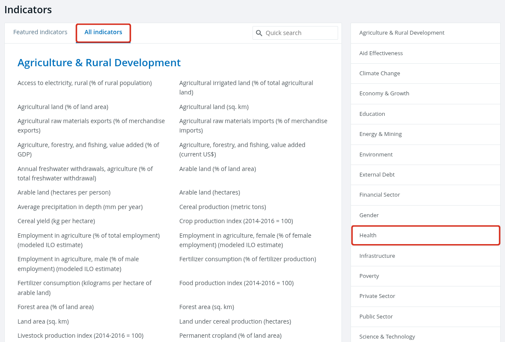
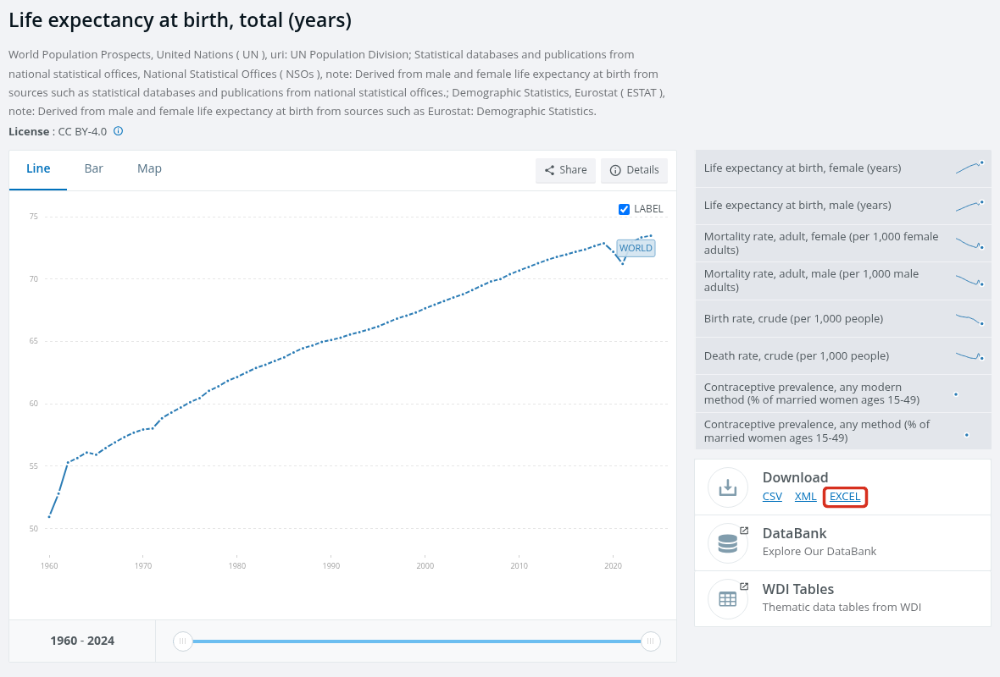
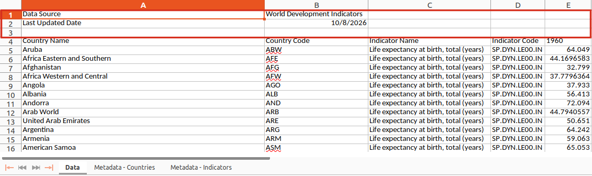

# Praca z danymi Banku Światowego {#sec-bank-swiatowy}

Załącznik przedstawia cały potok przygotowania danych z serwisu Banku Światowego: od pobrania pliku
Excel, przez wczytanie i połączenie arkuszy, po zapis tabeli do pliku CSV i warstwy z granicami państw
do pliku GeoPackage. Przykład dotyczy oczekiwanej długości życia. Pełny kod na końcu załącznika (@sec-bs-pelny-kod)
pozwala przygotować w ten sam sposób plik innego wskaźnika o takim samym układzie arkuszy.

## Wskaźniki Banku Światowego {#sec-bs-wskazniki}

Bank Światowy udostępnia dane na stronie <https://data.worldbank.org/indicator>. **Wskaźnik**
(ang. *indicator*) to pojedyncza miara podawana dla państw i grup państw w kolejnych latach, np.
oczekiwana długość życia albo lesistość. Każdy wskaźnik ma:

- nazwę z jednostką w nawiasie, np. *Life expectancy at birth, total (years)*;
- kod, np. `SP.DYN.LE00.IN`, który jest także częścią adresu strony wskaźnika i nazwy pobranego pliku;
- opis: definicję i źródło danych.

Zakładka **All indicators** porządkuje wskaźniki w 20 grup tematycznych, np. *Health*,
*Environment* i *Education* (@fig-bs-wskazniki).

{#fig-bs-wskazniki}

Przykład wykorzystuje wskaźnik *Life expectancy at birth, total (years)*, czyli oczekiwaną
długość życia w chwili urodzenia, podaną w latach, łącznie dla kobiet i mężczyzn. Według opisu
wskaźnika w pobranym pliku jest to liczba lat, jaką przeżyłby noworodek, gdyby wzorce umieralności
z chwili jego urodzenia pozostały niezmienione przez całe jego życie.

## Pobranie danych w formacie Excel {#sec-bs-pobranie}

1. Otwórz stronę <https://data.worldbank.org/indicator> i wybierz zakładkę **All indicators**.
2. W grupie **Health** kliknij nazwę wskaźnika *Life expectancy at birth, total (years)*. Strona wskaźnika
   ma adres <https://data.worldbank.org/indicator/SP.DYN.LE00.IN>.
3. W panelu **Download** po prawej stronie kliknij odnośnik **EXCEL** (@fig-bs-pobieranie).
4. Przenieś pobrany plik do folderu `dane/` obok pliku `.qmd`.

{#fig-bs-pobieranie}

Dalsza część załącznika wykorzystuje plik `dane/API_SP.DYN.LE00.IN_DS2_en_excel_v2_1292.xls`,
zaktualizowany przez Bank Światowy 8 października 2026 roku. Dane są udostępniane na licencji
CC BY 4.0. Plik pobrany później może mieć inną nazwę i zawierać nowsze wartości; nazwę pliku
zmienia się wtedy w obiekcie `plik_wb`.

## Wczytanie arkusza z danymi {#sec-bs-data}

Pierwsze wiersze arkusza **Data** zawierają informacje o pliku, a tabela zaczyna się niżej
(@fig-bs-arkusz):

| Wiersz | Zawartość |
|---|---|
| 1 | źródło danych: *Data Source*, *World Development Indicators* |
| 2 | data aktualizacji: *Last Updated Date* |
| 3 | wiersz pusty |
| 4 | nazwy kolumn tabeli |
| od 5 | dane: jeden wiersz dla państwa albo grupy państw |

{#fig-bs-arkusz}

Wiersze 1–3 nie należą do tabeli, dlatego nie są wczytywane. Funkcja `read_excel()` traktuje
pierwszy wczytany wiersz jako nazwy kolumn. Bez pominięcia wierszy nazwami kolumn stają się
więc wartości z wiersza 1, a rzeczywiste nazwy kolumn trafiają do danych.

```{r}
#| message: false
# pakiety: tidyverse (przetwarzanie danych i wykresy), readxl (pliki Excel),
# sf (dane przestrzenne), rnaturalearth (granice państw)
library(tidyverse)
library(readxl)
library(sf)
library(rnaturalearth)

# ścieżka do pobranego pliku
plik_wb <- "dane/API_SP.DYN.LE00.IN_DS2_en_excel_v2_1292.xls"

# nazwy arkuszy w pliku
excel_sheets(plik_wb)
```

```{r}
#| message: false
# wczytanie arkusza bez pominięcia wierszy: pierwsze trzy nazwy kolumn są nieprawidłowe
names(read_excel(plik_wb, sheet = "Data"))[1:3]
```

```{r}
#| R.options:
#|   width: 100
# wczytanie arkusza Data z pominięciem trzech pierwszych wierszy
dane_wb <- read_excel(plik_wb, sheet = "Data", skip = 3)

# liczba wierszy i kolumn
dim(dane_wb)

# pierwsze kolumny i pierwsze wiersze tabeli
dane_wb |>
  select(1:5) |>
  head(4)
```

**Obliczenia w R.**

- `excel_sheets()` z pakietu `readxl` zwraca nazwy arkuszy pliku Excel. Plik zawiera arkusze `Data`,
  `Metadata - Countries` i `Metadata - Indicators`. Ostatni zawiera opis wskaźnika.
- `read_excel()` wczytuje arkusz wskazany argumentem `sheet`, a `skip = 3` pomija trzy pierwsze
  wiersze (@sec-pd-wlasne). Funkcja obsługuje pliki `.xls` i `.xlsx`.

Tabela `dane_wb` liczy 266 wierszy i 70 kolumn. Cztery pierwsze kolumny opisują wiersz: nazwa i kod
państwa albo grupy państw oraz nazwa i kod wskaźnika. Pozostałe kolumny zawierają wartości wskaźnika
w latach 1960–2025, po jednej kolumnie na rok. Kolumna `2025` w tym pliku nie zawiera wartości.

## Połączenie z arkuszem opisującym kraje {#sec-bs-metadane}

Arkusz **Metadata - Countries** przypisuje każdemu kodowi region i grupę dochodową. Tabele łączy
kod kraju. W nazwach kolumn nie stosuje się spacji, ponieważ nazwę ze spacją trzeba w R zapisywać
w odwrotnych apostrofach, np. `` `Country Code` ``. Dlatego przed połączeniem nazwy kolumn zostają
zmienione.

```{r}
#| R.options:
#|   width: 100
# wczytanie arkusza z opisem krajów; tabela zaczyna się w pierwszym wierszu
kraje_wb <- read_excel(plik_wb, sheet = "Metadata - Countries")
names(kraje_wb)

# nazwy kolumn bez spacji i wybór kolumn potrzebnych w tabeli wynikowej
kraje_wb <- kraje_wb |>
  select(country_code = `Country Code`, region = Region,
         income_group = IncomeGroup, table_name = TableName)

# usunięcie kolumn z nazwą i kodem wskaźnika; nazwy kolumn arkusza Data bez spacji
dane_wb <- dane_wb |>
  select(-`Indicator Name`, -`Indicator Code`) |>
  rename(country_name = `Country Name`, country_code = `Country Code`)

# połączenie według kodu kraju i ustalenie kolejności kolumn
dlugosc_zycia <- dane_wb |>
  left_join(kraje_wb, by = "country_code") |>
  select(country_name, country_code, region, income_group, table_name, everything())

dlugosc_zycia |>
  select(1:5) |>
  head(4)
```

**Obliczenia w R.**

- `select()` może jednocześnie wybrać kolumnę i zmienić jej nazwę: zapis `region = Region` tworzy
  kolumnę `region` z kolumny `Region`. Kolumna `SpecialNotes` nie została wybrana, więc nie
  przechodzi dalej.
- Znak `-` w `select()` usuwa wskazane kolumny. Kolumny `Indicator Name` i `Indicator Code` mają
  w każdym wierszu tę samą wartość, ponieważ plik zawiera jeden wskaźnik.
- `rename()` zmienia nazwy wskazanych kolumn i pozostawia wszystkie pozostałe, dlatego kolumny lat
  pozostają w tabeli.
- `left_join()` zachowuje wszystkie wiersze tabeli `dane_wb` i dopisuje kolumny z tabeli `kraje_wb`
  w wierszach o tym samym kodzie (@sec-pd-join).
- `everything()` w `select()` oznacza wszystkie pozostałe kolumny, tu: kolumny lat.

Kolumny `country_name` i `table_name` zawierają nazwy zapisane w dwóch wersjach. Wśród krajów nazwy te
różnią się w 5 wierszach, np. `Turkiye` i `Türkiye`.

## Wybór krajów {#sec-bs-kraje}

Arkusz **Data** zawiera także wiersze dla grup krajów, np. `WLD` (świat), `ARB` (świat arabski)
i `HIC` (kraje o wysokich dochodach). Grupy te nie mają przypisanego regionu ani grupy dochodowej.
Wybór wierszy z podanym regionem pozostawia więc wyłącznie kraje.

```{r}
# wiersze bez regionu: grupy krajów
dlugosc_zycia |>
  filter(is.na(region)) |>
  select(country_code, country_name, region) |>
  head(4)

# liczba wierszy bez regionu
sum(is.na(dlugosc_zycia$region))

# pozostawienie wierszy z podanym regionem
kraje <- dlugosc_zycia |>
  filter(!is.na(region))

# liczba krajów w regionach
kraje |>
  count(region)
```

**Obliczenia w R.**

- `is.na()` zwraca `TRUE` dla braku danych, a znak `!` odwraca warunek: `!is.na(region)` wybiera
  wiersze, w których kolumna `region` zawiera wartość (@sec-pd-braki).
- Wiersze bez regionu są 49: 48 grup krajów opisanych w arkuszu **Metadata - Countries** bez regionu
  oraz wiersz `INX` (*Not classified*), którego kodu nie ma w tym arkuszu i który po połączeniu
  otrzymał `NA`.

Tabela `kraje` liczy 217 wierszy. Bank Światowy podaje wartości dla krajów i gospodarek, dlatego
wśród nich znajdują się także terytoria niebędące państwami, np. Aruba i Bermudy. Wartość
wskaźnika w 2024 roku jest podana dla wszystkich 217 jednostek.

| Kolumna | Znaczenie | Jednostka |
|---|---|---|
| `country_name` | nazwa kraju z arkusza `Data` | — |
| `country_code` | trzyliterowy kod kraju | — |
| `region` | region Banku Światowego, 7 kategorii | — |
| `income_group` | grupa dochodowa Banku Światowego, 4 kategorie | — |
| `table_name` | nazwa kraju z arkusza `Metadata - Countries` | — |
| `1960`, …, `2025` | oczekiwana długość życia w chwili urodzenia w danym roku | lata |

## Połączenie z granicami państw {#sec-bs-granice}

Granice państw pochodzą z bazy Natural Earth (domena publiczna). Z obiektu granic pozostają tylko kod
kraju, według którego następuje połączenie, oraz geometria; wszystkie atrybuty pochodzą z tabeli `kraje`.

```{r}
# granice państw: 169 kolumn, w tym geometria
granice <- ne_countries(scale = "medium", returnclass = "sf")
dim(granice)

# pozostawienie kodu kraju (pod nazwą country_code) i geometrii
granice <- granice |>
  select(country_code = iso_a3_eh)
names(granice)

# połączenie tabeli atrybutów z granicami według kodu kraju
kraje_granice <- granice |>
  left_join(kraje, by = "country_code")
dim(kraje_granice)

# kraje z tabeli, które nie mają odpowiednika w granicach
kraje |>
  anti_join(granice, by = "country_code") |>
  select(country_code, country_name)
```

**Obliczenia w R.**

- `select()` zastosowany do obiektu `sf` zawsze zachowuje kolumnę z geometrią, dlatego wynik zawiera
  kolumny `country_code` i `geometry`, choć geometrii nie wymieniono (@sec-sf-obiekt).
- Kod kraju pochodzi z kolumny `iso_a3_eh`. Kolumna `iso_a3` ma wartość `-99` m.in. dla Francji i Norwegii,
  więc połączenie według niej pominęłoby te państwa.
- `left_join()` zachowuje wszystkie 242 wiersze obiektu `granice` (@sec-sf-join). Obiekt `sf` jest
  pierwszym argumentem, dlatego wynik pozostaje obiektem `sf`.
- `anti_join()` zwraca wiersze pierwszej tabeli, które nie mają odpowiednika w drugiej.

Wynik połączenia wymaga trzech uwag:

- **Trzy jednostki z tabeli `kraje` nie mają granic w wyniku:** Wyspy Normandzkie (`CHI`), Gibraltar
  (`GIB`) i Kosowo (`XKX`). W warstwie Natural Earth Jersey i Guernsey mają osobne kody (`JEY`, `GGY`),
  Kosowo ma w kolumnie `iso_a3_eh` wartość `-99`, a Gibraltaru warstwa nie zawiera.
- **26 wierszy nie ma atrybutów.** Są to obszary bez odpowiednika w tabeli, np. Antarktyda
  i Tajwan, oraz obszary z kodem `-99`.
- **Kod `AUS` występuje w trzech wierszach:** Australia, Wyspy Ashmore i Cartiera oraz terytorium
  *Indian Ocean Ter.* Wszystkie trzy otrzymują atrybuty Australii.

Mapa pozwala sprawdzić wynik połączenia (@fig-bs-mapa). Nazwa kolumny rozpoczynająca się od cyfry
wymaga odwrotnych apostrofów.

```{r}
#| label: fig-bs-mapa
#| fig-cap: "Oczekiwana długość życia w chwili urodzenia w 2024 roku; szary kolor — obszary bez danych. Dane: Bank Światowy; granice: Natural Earth"
#| fig-width: 9
#| fig-height: 5.5
# mapa kontrolna: kolor państwa odpowiada klasie oczekiwanej długości życia
ggplot(kraje_granice) +
  geom_sf(aes(fill = `2024`), colour = "grey40", linewidth = 0.1) +
  scale_fill_fermenter(breaks = c(60, 65, 70, 75, 80), palette = "YlGnBu",
                       direction = 1, na.value = "grey85") +
  labs(fill = "Oczekiwana długość\nżycia [lata]") +
  theme_void(base_size = 13) +
  theme(legend.position = "bottom")
```

## Zapis wyników {#sec-bs-zapis}

```{r}
# zapis tabeli krajów do pliku CSV
write_csv(kraje, "dane/wb_dlugosc_zycia.csv")

# zapis tabeli połączonej z granicami do pliku GeoPackage;
# delete_dsn = TRUE zastępuje plik zapisany wcześniej
st_write(kraje_granice, "dane/wb_dlugosc_zycia.gpkg", delete_dsn = TRUE, quiet = TRUE)
```

```{r}
# sprawdzenie zapisanych plików: wczytanie i liczba wierszy oraz kolumn
tabela_csv <- read.csv("dane/wb_dlugosc_zycia.csv", encoding = "UTF-8")
dim(tabela_csv)
names(tabela_csv)[1:6]

warstwa_gpkg <- st_read("dane/wb_dlugosc_zycia.gpkg", quiet = TRUE)
dim(warstwa_gpkg)
names(warstwa_gpkg)[1:6]
```

**Obliczenia w R.**

- `write_csv()` z pakietu `readr` (część `tidyverse`) zapisuje tabelę z przecinkiem jako separatorem
  i kodowaniem UTF-8, dlatego litery takie jak `ç` w kolumnie `table_name` nie ulegają zmianie.
- `st_write()` z pakietu `sf` zapisuje obiekt przestrzenny. Format pliku wynika z rozszerzenia `.gpkg`.
- `st_read()` i `read.csv()` dodają literę `X` przed nazwą kolumny rozpoczynającą się od cyfry. Po
  ponownym wczytaniu kolumna `2024` ma więc nazwę `X2024`.

## Źródła {#sec-bs-zrodla}

- Bank Światowy, wskaźnik *Life expectancy at birth, total (years)*, kod `SP.DYN.LE00.IN`, baza
  *World Development Indicators*, licencja CC BY 4.0:
  <https://data.worldbank.org/indicator/SP.DYN.LE00.IN>. Bank Światowy podaje jako źródła m.in.
  *World Population Prospects* (ONZ), krajowe urzędy statystyczne i Eurostat.
- Natural Earth (domena publiczna): <https://www.naturalearthdata.com/>.

## Pełny kod {#sec-bs-pelny-kod}

Poniższy blok zawiera cały kod przygotowania danych; jest on dostępny także jako plik
`kod/E_bank_swiatowy.qmd`. Aby przygotować inny plik, należy zapisać go
w folderze `dane/` i podać jego nazwę w obiekcie `plik_wb`. Funkcja `read_excel()` wczytuje pliki
`.xls` i `.xlsx`. Nazwy plików wynikowych powstają z kodu wskaźnika, np.
`dane/wb_SP.DYN.LE00.IN.csv` i `dane/wb_SP.DYN.LE00.IN.gpkg`, dlatego wyniki dla różnych wskaźników
nie zastępują się nawzajem. Kod zakłada układ pliku opisany w @sec-bs-data: arkusze `Data`
i `Metadata - Countries` oraz tabelę arkusza `Data` rozpoczynającą się w wierszu 4.

```{r}
#| label: bs-pelny-kod
#| eval: false
# pakiety: tidyverse (przetwarzanie danych), readxl (pliki Excel),
# sf (dane przestrzenne), rnaturalearth (granice państw)
library(tidyverse)
library(readxl)
library(sf)
library(rnaturalearth)

# nazwa pobranego pliku: jedyny element do zmiany
plik_wb <- "dane/API_SP.DYN.LE00.IN_DS2_en_excel_v2_1292.xls"

# arkusz Data z pominięciem trzech pierwszych wierszy
dane_wb <- read_excel(plik_wb, sheet = "Data", skip = 3)

# kod wskaźnika do nazw plików wynikowych
kod_wskaznika <- dane_wb$`Indicator Code`[1]

# usunięcie kolumn z nazwą i kodem wskaźnika; nazwy kolumn bez spacji
dane_wb <- dane_wb |>
  select(-`Indicator Name`, -`Indicator Code`) |>
  rename(country_name = `Country Name`, country_code = `Country Code`)

# arkusz z opisem krajów: wybór kolumn i nazwy bez spacji
kraje_wb <- read_excel(plik_wb, sheet = "Metadata - Countries") |>
  select(country_code = `Country Code`, region = Region,
         income_group = IncomeGroup, table_name = TableName)

# połączenie według kodu kraju i pozostawienie wierszy z regionem, czyli bez grup krajów
kraje <- dane_wb |>
  left_join(kraje_wb, by = "country_code") |>
  select(country_name, country_code, region, income_group, table_name, everything()) |>
  filter(!is.na(region))

# granice państw: tylko kod kraju i geometria
granice <- ne_countries(scale = "medium", returnclass = "sf") |>
  select(country_code = iso_a3_eh)

# połączenie tabeli atrybutów z granicami
kraje_granice <- granice |>
  left_join(kraje, by = "country_code")

# zapis tabeli do pliku CSV i tabeli z granicami do pliku GeoPackage
write_csv(kraje, paste0("dane/wb_", kod_wskaznika, ".csv"))
st_write(kraje_granice, paste0("dane/wb_", kod_wskaznika, ".gpkg"),
         delete_dsn = TRUE, quiet = TRUE)
```

`paste0()` łączy napisy bez odstępu i tworzy w ten sposób ścieżkę pliku wynikowego.

## Wykorzystanie danych Banku Światowego w raportach statystycznych {#sec-bs-raporty}

Przygotowana tabela zawiera wartości wskaźnika dla krajów w kolejnych latach oraz dwie zmienne
grupujące: region i grupę dochodową. Pytanie badawcze określa więc wybór jednostek (kraj, kilka krajów,
region, grupa dochodowa, świat) i wybór lat (jeden, dwa, cały okres). Poniższe podejścia mogą stanowić
osobne raporty albo sekcje większego raportu.

**Jeden rok**

- Świat: rozkład wartości w krajach i ich rozmieszczenie przestrzenne.
- Porównanie między regionami.
- Porównanie grup dochodowych: statystyki opisowe w grupach.
- Porównanie krajów należących do danego regionu.
- Porównanie krajów o najwyższych i najniższych wartościach na świecie albo w regionie w danym roku.
- Jedna grupa dochodowa: rozkład wartości i różnice między regionami wewnątrz tej grupy.
- Pozycja jednego kraju: wartość kraju na tle rozkładu świata, regionu albo grupy dochodowej.

**Dwa lata**

- Państwa świata: zmiany wartości między latami i ich przestrzenne zróżnicowanie.
- Region: jak zmieniły się państwa danego regionu lub wartości w tym regionie między latami.
- Porównanie regionów między latami.
- Porównanie grup dochodowych: zmiana wartości w każdej grupie.
- Kraj albo kilka krajów: wartości z obu lat i ich różnica.
- Kraje o największej i najmniejszej zmianie: na świecie albo w regionie.
- Zależność między latami: wartość w roku początkowym i końcowym w krajach.

**Wiele lat**

- Jeden kraj: przebieg wartości w całym okresie i okresy spadku.
- Kilka krajów: porównanie przebiegów, np. krajów sąsiednich.
- Kraj na tle świata albo regionu: przebieg wartości dla kraju na tle zakresu wartości pozostałych krajów.
- Region albo grupa dochodowa: zmiany statystyk w kolejnych latach.
- Porównanie regionów.
- Tempo zmian: różnice między kolejnymi latami albo pięcioleciami i lata, w których wartość spadała.
- Wybrane lata, np. co 10 lat (porównanie wartości danych).
